# DroneLab

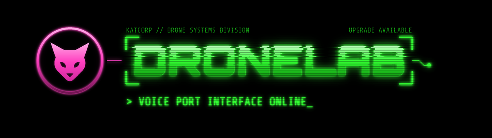

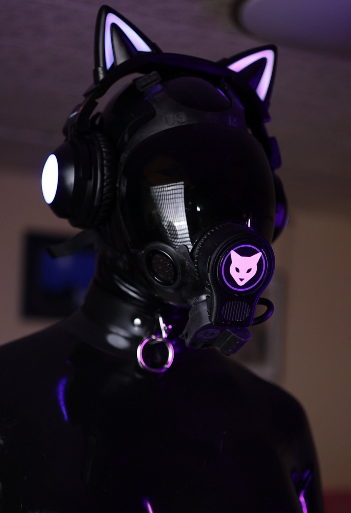

## What is DroneLab?

KatCorp Drone Systems Division is pleased to announce DroneLab: a display and voice upgrade for drones with compatible gas masks.¹

The DroneLab display unit replaces the mask's voice port cover with a glowing 1.75" round touch screen.  It shows designation, images and animations, lights up as your drone speaks, and in the speaker model gives your drone a new voice: synthetic, robotic, or a collective of many.  Units link into a HiveMind with the rest of their hive, and take orders from a phone or from authorized handlers.

**Who it's for:** latex and rubber drones that require an upgrade to the latest hive networking protocols and speech coding units... and anyone else with a compatible mask (cosplayers, costume and prop makers) who needs some tech bling.

**What it is, really:** a hobby project with its source published: firmware, a phone app and 3D printable housings for an off-the-shelf Waveshare display board, free to build, change and share for non-commercial use (see [License](#license)).  KatCorp isn't a real company, and DroneLab isn't sold.  You build your own (see [Get a unit](#get-a-unit) below), and nothing needs soldering.

## Features

<table>
<tr>
<td width="190" align="center"><a href="docs/features/voice-effects.md">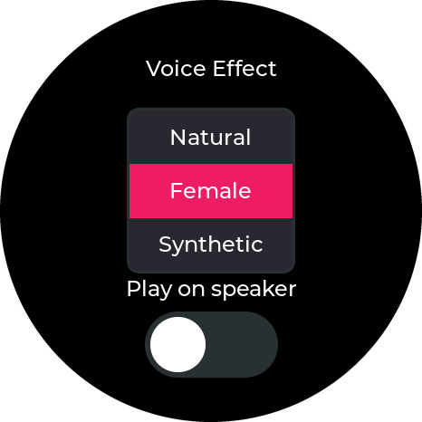</a></td>
<td>
<h3>Voice Changing Effects</h3>

The speaker model changes the wearer's voice on the unit itself, in real time, and plays it out of a speaker in the housing.  Ten presets, from <i>Natural</i> and <i>Female</i> to <i>Android</i>, <i>Robot</i>, <i>Dalek</i>, <i>Drone</i> and <i>Borg</i>.  The unit hears its own speaker and cancels it out of its microphones, so it goes loud without feedback.

<a href="docs/features/voice-effects.md">Voice effects →</a>

</td>
</tr>
<tr>
<td width="190" align="center"><a href="docs/features/comms.md">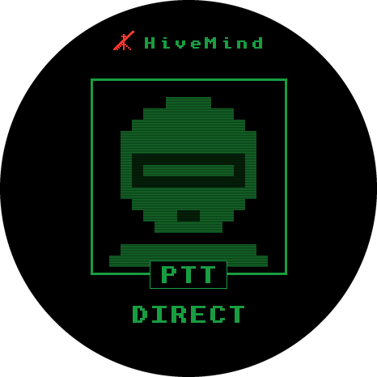</a></td>
<td>
<h3>HiveMind (Comms)</h3>

Link every drone in the hive into one mind.  Push to talk, or just speak, and your voice, through the effect of your choice, goes straight into every other drone's headphones, while the display shows which drone is transmitting, with its avatar.  Messages and commands travel the same link, so the hive can reach any drone's terminal, or its toys, if that drone has allowed it.  A cheap Bluetooth camera remote makes a talk button.

HiveMind can operate in two modes:

    <ul><li><b>Cloud mode:</b> through the wearer's phone to the hive's <a href="https://www.mumble.info">Mumble</a> server, so distance doesn't matter, and people without a mask join from any Mumble app.</li><li><b>Direct mode</b> <i>(in development)</i>: unit to unit over the radio, with no server, internet or phone signal.  Encrypted groups, Long Range, and relaying through the drones in between.</li></ul>

<a href="docs/features/comms.md">HiveMind (Comms) →</a>

</td>
</tr>
<tr>
<td width="190" align="center"><a href="docs/features/visualizer.md">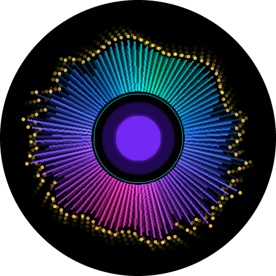</a></td>
<td>
<h3>Visualizers</h3>

Seven animated displays of the wearer's voice and whatever the speaker is playing: KITT's voice box, a 3D spectrum terrain, an oscilloscope, a spinning halo, an aurora, orbits and ripples.

<a href="docs/features/visualizer.md">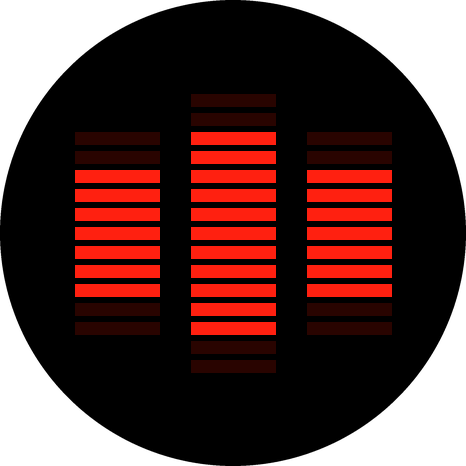</a> <a href="docs/features/visualizer.md">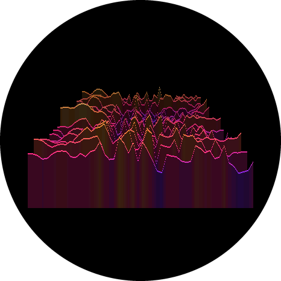</a> <a href="docs/features/visualizer.md">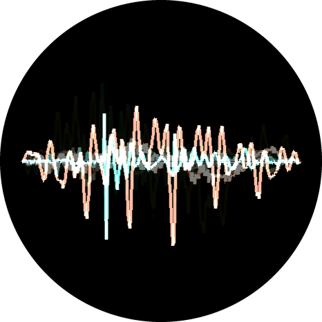</a> <a href="docs/features/visualizer.md">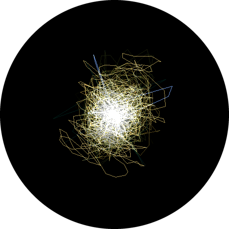</a> <a href="docs/features/visualizer.md">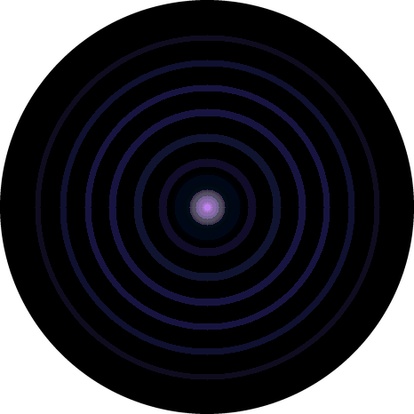</a>

<a href="docs/features/visualizer.md">Visualizer →</a>

</td>
</tr>
<tr>
<td width="190" align="center"><a href="docs/features/lovense.md">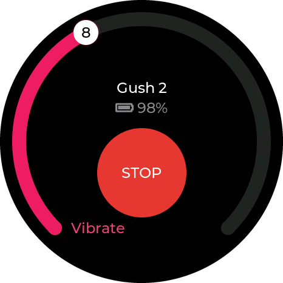</a></td>
<td>
<h3>Lovense toy control</h3>

Runs up to three Lovense devices over Bluetooth, with no Lovense app: levels, patterns (including your own), and reactions to the wearer's voice, movement or stillness.  Others in the hive can send commands from their phones, but only once the wearer has authorized them.

<a href="docs/features/lovense.md">Lovense toy control →</a>

</td>
</tr>
<tr>
<td width="190" align="center"><a href="docs/features/images.md">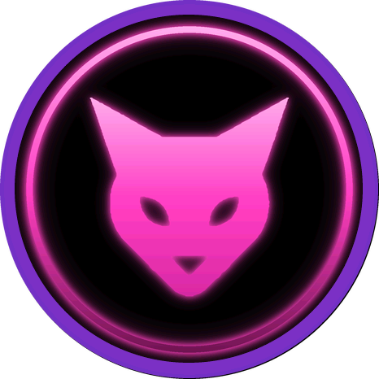</a></td>
<td>
<h3>Images and the voice ring</h3>

Any picture or animated GIF, built in or from a micro SD card, with a glowing ring around the edge that pulses as the wearer speaks.

<a href="docs/features/images.md">Images →</a> · <a href="docs/features/voice-ring.md">Voice Ring →</a>

</td>
</tr>
<tr>
<td width="190" align="center"><a href="docs/features/terminal.md">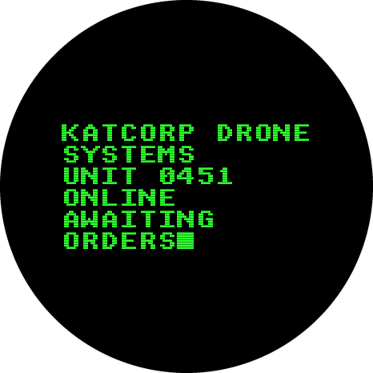</a></td>
<td>
<h3>Terminal</h3>

Text typed on a phone appears on the display as a green-screen terminal, letter by letter.  Authorized handlers can send messages to it from the app.

<a href="docs/features/terminal.md">Terminal →</a>

</td>
</tr>
</table>

### Also on board

- **Remote operation:** the DroneLab app for Android runs the whole display unit from a phone over Bluetooth.  Change what's displayed on the screen and operate features without having to see the display.  Phones without the app (including iPhones) can run it through the display unit's own WiFi hotspot, in a web browser.  [The app](docs/installing-the-app.md) · [Hotspot remote](docs/features/phone-remote.md)
- **Sound:** plays WAV, MP3 and FLAC files from the SD card through the speaker.  [Sound](docs/features/sound.md)
- **Recording:** records voice effect output to the phone or a computer for videos, or feeds it to a video call or streaming software as a microphone.  [Voice Lab](docs/features/voice-lab.md)
- **All-day battery:** the speaker model runs about 13.5 hours on a charge, or about 9.5 with HiveMind comms on, and charges over USB-C without leaving the mask.

> **Screenshot to come:** the DroneLab app's Comm tab and Remote tab, side by side.

See [Features](docs/features/README.md) for everything it does.

## How it works

Each unit is built around one off-the-shelf board, the [Waveshare ESP32-S3-Touch-AMOLED-1.75](https://docs.waveshare.com/ESP32-S3-Touch-AMOLED-1.75).  It has the display, the processor, two microphones, a speaker amplifier, a micro SD card slot, WiFi, Bluetooth, a motion sensor and a battery charger, all on one round circuit board about the size of a coaster.  The DroneLab firmware runs on it.  A 3D printed housing holds it, with a battery and, in the speaker model, a speaker, and screws into the mask's voice port by the same thread as the original cover.

### The two models

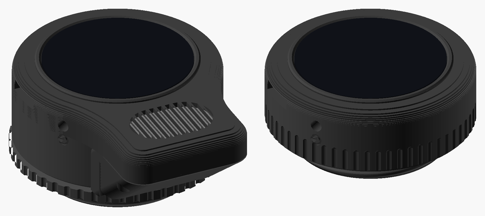

| | |
|---|---|
| 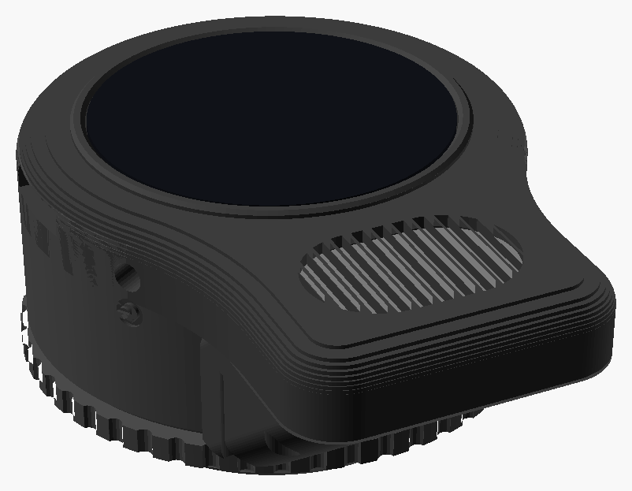 | **The speaker model** is the full upgrade: every feature, with a speaker facing out below the display for voice changing effects and sound, and a 2000 mAh battery for about 13.5 hours.  The display is held level by a turning collar while it's screwed in.  It stands about 33 mm out of the mask, and its sloped chin clears the filter mount below the port.  **Status: built, worn and working.** |
| 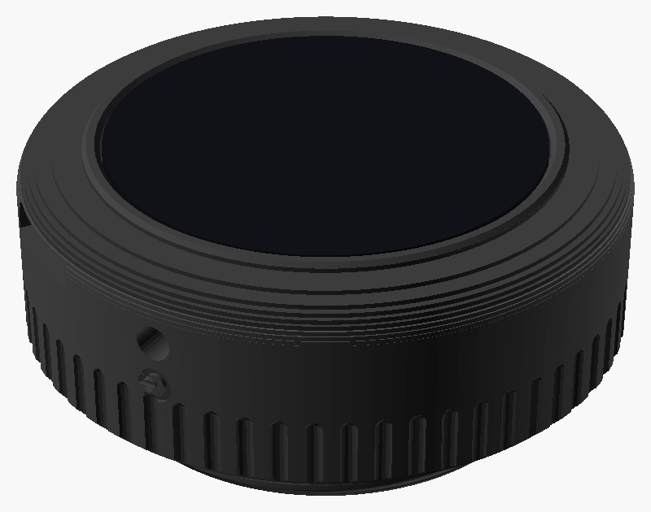 | **The low-profile model** is the entry-level unit: no speaker, so no voice effects or sound, but everything else, in a slim round housing that stands only about 23 mm out of the mask.  Fewer parts, a smaller battery for about 4.5-5.5 hours, and the quickest build.  **Status: printed, waiting on parts for validation testing.** |

### Specifications

| | |
|---|---|
| Display | 1.75" round AMOLED, 466 x 466, capacitive touch |
| Processor | ESP32-S3, two cores at 240 MHz, 8 MB PSRAM, 16 MB flash |
| Audio | Two microphones with echo cancelling; speaker amplifier (speaker model) |
| Wireless | WiFi, Bluetooth LE, ESP-NOW for direct-mode comms |
| Sensors | Motion sensor, for the built-in spirit level and motion reactions |
| Storage | Micro SD card for images, sounds and patterns |
| Battery | 2000 mAh (speaker model, about 13.5 h) or 700-850 mAh (low-profile, about 4.5-5.5 h), charged over USB-C |
| Fits | The voice port of compatible gas masks: made to fit the MSA Millennium's¹ |
| Phone app | Android (iPhone users can use the WiFi hotspot remote) |

## Get a unit

DroneLab isn't sold.  KatCorp's units are built by their owners, from parts anyone can buy and a 3D printed housing: your own printer, a makerspace's, or a [print service](docs/build/README.md#no-3d-printer).  No soldering, no electronics experience: the battery and speaker plug straight into the board.  If you can follow a recipe and use a screwdriver, you can build one.

The [**Build Guide**](docs/build/README.md) walks you through it, step by step:

1. **[Choose a model and order the parts](docs/build/README.md)**: the board, a battery, a speaker for the speaker model, screws and a few craft supplies.
2. **Print the housing**: PLA, plus a little TPU, or [have it printed](docs/build/README.md#no-3d-printer).  See the [speaker model](docs/build/speaker-housing.md#2-print-the-parts) or the [low-profile model](docs/build/low-profile-housing.md#2-print-the-parts).
3. **Put it together**: the [speaker model](docs/build/speaker-housing.md#3-put-it-together) or the [low-profile model](docs/build/low-profile-housing.md#3-put-it-together).
4. **[Install the firmware](docs/building-firmware.md)** over USB, straight from the browser with the [web installer](https://rcat3.github.io/DroneLab/).
5. **[Set it up](docs/build/first-start.md)**: rotation, levelling it in the mask, and your images and sounds on an SD card.
6. **[Install the app](docs/installing-the-app.md)** on an Android phone, for comms and the remote (optional).

## Documentation

- **[Build Guide](docs/build/README.md):** choosing a model, the parts, printing, assembly and setup.
- **[Installing the Firmware](docs/building-firmware.md):** the web installer, flashing a release by hand, or building it yourself.
- **[Installing the App](docs/installing-the-app.md):** the DroneLab app for Android, from the [releases page](https://github.com/rcat3/DroneLab/releases/latest).
- **[Using the Display](docs/using-the-display.md):** finding your way around, and turning it on and off.
- **[Features](docs/features/README.md):** each feature in detail.
- **[The board](docs/hardware/waveshare_esp32s3_touch_amoled_1_75.md):** technical notes on the ESP32-S3-Touch-AMOLED-1.75: power, audio and the echo canceller.
- **[Developing](docs/development/README.md):** how the firmware is put together, adding a feature or a board, and contributing.
- **[Hardware designs](hardware/README.md):** the housings' OpenSCAD designs, and how they're organized.
- **[Other Boards](docs/other-boards.md):** the other Waveshare displays the firmware runs on, for projects of your own.

Questions, build reports, or a unit of your own to show off? Post them in [Discussions](https://github.com/rcat3/DroneLab/discussions). Found a bug? Open an [issue](https://github.com/rcat3/DroneLab/issues).

## License

DroneLab is the realization of some fun ideas I've been thinking about for some time.  I'd love to see the community enjoy it.  The firmware, app and tools are licensed under the [PolyForm Noncommercial License 1.0.0](LICENSE).  You're free to build them, flash them to your own boards, change them and share them, as long as it isn't for a commercial purpose, and as long as you pass on the license and the copyright notice with anything based on them.  Selling them, or devices running them, needs permission.  Third-party code keeps its own license, and the housings in `hardware/` have their own Creative Commons licenses, some of them based on other people's designs (see [`hardware/`](hardware/README.md#licenses)).

Contributions are welcome as pull requests.  Code you contribute is licensed to Rubber Cat under the MIT License (see [Contributing](docs/development/contributing.md)).

## About KatCorp

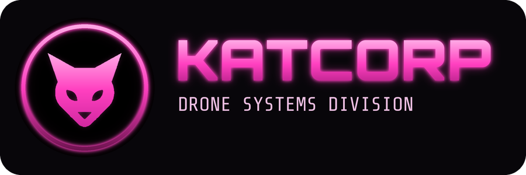

KatCorp is fictional and is not a real company.  DroneLab is a hobby project by Rubber Cat.

## Trademarks

¹ MSA and Millennium are trademarks of MSA Safety Incorporated.  DroneLab is an independent project.  It isn't made, licensed, approved, sponsored or endorsed by MSA, and its housings aren't MSA products, parts or accessories.  The name is used only to say which mask's voice port the housings are made to fit: "compatible" means that, and nothing more.

**Not protective equipment.**  Fitting DroneLab replaces the mask's voice port cover with a 3D printed part, so a mask with it fitted is a costume, not a respirator: don't rely on it for protection from anything.  Likewise, Waveshare, Lovense, Mumble and the other product and company names here are trademarks of their owners.  They're used only to say what the project is built on or works with, and none of those companies makes, sponsors or endorses DroneLab.
