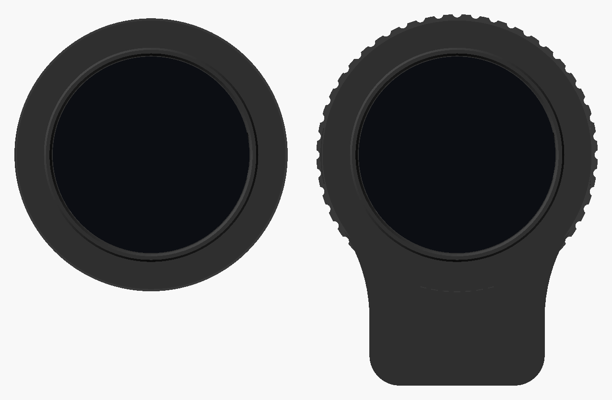
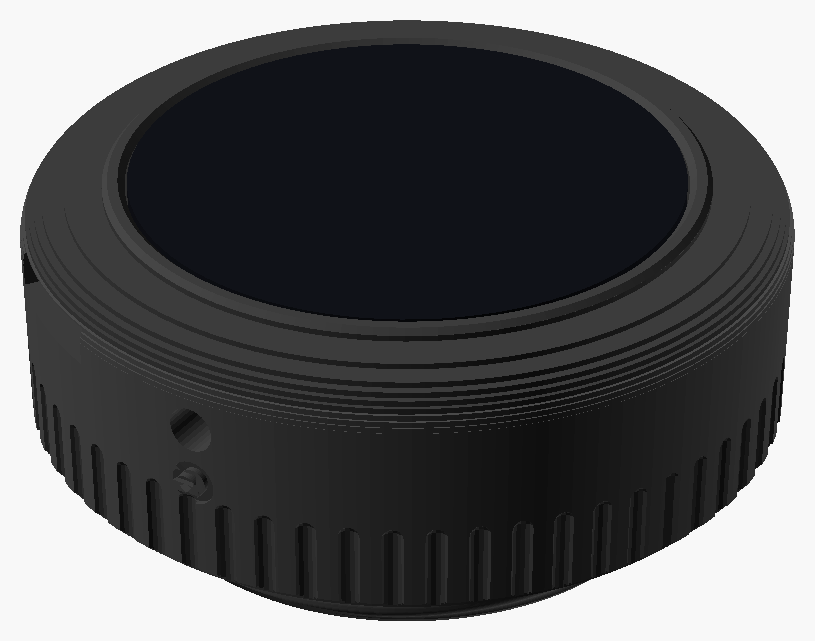
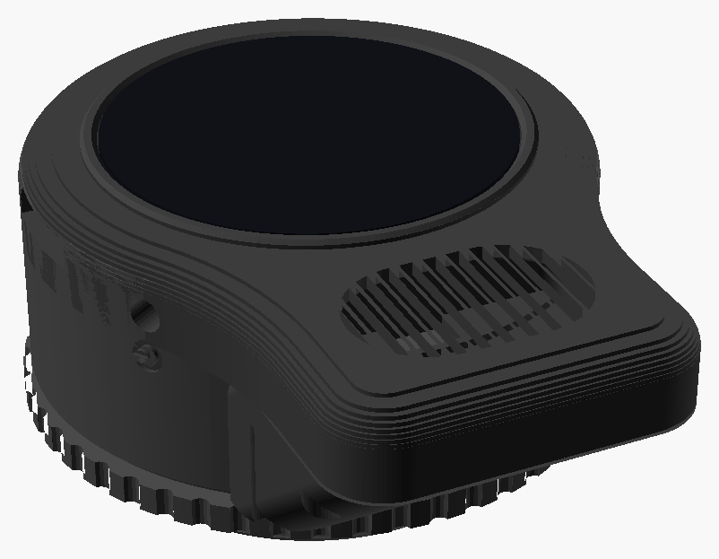

# DroneLab

This project features firmware and 3D printable housings for a small round Waveshare touch display.  While primarily intended to screw into the voice port on the front of an MSA Millennium gas mask, this ecosystem was designed to be flexible.  The immediate audience will be "latex drones" desiring slick high-tech accessories for their gas mask.  Though cosplayers and other costume designers might find the project suits their needs as well.  

What started as a simple application to display images on Waveshare displays has grown into a small platform, built around the Waveshare ESP32-S3-Touch-AMOLED-1.75.  It shows images, lights up with your voice, changes your voice, plays sound, controls Lovense devices and can be run from a phone.

*The two housings, to scale: the low-profile housing (left) and the speaker housing (right).*

## What it does

You swipe up and down between features, and left and right between each feature's pages (see [Using the Display](docs/using-the-display.md)).

- **[Images](docs/features/images.md)**: still images and animated GIFs, built into the firmware or from an SD card.
- **[KITT and the Voice Ring](docs/features/kitt-and-voice-ring.md)**: red bars like KITT's voice box, or a glowing ring around the edge, that light up as you talk.
- **[Voice Effects](docs/features/voice-effects.md)**: changes your voice on the board itself, from a natural female voice to a robot or a Dalek.
- **[Voice Lab](docs/features/voice-lab.md)**: streams the microphone to a computer, for trying out voice effects.
- **[Sound](docs/features/sound.md)**: plays WAV, MP3 and FLAC files from the SD card.
- **[Lovense](docs/features/lovense.md)**: controls up to three Lovense devices over Bluetooth, with patterns and reactions to your voice and movement.
- **[Level](docs/features/level.md)**: a spirit level, for lining the display up on the mask.
- **[Terminal](docs/features/terminal.md)**: shows text typed on a phone, like an old green-screen terminal.
- **[Phone Remote](docs/features/phone-remote.md)**: runs the whole display from a phone's web browser, over the display's own WiFi hotspot, with no app.
- **[Settings](docs/features/settings.md)**: brightness, rotation, what's shown at startup, and the battery voltage.

## Hardware

DroneLab runs on the [Waveshare ESP32-S3-Touch-AMOLED-1.75](docs/hardware/waveshare_esp32s3_touch_amoled_1_75.md): a 1.75" round AMOLED touch screen (466x466) on an ESP32-S3 with 8 MB of PSRAM, two microphones, a speaker amplifier, a micro SD card slot, WiFi, Bluetooth LE, an accelerometer and a power button.  Its charger is set by the firmware, so there's no resistor to change, and the battery and speaker plug straight into the board: nothing needs soldering.

There are two 3D printable housings for it that screw into the mask's voice port, and a [build guide](docs/hardware/waveshare_esp32s3_touch_amoled_1_75.md) with everything needed to make either:

| | |
|---|---|
|  | **[Low-profile housing](docs/hardware/waveshare_esp32s3_touch_amoled_1_75.md#the-low-profile-housing)** (designed, not printed yet): the entry-level build, without a speaker, for images, voice displays, Lovense control and the phone remote.  A flat battery for about 4.5-5.5 hours and the thread fixed to the back, standing about 23 mm out of the mask. |
|  | **[Speaker housing](docs/hardware/waveshare_esp32s3_touch_amoled_1_75.md#the-speaker-housing)**: every feature, including sound and voice effects, with a speaker below the display that faces out, and a 2000 mAh battery for about 13.5 hours.  A turning collar holds it level. |

The housings' designs are in [`hardware/`](hardware/), in [OpenSCAD](https://openscad.org/).  The firmware also runs on a few other Waveshare round displays, which may be useful for other projects (see [Other Boards](docs/other-boards.md)).

## How the software is put together

The application in `core/` is the same on every board.  It's written in C with the [LVGL](https://lvgl.io) graphics library, and reaches the hardware only through a small set of functions in [`core/include/hal.h`](core/include/hal.h), which each board implements with its own SDK: [pico-sdk](https://github.com/raspberrypi/pico-sdk) for the RP2040 and RP2350, and [ESP-IDF](https://docs.espressif.com/projects/esp-idf/en/v5.5.5/esp32s3/get-started/) for the ESP32-S3.

- **Features are modules.**  Each one is a single file, and can be switched on or off for a build.  A feature that needs hardware the board doesn't have, like a microphone or WiFi, hides itself.
- **Boards share what they can.**  Adding a display means adding its board folder, with its HAL and screen size, without copying the application around.  The ESP32 boards share everything that doesn't depend on the board.
- **One set of images for every screen.**  Images are converted for each board's screen size when the firmware is built, and the layout scales from 240x240, so the same files and pages work everywhere.

See [Developing](docs/development/README.md) for how it fits together, and how to add a feature or a board.

## Documentation

- **[Building one](docs/hardware/waveshare_esp32s3_touch_amoled_1_75.md):** the parts to buy, printing, wiring, putting it together, and building and flashing the firmware, for either housing.
- **[Building the Firmware](docs/building-firmware.md):** getting the code, setting up ESP-IDF, building, flashing, and choosing which features to build.
- **[Using the Display](docs/using-the-display.md):** finding your way around, and turning it on and off.
- **[Features](docs/features/README.md):** each feature in detail, with what it needs.
- **[Developing](docs/development/README.md):** how it's put together, [adding a feature](docs/development/adding-a-feature.md), [the hardware abstraction layer](docs/development/hardware-abstraction.md) and [adding a board](docs/development/adding-a-board.md).
- **[Hardware designs](hardware/):** the housings, and how they're organized.
- **[Other Boards](docs/other-boards.md):** the other displays the firmware runs on.

## Acknowledgement

The first housing for the 1.28" display was the [RP2040-LCD-1.28-MSA](https://www.printables.com/model/538771-rp2040-lcd-128-msa) model by whyrlpool.  Their voice port thread has been reused by every housing in this project.  The housings are under their own Creative Commons licenses, which are described in [`hardware/`](hardware/README.md#licenses).
