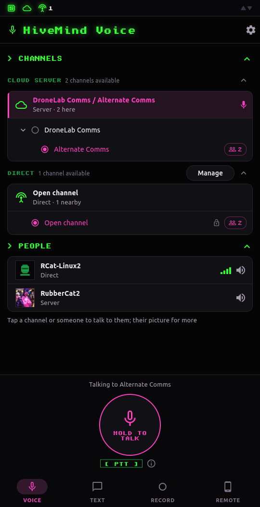
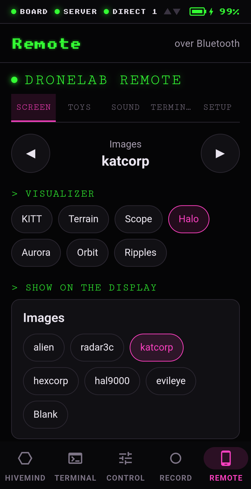
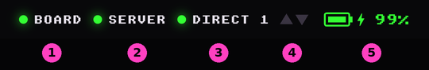

# The DroneLab App

The DroneLab app is the phone's half of your unit.  It links your unit to the rest of the hive, so you can talk and listen to other drones, text them and send them commands, records your voice for videos, runs the unit's display from your hand, and keeps the unit's firmware up to date.  It's for Android phones and tablets.

&nbsp;

**On an iPhone?**  The app is Android only for now.  An iPhone, or any phone with a web browser, can still run the unit through its own [WiFi Hotspot Remote](../features/phone-remote.md): what's on the display, its settings, the Lovense toys, the voice effect, sounds and the Terminal.  Talking to the hive, texting others and recording need the app.

## What it does

- **[Voice](voice.md)**: talk to other drones and hear them, like a radio, over the internet through a shared server, or unit to unit with no signal at all.  Your voice goes out through your voice effect; theirs comes to your headphones, through the phone.  [Call](voice.md#calls) one drone to talk alone.
- **[Text](text.md)**: text one drone, a channel, or everyone who can hear you, in a conversation for each, with photos over the server and emoji reactions; and from any of them, put words on their displays, if they've allowed you.
- **[Control](control.md)**: run other drones' [Lovense](../features/lovense.md) toys, if they've allowed you, from a conversation.
- **[Permissions](permissions.md)**: choose who can control your display and toys, accept or decline their requests, and see a log of every command that came.
- **[Record](record.md)**: record your voice effect to the phone as WAV files, for videos, with a beep to line it up with the camera.
- **[Remote](remote.md)**: everything on the unit's display, from the phone, so nobody has to reach the display in the mask.
- **[Firmware updates](firmware-updates.md)**: the app carries the latest firmware for your unit and offers to put it on.

## Getting started

1. **[Install the app](installing.md)** from the project's releases page.
2. **[Connect it](connecting.md)**: pair it with your unit, which is all it needs.  If your hive uses a server, join it too, and pick your avatar.
3. **[Talk to the hive](voice.md#talking)**: hold the talk button and speak.

**No unit yet?**  Join the server and skip the pairing: the app talks from the phone's own microphone, with texts, calls and commands as well.  See [Without a display unit](voice.md#without-a-display-unit).

## The screen

Four tabs along the bottom, and the status strip along the top of every one:

| Tab | What it's for |
|---|---|
| **Voice** | The channels and who's in the hive, and talking to them, or calling one alone.  The gear opens *Setup*. |
| **Text** | Conversations, with Broadcast, each channel and each person, and from them, others' displays and toys.  A number on the tab counts the messages you haven't seen. |
| **Record** | Recording your voice, and your recordings. |
| **Remote** | The unit's own controls, as on its display. |

**Setup**, behind the gear on the Voice tab, has what's set once: [connecting](connecting.md) the unit and the server, your [identity](connecting.md#3-identity) (name, avatar and key), how you [talk](voice.md#setup-talking), the [display unit's](remote.md#setup-display-unit) brightness, rotation, startup page and WiFi hotspot, the [unit's sounds](voice.md#setup-unit-sounds), [permissions](permissions.md), the headphones' ring, text and attention tones, [notifications](text.md#notifications), and the [unit's firmware](firmware-updates.md).  Its (i), top right, opens **About**: the app's and phone's versions, and the unit's connection, signal, firmware, MAC addresses, enclosure, uptime and battery.  The (i) buttons throughout the app explain each setting.  Tapping the version on *About* ten times shows [developer options](developer-options.md) in Setup, for testing range and relays alone.

### The status strip

| | Shows | |
|---|---|---|
| 1 | **Unit** (a circuit board) | Green while the app's connected to your unit over Bluetooth, with four bars beside it for the Bluetooth signal (the dBm is on the links sheet). |
| 2 | **Server** (a cloud) | Green while it's connected to the hive's server, for the [cloud link](voice.md#two-links-server-and-direct). |
| 3 | **Direct** (an antenna) | Green while [direct mode](voice.md#two-links-server-and-direct) is on, with how many units it hears nearby. |
| 4 | **Requests** (a raised hand) | Yellow, with how many, while someone's [asking to control](permissions.md#requests) something of yours.  Gone when there are none. |
| 5 | **Arrows** | Up, pink: your voice is going out.  Down, green: you're hearing someone.  Down, grey: someone's talking on another direct channel nearby, which you can't hear. |
| 6 | **Battery** | Your unit's charge, with a bolt while it charges.  It turns red at 15%. |

A grey icon is a link that's off, or not connected.  Tap the strip to pull down the [links sheet](connecting.md#the-links-sheet), which connects or disconnects each one, and opens Permissions.

### Other signs

- **TX**, in pink at the top of the Voice tab: you're talking.  The talk button glows pink too.
- **A message card** on the Voice tab when the hive can't be reached, saying why:
  - *Not linked yet*: the unit isn't paired, or the server isn't set up.  *Set up* goes to Setup.
  - *Board offline*: the app can't reach your unit.  It keeps trying by itself.
  - *No link to the hive*: the unit's connected, but neither the server nor direct mode is.
- **A yellow warning sign** by the channel's name: units nearby run [a different firmware](firmware-updates.md#units-on-different-versions), and can't be heard.
- **An offer to update the unit**, when the app has newer firmware for it: see [Firmware updates](firmware-updates.md).
- **A banner under the status strip** when a newer version of the app itself is out: see [Updating the app](installing.md#updating).

## More

- [Installing the App](installing.md), and what to do if the phone won't let you.
- [Connecting](connecting.md): pairing, the server, your avatar.
- [Voice](voice.md), [Text](text.md), [Control](control.md), [Permissions](permissions.md), [Record](record.md), [Remote](remote.md).
- [Updating the unit's firmware](firmware-updates.md).
- [HiveMind (Comms)](../features/comms.md): the unit's side of HiveMind, setting up a server, and how it works underneath.
