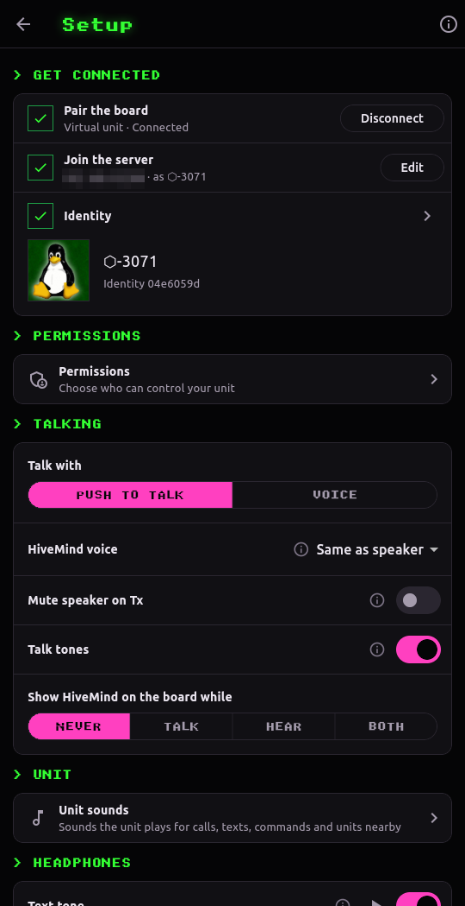
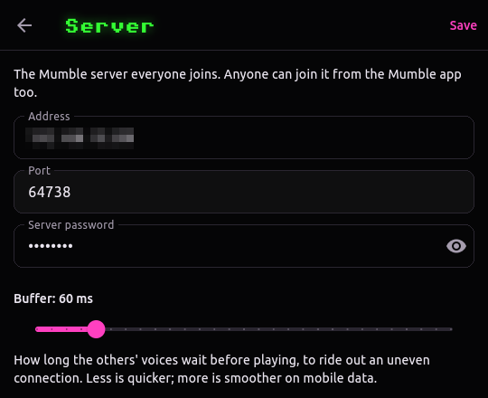
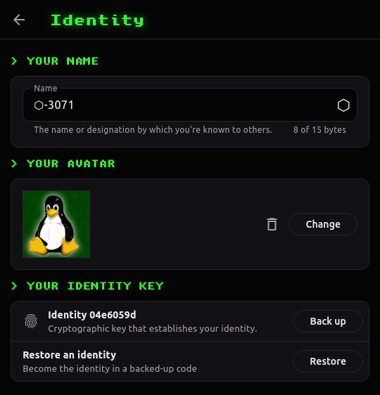
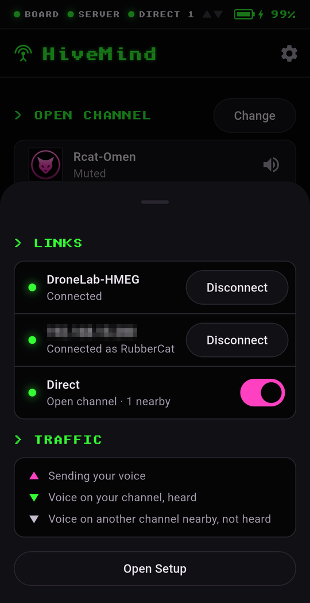

# Connecting the App

The only link the app needs is to **your unit**, over Bluetooth.  With just that, everything works: the [Remote](remote.md), [Record](record.md), [firmware updates](firmware-updates.md), and talking, messaging and controlling toys with drones nearby over [direct mode](voice.md#two-links-server-and-direct).

A **Mumble server** on the internet is **optional**.  Join one only if your hive uses one, to reach drones who aren't nearby.

Both are set up once, in *Setup*, behind the gear at the top of the Voice tab, under *Get connected*.  Each step gets a green tick once it's done.  After that, the app connects to them by itself whenever it starts.

Back to [the app](README.md).

## 1. Pair the unit

The unit only talks to a phone that's paired with it, so nobody else nearby can listen in or take it over.

1. On the unit, switch on the *Phone App* page in [Settings](../features/settings.md), just after Brightness.  Pairing is open for two minutes after it's switched on.  (Later, to pair another phone, use *Pair a phone* on the *Paired Phones* page instead.)
2. In the app's *Setup*, tap *Find* by *Pair the board*.  It lists the units nearby with the Phone App on, the strongest signal first.
3. Pick yours, by the name on its *Phone App* page: `DroneLab-` and four letters.  With several units about, check the name: if you pick someone else's, the code shows on their display, not yours.
4. The phone asks to pair, and the unit shows a 6-digit code over whatever's on its screen.  Type it into the phone.

After that the phone and unit remember each other.  The *Phone App* page stays on from one startup to the next.

Pairing only opens when someone at the display asks for it, because the display faces outward while the mask's worn, where anyone could read a code.  The rest of the time, a phone that isn't paired is turned away before any code's shown.

## 2. Join a server (optional)

Only if your hive uses a server: it's for the [cloud link](voice.md#two-links-server-and-direct), to reach drones anywhere over the internet.  Without one, the app works the same with drones nearby, over direct mode.  Skip this step, and leave *Join the server* unticked.

Tap *Set up* by *Join the server*, and fill in what the hive's server needs.  Your name isn't here: it's under [Identity](#3-identity), and it's needed to join.

- **Address**: the server's name or IP address.
- **Port**: 64738, unless you've been told otherwise.
- **Server password**: if it has one.
- **Buffer**: how long the others' voices wait before playing, to ride out an uneven connection.  60 ms is right on WiFi; more is smoother on mobile data.

*Save*, and the app connects.  The hive needs one server between everyone: if it hasn't got one yet, see [Setting up a Mumble server](../features/comms.md#setting-up-a-mumble-server).

The first time it connects, the app trusts the server's certificate.  If the certificate ever changes, the app won't connect without asking, as that could be someone pretending to be the server: *Trust the new certificate* appears under the server in the [links sheet](#the-links-sheet), only to be tapped if you know the server was set up again.

## 3. Identity

Who you are to the hive.  Setup shows your avatar, name and identity; tap it to change them.

- **Your name**: the name or designation the others know you by, on the server, their app and their display, and over direct mode.  It's taken as you leave the page, and the app joins the server again under it.  It can be up to 15 bytes, counted under the field as you type: a unit sends no more than that over direct mode.
- **Your avatar**: your picture, shown to the hive on their app and their display while you talk.  *Choose* or *Change* picks a photo, cut square from the middle.  It's your [Mumble](https://www.mumble.info) avatar too, so the Mumble apps show it, and it goes to units nearby over direct mode.  Anyone without one shows as a head in a visor.
- **Your identity key**: the cryptographic key that establishes your identity, and what others really know you by.  **Back up** and **Restore** keep it, as in [Setup: your identity](voice.md#setup-your-identity).

> **Note:** the ⬡ button at the end of the name field adds a hexagon, for HexDrones; it takes 3 of the 15 bytes.  Units show it from this release on.  Some servers only take plain letters, digits and punctuation in a name: if yours turns the name away, the app says so and doesn't keep trying, so you can change it.

## The links sheet

Tap the [status strip](README.md#the-status-strip) at the top of any tab, and the links sheet pulls down from the top, under the DroneLab logo: each link to connect or disconnect, the unit (*Find* or *Disconnect*), the server (*Connect* or *Disconnect*), and *Direct* on or off.  Under them, **Permissions** opens [Permissions](permissions.md), with a yellow raised hand while requests are waiting, and the arrows' meanings are at the bottom.  Tap outside it, or swipe it up, to close it.

## Staying connected

- When the app starts, it connects to the unit and the server it had last, unless you disconnected them.  *Disconnect* is remembered: the app leaves that link alone until you connect it again.
- If the unit goes out of range, restarts or runs out of battery, the app tries again every few seconds by itself: the Voice tab says *Board offline* meanwhile.
- The app keeps going with the screen off, so you can talk and listen with the phone in a pocket.  A notification says so while it's on.

If the app can't find the unit at all, check its *Phone App* page is on, and that the phone isn't connected to it already from another app.  A unit talks to one phone at a time.
