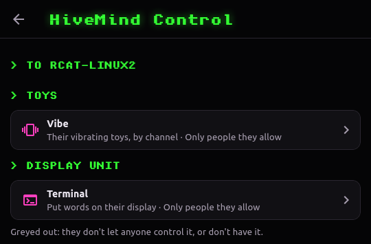
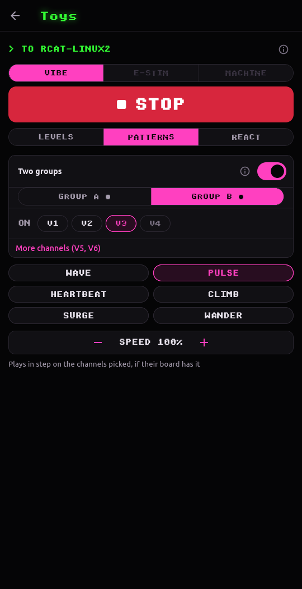
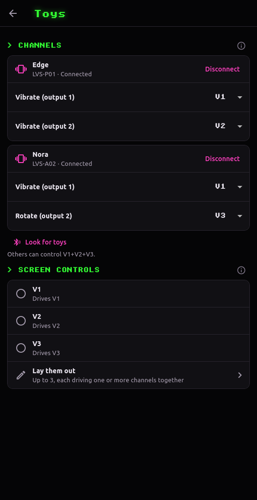

# HiveMind Control

HiveMind Control runs parts of other drones' units, through those units: over the server or over direct mode, wherever they are.  It has areas: **Toys**, their [Vibe toys](../features/toys.md) for now (e-stim and machines are planned), and **Display unit**, words on their [Terminal](text.md#their-display) (pictures and sounds are planned).  It only works on what their wearers have allowed you (see [Permissions](permissions.md)); if they haven't, your first command asks them.

Back to [the app](README.md).  Running *your own* toys is on your unit's [Toys](../features/toys.md) feature, or the [Remote](remote.md) tab's *Toys*; which channel each of your toys follows is in [Setup: Pairing and Mapping](#setup-pairing-and-mapping).

## Sending

The **HiveMind Control button** (a remote) at the top of a [Text](text.md) conversation opens a menu of what you can control, by area: under *Toys*, **Vibe**, their toys; under *Display unit*, **Terminal**, words on their display.  It's for whoever that conversation is with, which it says at the top.  From a person's conversation it's their unit, sent both ways they can be reached (their unit does each once, by whichever way it allows); from a channel's, the units of everyone in it; from *Broadcast*, everyone who can hear you.

For one person, what they don't let others control is greyed out: they've set it to *Nobody*, or for Vibe, have no toy connected.  Each unit says what it lets others control (see [What others see](permissions.md#what-others-see)).  In a channel, everything is, as each person in it may allow different things.

The **Control** button on someone's card, from the [Voice](voice.md#whos-there) list, opens the same choice as a screen, by area: each one, whether anyone can control it or only people they allow, and what's greyed out.

## Toys

Picking **Vibe** opens *Toys*.  Along the top are the classes of toy: **VIBE**, with *E-STIM* and *MACHINE* greyed out until they come.  Below them is **STOP**, always in reach: it stops everything on their toys at once, levels, patterns and reactions, and says *STOPPED* once it's gone.

Vibe toys are run by **channel**, **V1** to **V6**, not by toy.  Each person chooses which of their own toys' outputs follow which channel (in their [Setup: Pairing and Mapping](#setup-pairing-and-mapping)), so V1 may be a vibrator for one person and a rotator for another, and everyone in a channel takes the same commands whatever toys they have.  V1 to V4 show to start with; **More channels** shows V5 and V6.  For one person, the app knows which channels their toys follow: those with nothing on them are greyed out, and V5 and V6 show by themselves if they use them.

The Vibe tab has three sections:

- **LEVELS**: a slider for each channel, from 0 to 20.  20 is each output's top, whatever it is.  Tap channel names to **gang** them: moving any ganged slider moves them all to the same level, sent as one command, so they change at the same moment.  Tap a name again, or **Ungang all**, to take them out.  A greyed-out channel can't be moved or ganged.  The levels also set how high Patterns and React go.
- **PATTERNS**: plays a pattern, in step, on the channels picked under *ON* (all those shown, to start with): the six built-in ones (*Wave*, *Pulse*, *Heartbeat*, *Climb*, *Surge*, *Wander*), then under *YOURS* the ones you've made and starred in [Vibe Patterns](patterns.md), which go to their unit along with it.  A pattern with several rows plays its first row on the first channel picked, and so on.  *SPEED* runs them from 25% to 300%, on the channels picked.  Changing the speed or a level while a pattern plays keeps it where it is, rather than starting it again.
- **REACT**: the channels picked under *ON* follow **their own** voice or movement, as their unit senses it: *VOICE*, *MOVING*, *STILL*, *MOTION* or *TILT* (see [React to](../features/toys.md) for what each does).  It keeps going until it's changed or stopped.  Tap the one that's on to turn it off: channels with no pattern left go back to 0.

**Two groups**, above *ON* in Patterns and React, splits the channels into **GROUP A** and **GROUP B**, each with its own pattern, speed and reaction: say a slow *Wave* on V1 and V2 while V3 follows their *VOICE*.  Pick a group, then its channels; a channel is in one group at a time, and moving one into a group gives it that group's pattern, speed and reaction.  A dot on a group's tab means it's playing or reacting.  Turning *Two groups* off puts group B's channels back with group A's.

What you set stays set on their toys until it's changed or stopped, even once you've closed it.  Each command is noted in your conversation with them, and in theirs with you, with its channels: *set your toys on V1+V2 to 8*.  Each one is sent again a moment later, in case the first was lost.  Over the server, it needs a Mumble server from version 1.4 on.

## Display unit

Picking **Terminal** puts words on their unit's display: see [Their display](text.md#their-display).

## Who can control your toys

The same works the other way: you choose whose commands your toys take, in [Permissions](permissions.md).  It's **Allowed** to start with, so someone new asks you first, and you accept or decline.  **STOP** on your own unit, or in your Remote tab, stops whatever anyone's set.

Which of your toys follow which channel, and what your unit's screen shows, is up to you: see [Setup: Pairing and Mapping](#setup-pairing-and-mapping).

It's separate from who can [put words on your display](text.md#who-can-put-words-on-your-display), so someone can put words on your display without being allowed near your toys.  Texting you needs neither.  People are known by their identity, not their name, so nobody can pass as someone you've allowed: see [Commands from others](../features/toys.md#commands-from-others) for the details.

## Setup: Pairing and Mapping

Setup's **Pairing and Mapping**, under *Toys*, sets up your own toys for HiveMind Control.  It's there while the app's connected to the unit, and needs the unit's firmware from this release on.

- **Channels**: each toy the unit has found, with **Connect** or **Disconnect** and, once it's said, its battery, and under it each of its outputs (each motor, the air pump and so on) with the channel it follows: **V1** to **V6**, or **None**, which leaves it to your own controls.  What anyone sends on V1 drives every output on V1, so two toys on one channel move together.  To start with, a toy's first output follows V1, its second V2.  The app keeps it, by toy, and gives it to your unit with your [permissions](permissions.md#your-phone-and-your-unit), so it holds while your phone's away.  **Look for toys** finds toys turned on near the unit.  The line under them says which channels others can control.
- **Screen controls**: the rings around your unit's [Toys](../features/toys.md#screen-controls) screen.  **Lay them out** for up to three, each with a label and the channels it drives together, so one ring can run V1 and V2 at once; **Save** keeps them, and sends them to the unit.  **One per channel** goes back to a ring for each channel a connected toy follows, as it starts.

The [Remote](remote.md) tab's *Toys* shows the channel each output follows under *Devices*.
