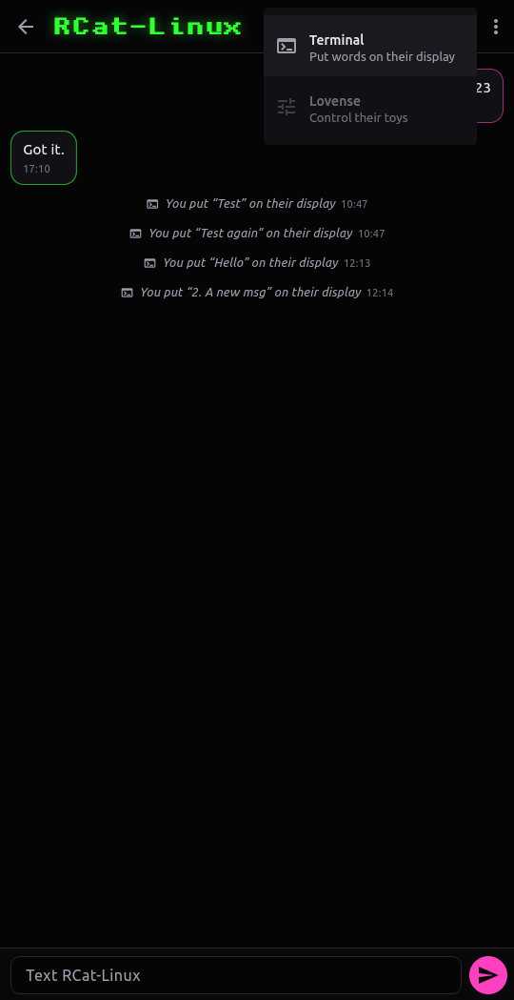

# Control

Control runs other drones' [Lovense](../features/lovense.md) toys, through their units: over the server or over direct mode, wherever they are.  It only works on toys whose wearers have allowed you (see [Permissions](permissions.md)); if they haven't, your first command asks them.

Back to [the app](README.md).  Running *your own* toys is on your unit's [Lovense](../features/lovense.md) feature, or the [Remote](remote.md) tab's *Toys*.

## Sending

The **Control button** (a remote) at the top of a [Text](text.md) conversation opens a menu of what you can control: **Terminal**, words on their [display](text.md#their-display), and **Lovense**, their toys.  It's for whoever that conversation is with, which it says at the top.  From a person's conversation it's their toys, sent both ways they can be reached (their unit does each once, by whichever way it allows); from a channel's, the toys of everyone in it; from *Broadcast*, everyone who can hear you.

For one person, what they don't let others control is greyed out: they've set it to *Nobody*, or for Lovense, have no toy paired.  Each unit says what it lets others control (see [What others see](permissions.md#what-others-see)).  In a channel, everything is, as each person in it may allow different things.

The **Control** button on someone's card, from the [Voice](voice.md#whos-there) list, opens the same choice as a screen: each feature, whether anyone can control it or only people they allow, and what's greyed out.

Picking **Lovense** opens Control:

It has three sections:

- **LEVELS**: a slider for each kind of motor, from 0 to 20: *VIBRATE*, *ROTATE*, *PUMP* and *THRUST*.  Each toy runs the motors it has, and 20 is each motor's top.  The levels also set how high Patterns and React go.
- **PATTERNS**: plays a pattern on their toys, if their unit has one by that name: the six built-in ones always do (*Wave*, *Pulse*, *Heartbeat*, *Climb*, *Surge*, *Wander*), and patterns from an SD card only if theirs has one with the same name.  The list is your unit's.  *SPEED* runs them from 25% to 300%.
- **REACT**: their toys follow **their own** voice or movement, as their unit senses it: *VOICE*, *MOVING*, *STILL*, *MOTION* or *TILT* (see [React to](../features/lovense.md) for what each does).  It keeps going until it's changed or stopped.

**STOP**, always at the foot of the screen, stops everything on their toys at once: levels, patterns and reactions.  It says *STOPPED* once it's gone.

What you set stays set on their toys until it's changed or stopped, even once you've closed Control.  Each one is noted in your conversation with them, and in theirs with you.  Each command is sent again a moment later, in case the first was lost.  Over the server, it needs a Mumble server from version 1.4 on.

## Who can control your toys

The same works the other way: you choose whose commands your toys take, in [Permissions](permissions.md).  It's **Allowed** to start with, so someone new asks you first, and you accept or decline.  **STOP** on your own unit, or in your Remote tab, stops whatever anyone's set.

It's separate from who can [put words on your display](text.md#who-can-put-words-on-your-display), so someone can put words on your display without being allowed near your toys.  Texting you needs neither.  People are known by their identity, not their name, so nobody can pass as someone you've allowed: see [Commands from others](../features/lovense.md#commands-from-others) for the details.
