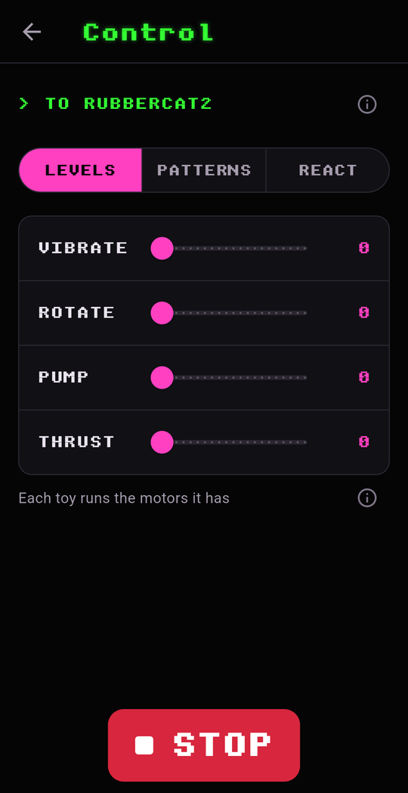

# Control

The Control tab runs other drones' [Lovense](../features/lovense.md) toys, through their display units: over the server or over direct mode, wherever they are.  It only works on toys whose wearers have [allowed you](#who-can-control-your-toys).

Back to [the app](README.md).  Running *your own* toys is on your display unit's [Lovense](../features/lovense.md) feature, or the [Remote](remote.md) tab's *Toys*.

## Sending

**Send to** picks who it's for, as on the [Terminal](terminal.md#sending-a-message): *Everyone* in your server and direct channels, or tap one or more names.  The *Control* button on someone in the [HiveMind](hivemind.md#whos-there) list picks just them, and brings you here.

Then one of three sections:

- **LEVELS**: a slider for each kind of motor, from 0 to 20: *VIBRATE*, *ROTATE*, *PUMP* and *THRUST*.  Each toy runs the motors it has, and 20 is each motor's top.  The levels also set how high Patterns and React go.
- **PATTERNS**: plays a pattern on their toys, if their display unit has one by that name: the six built-in ones always do (*Wave*, *Pulse*, *Heartbeat*, *Climb*, *Surge*, *Wander*), and patterns from an SD card only if theirs has one with the same name.  The list is your display unit's.  *SPEED* runs them from 25% to 300%.
- **REACT**: their toys follow **their own** voice or movement, as their display unit senses it: *VOICE*, *MOVING*, *STILL*, *MOTION* or *TILT* (see [React to](../features/lovense.md) for what each does).  It keeps going until it's changed or stopped.

**STOP**, always at the foot of the screen, stops everything on their toys at once: levels, patterns and reactions.  It says *STOPPED* once it's gone.

What you set stays set on their toys until it's changed or stopped, even if you leave the tab.  Each command is sent again a moment later, in case the first was lost.  Over the server, it needs a Mumble server from version 1.4 on.

## Who can control your toys

The same works the other way: your toys only take commands from people you've allowed.

- The first time someone sends you a command, they're added to your display unit's list, **not allowed**, and the command is ignored.  Allow them, and their commands work from then on.
- The list is on your display unit, on the Lovense feature's last page, *Hive Commands*, and in the app's [Remote](remote.md) tab, under *Toys*, *From others*.
- **Accept** off ignores everyone's commands, and adds nobody.
- **STOP** on your own display unit, or in your Remote tab, stops whatever anyone's set.

It's a separate list from the [Terminal's](terminal.md#who-can-send-you-messages), so someone can message you without being allowed near your toys.  Names can be borrowed on the open channel or an open server, so only allow people on those if you trust everyone there: see [Commands from others](../features/lovense.md#commands-from-others) for the details.
