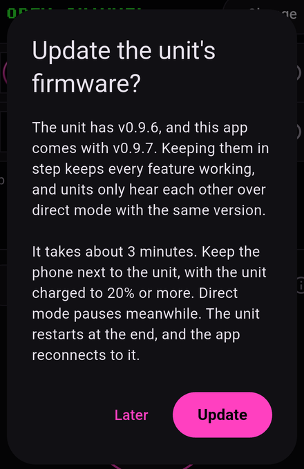
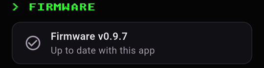
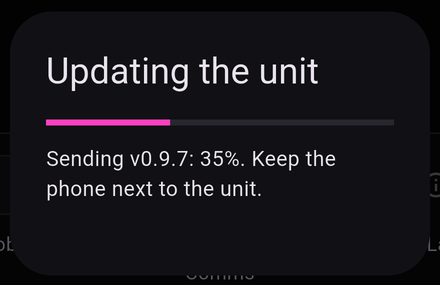
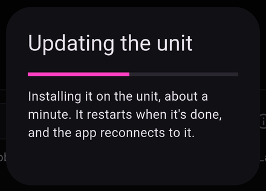
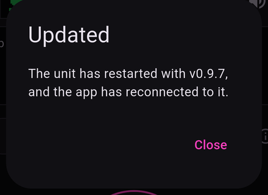
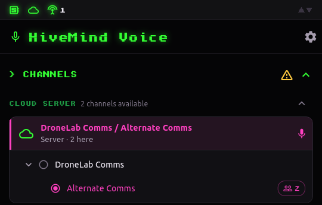
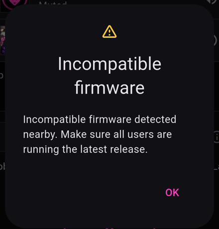

# Updating the Unit's Firmware

Each release of the app carries the firmware released with it, and keeps your unit in step with it, over Bluetooth.  There's nothing to download separately: update the app, and it offers to update the unit.

Back to [the app](README.md).

## Why keep them in step

- **Features need both halves.**  New things in the app often need the matching firmware on the unit, and the other way round.  Most go quiet, rather than break, when the two don't match, so it's easy to miss what's missing.
- **Direct mode needs everyone on the same release.**  Units only hear each other over [direct mode](voice.md#two-links-server-and-direct) when their firmware speaks the same version of it.  If units nearby are on a different one, a yellow warning sign appears by the channel's name: see [below](#units-on-different-versions).

## When it happens

When the app connects to your unit, and the firmware it carries is newer than the unit's, it asks:

- **Update** starts it.
- **Later** leaves it, until the app next connects.  You can start it yourself any time from Setup, at the foot, under *Firmware*: it shows the unit's firmware, and an *Update* button while there's a newer one.

So the usual order is: install the new app (see [Updating](installing.md#updating)), open it, and let it update the unit.

## What happens

It takes **about 3 minutes**: two to send the firmware, one to install it, and a few seconds to restart.

 

 

1. **Sending**: the app sends the firmware to the unit, with how far it's got.
2. **Installing**: once it's all there, the unit writes it into its memory.  The link to the phone may drop for a moment while it does.
3. **Restarting**: the unit restarts into the new firmware, and the app reconnects by itself.  *Updated* says it's done.

**The unit can't be used while it updates.**  Its display shows the update the whole time, over everything else, and doesn't respond to touch:

- *Downloading Firmware Update...*, then *Installing Firmware Update...*, then *Restarting...*, with a progress bar and how far it's got.
- The firmware it has, and the one it's getting.
- While it downloads, how fast it's coming (around 40 to 50 KB/s): much less means a poor link, so bring the phone closer.

Direct mode pauses for the update, and comes back by itself afterwards.  Don't plan to talk on HiveMind meanwhile.

**Before you start:**

- Keep the phone **next to the unit**, and the app open, until it's done.
- The unit's battery needs **20% or more**: it won't start below that.  Plugging it in to charge is fine.
- Your settings are kept: pairing, the server, direct channels, everything.

## If it goes wrong

Updating is safe to interrupt.  If the link drops, the app's closed, or anything goes wrong while it sends, the unit throws away what it had and carries on with the firmware it had: the app says what went wrong, and **Try again** starts over.

The unit only takes firmware meant for it, and checks it's whole before using it.  And if the new firmware were to fail to start properly, the unit goes back to the old one by itself the next time it starts.

## Updating over USB instead

The app is the easy way, but a computer and a USB cable work too, with the [web installer](../building-firmware.md#the-web-installer) in Chrome or Edge.  Use it:

- **The first time**: a new board has no DroneLab firmware for the app to talk to.  See [Installing the Firmware](../building-firmware.md).
- **If the unit won't start**, or doesn't get as far as linking to the app: USB works whatever's on the unit.
- **For development**, running firmware you've built yourself: see [Building it yourself](../building-firmware.md#building-it-yourself).
- **Without an Android phone**: an iPhone can't run the app, so units looked after from an iPhone are updated over USB.
- **When you're at a computer anyway**: it takes about a minute.

Updating over USB keeps your settings too, as long as you leave *Erase device* unticked.

## Units on different versions

&nbsp;

A **yellow warning sign** by the *Channels* heading on the Voice tab means your unit is hearing units nearby whose direct mode is a different version: they can't hear you, and you can't hear them.  Tap it for a reminder.  It goes once they're gone, or everyone's on the same release: whoever's behind updates their app, and lets it update their unit.  It doesn't affect the server link, which works across versions.
