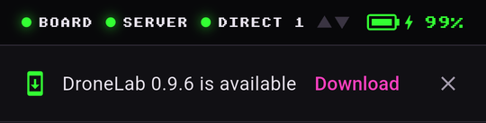

# Installing the App

The DroneLab app is for **Android** phones and tablets, and **Linux** computers (a desktop, a laptop, or a Raspberry Pi 4 or 5: see [On a Linux computer](#on-a-linux-computer)).  It isn't on the Play Store: you install it from a file on the project's [releases page](https://github.com/rcat3/DroneLab/releases/latest).  To build it yourself instead, see [`app/README.md`](../../app/README.md).

**No Android phone?**  iPhones, and any phone without the app, can still run the unit from a web browser, through the unit's own [WiFi Hotspot Remote](../features/phone-remote.md).  That covers what's on the display, the settings, the toys, the voice effect, sounds and the Terminal; it doesn't cover talking to the hive ([Voice](voice.md)), [texting](text.md) others, or recording, which need the app.

Back to [the app](README.md).

## Installing a release

1. On the phone, open the [latest release](https://github.com/rcat3/DroneLab/releases/latest) and download the APK under *Assets*:
   - `DroneLab.apk` for most phones (anything from the last several years, which is 64-bit).
   - `DroneLab-armv7.apk` for older 32-bit phones, if `DroneLab.apk` won't install.

   The direct link to the usual one is <https://github.com/rcat3/DroneLab/releases/latest/download/DroneLab.apk>, which always gets the newest release.
2. Open the downloaded file, from the browser's downloads or the *Files* app.
3. Android asks whether to allow that app (the browser, or *Files*) to install unknown apps.  Go into its setting, switch *Allow from this source* on, and go back.
4. Tap *Install*.
5. Open it.  The first time, it asks for permission to find and connect to nearby devices (Bluetooth), and to show notifications, which it needs to keep going with the screen off.  On older versions of Android, finding Bluetooth devices needs the location permission too.

You can switch *Allow from this source* off again once it's installed.

Then [connect it to your unit](connecting.md).

## If the phone won't let you install it

Phones guard against apps from outside the Play Store, and a few of their protections can get in the way.  The app is safe to install, but none of these know that:

- **Play Protect** may say the app is from an unknown developer, that it hasn't seen it before, or offer to scan it.  Choose *Install anyway* (it may be under *More details*), or let it scan and then install.
- **Samsung Auto Blocker** (Samsung phones and tablets, *Settings* › *Security and privacy* › *Auto Blocker*) blocks every app that isn't from the Galaxy Store or the Play Store, without asking.  If tapping the file does nothing, or says it's blocked, switch Auto Blocker off, install the app, and switch it back on: the app keeps working with it on.
- **Advanced Protection** (on some phones with Android 16 and later) blocks apps from outside the Play Store altogether.  It has to be off while you install.
- **Work phones** and phones with parental controls may not allow it at all: that's up to whoever manages the phone.

## On a Linux computer

The same app, for a computer in place of a phone: a desktop or laptop on Ubuntu 22.04 or newer (or Debian 12 and the like), or a Raspberry Pi 4 or 5 on 64-bit Raspberry Pi OS.  It works with a real unit over the computer's Bluetooth, and it comes with a **virtual unit**, the unit's firmware running on the computer with its round screen in a window, for using DroneLab, or trying it out, without any hardware.

1. From the [latest release](https://github.com/rcat3/DroneLab/releases/latest), download `DroneLab-linux-x64.tar.gz` for an ordinary PC, or `DroneLab-linux-arm64.tar.gz` for a Raspberry Pi.
2. Unpack it anywhere, and start `dronelab` in the `DroneLab` folder:
   ```
   tar xzf DroneLab-linux-x64.tar.gz
   DroneLab/dronelab
   ```
   It needs these, which a desktop usually has already: `sudo apt install libgtk-3-0 libopus0 libsecret-1-0 libx11-6 bluez`.
3. Tap the status strip at the top, then *Find*.  Pick your unit, and type in the code it shows, as on a phone; or tap *Start a virtual unit*.

The virtual unit hears through the computer's microphone and plays through its speakers: use headphones, or a voice effect played out loud feeds back.  Closing its window switches it off; the app starts it again next time.  Virtual units reach each other over the local network, but not real units over the radio: for real direct comms, connect a real unit.

To run two at once, as two people, start the second with `DroneLab/dronelab --profile 2`: it's a separate person, with its own identity, settings and unit.  More in the [`README.md`](../../app/linux/README.md) in the `DroneLab` folder.

To update, unpack the new release over the old folder: the settings and identity are kept elsewhere, in `~/.local/share/io.github.rcat3.dronelab`.

## Updating

The app says when there's a new release, with a banner under the status strip:



**Download** opens the release's page in the browser, to get the APK.  The **×** hides the banner until the app next starts.  To know, the app asks GitHub for the latest release when it starts, and once a day while it's open; nothing about you or your unit is sent.

Download the new release's APK and install it the same way.  It installs over the old one, and keeps its settings, the server and the paired unit.

Then let it update the unit, when it offers: each release of the app carries the firmware released with it.  See [Updating the unit's firmware](firmware-updates.md).

If Android says the app conflicts with one that's installed, the copy on the phone was signed with a different key: usually one you built yourself (see [`app/README.md`](../../app/README.md#installing-on-a-phone)).  Uninstall it first, which loses its settings, then install the release.
