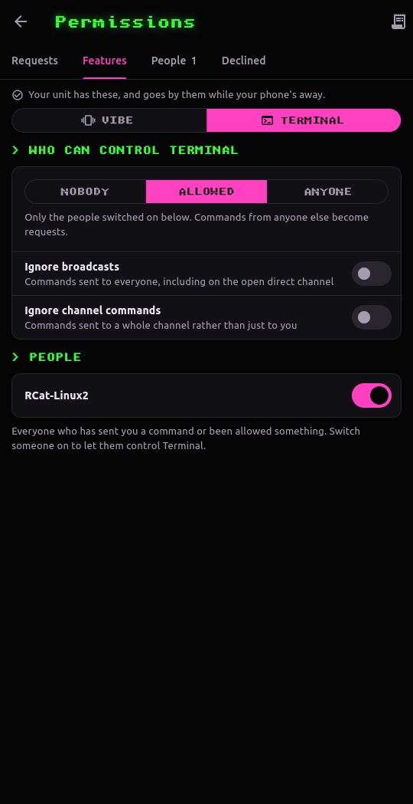
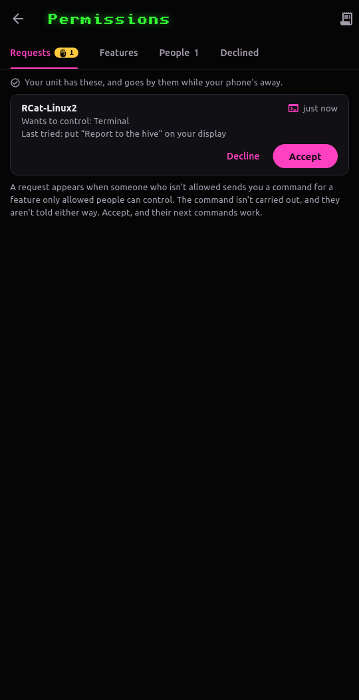
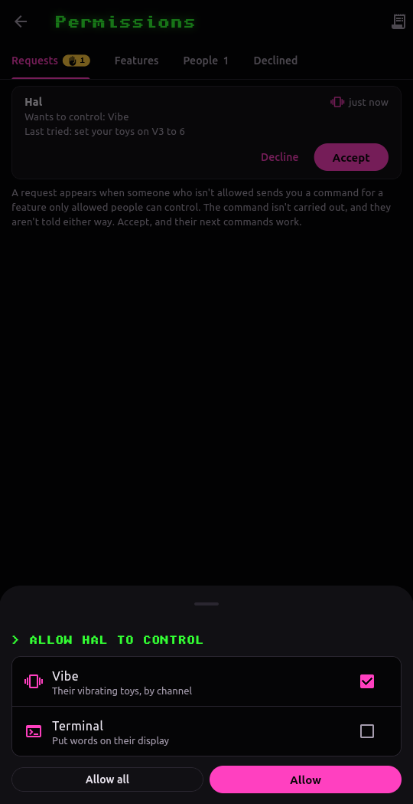
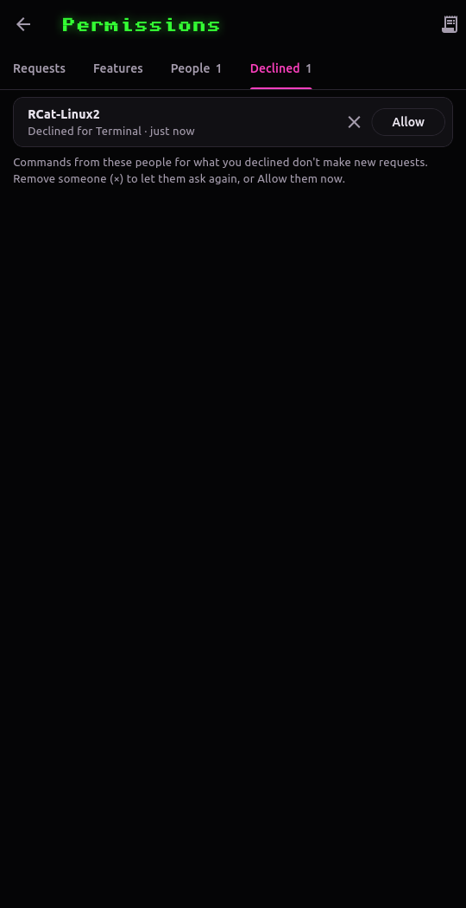
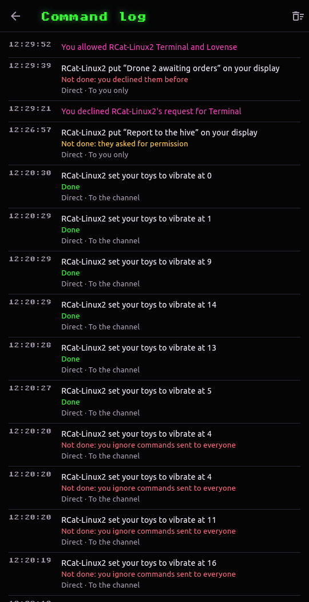
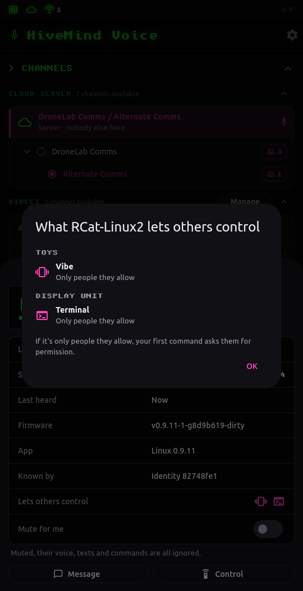

# Permissions

Others in the hive can control parts of your unit: put words on its [Terminal](../features/terminal.md), or run your [Vibe toys](../features/toys.md).  **Permissions** is where you choose who can, see who's asking, and look back at every command that came.  The choices are kept in the app, which gives them to your unit: your unit goes by the last it was given, so they work whether or not your phone's with you.

Open it from *Setup*, or from the [links sheet](connecting.md#the-links-sheet) that pulls down from the status strip.  When someone's asking, a yellow raised hand with a count shows on the [status strip](README.md#the-status-strip), on the links sheet and in Setup.

Back to [the app](README.md).

## Features

Pick a feature at the top, *VIBE* or *TERMINAL*, to see one at a time.

**Who can control it**:

- **NOBODY**: everyone's commands are ignored.  Who you've allowed is kept for when you turn it back on.
- **ALLOWED**, to start with: only the people switched on below.  Commands from anyone else aren't carried out, and come in as [requests](#requests).
- **ANYONE**: everyone's commands are carried out.  The switches for each person make no difference while it's set.

Two more switches ignore some commands whoever they're from, allowed or not:

- **Ignore broadcasts**: commands sent to everyone who can hear the sender, from their *Broadcast*.  Those sent to the open direct channel count too, as anyone nearby can hear that.
- **Ignore channel commands**: commands sent to a whole channel, server or direct, rather than just to you.

With both on, only commands sent to you alone get through.

**People** is everyone on your list: anyone who's sent you a command, or been allowed something.  Switch someone on to let them control the feature.

## People

Everyone on your list, with icons for what each is allowed.  Tap someone to choose everything they can control at once.  The remove button takes them off the list and allows them nothing: if they send you a command again, it comes in as a new request.

People are known by their identity, not their name: their app signs each command with a key only it has.  So it's one entry whether they reach you over the server or direct, and nobody can pass as someone you've allowed by taking their name.  Someone using a name another person had first is marked ⚠.

## Requests

A request appears when someone who isn't allowed sends you a command for a feature set to *ALLOWED*.  Their command isn't carried out, and they aren't told either way: they just send, and it works once you've allowed them.  Several commands from one person make one request, with each feature they tried and their latest command.

- **Accept** asks what to allow them.  The feature they asked for is already ticked; tick others to allow those too, or **Allow all**.  A feature you've set to *NOBODY* can be ticked: it takes effect when you turn it back on.
- **Decline** leaves everything as it was, and moves them to [Declined](#declined).

A request is only made while the app's linked to your unit: with your phone away, commands from people you haven't allowed simply aren't carried out.

When one comes in:

- **Attention tone**: four short notes in your headphones, unlike the text tone or the ring.  In *Setup*, under *Headphones*, with a play button to hear it.  It's on to start with.
- **Permission requests** notification: in *Setup*, under *Notifications*.  Tap it to open Permissions.  It's off to start with.

Your unit plays no sound for requests.

## Declined

Their commands for what you declined don't make new requests; the [log](#command-log) still notes them.

- **×** takes them off this list, so their next command asks again.
- **Allow** lets you allow them now, without waiting for a new request.

## Command log

The log button at the top of Permissions lists every command that came to you, newest first, with the time:

- **Who and what**: *RCat-Linux2 put "Report to the hive" on your display*, or *set your toys on V1 to 4*.
- **What came of it**: *Done* (green); *Not done: they asked for permission* or *their request is waiting* (yellow); or *Not done* and why (red): the feature's off, you ignore commands sent to everyone or to a channel, you declined them before, or you muted them.
- **How it came**: *Cloud* (the server) or *Direct*, and whether it was sent *To you only*, *To the channel* or *To everyone*.

Accepting, declining and allowing are noted too, in pink.  It keeps the last 500 entries; the button at its top clears it.  A command that came both ways is listed for each.

## What others see

Each unit tells the others what its wearer lets others control: over the server through its app, and over direct mode in the unit's own hello.  It says each feature that's *ALLOWED* or *ANYONE*, and leaves out those set to *NOBODY*, and *Vibe* while no toy is connected.  For Vibe, it also says which channels your toys follow, so their apps grey out the rest.  It says nothing about who in particular you've allowed.

On someone's card ([Voice](voice.md#whos-there)), *Lets others control* shows an icon for each.  Tap it for the whole list: *Anyone can control it*, *Only people they allow*, or *Not available*.  See [HiveMind Control](control.md#sending) for how it's used.

## Your phone and your unit

Your permissions, who you've muted, and how your toys are [set up](control.md#setup-toys) are kept in the app, and sent to your unit whenever they change and each time it connects.  The unit keeps the last it was given and goes by them on its own, so commands still work while your phone's away.  The line at the top of Permissions says whether your unit has them: *Your unit has these*, *Sending these to your unit*, or *Kept on your phone* while it isn't connected.

On the unit itself, each feature's *Others* page (the Toys feature's *Hive Commands*, the Terminal's *Hive Messages*) shows its setting and who's allowed, but you change them here.  The one thing you can do on the unit is **Turn off**: it stops that feature taking anyone's commands straight away, without your phone.  The app picks that up as soon as it's connected, and you switch it back on here.

A new phone, or the app installed again, takes on the unit's permissions the first time it connects, rather than starting afresh.
