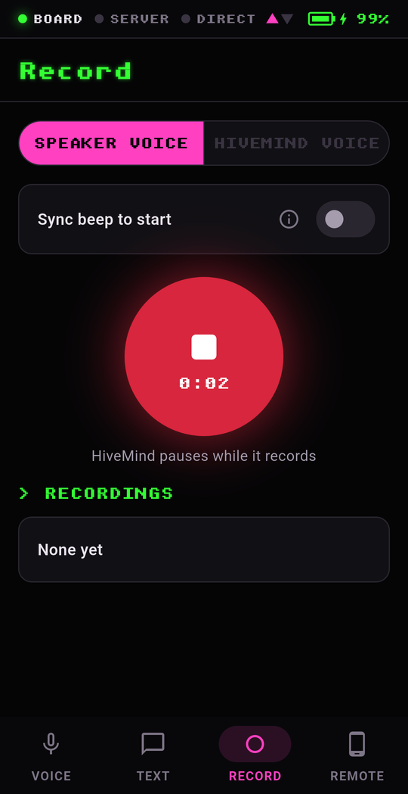

# Record

The Record tab records your voice effect straight to the phone, as it sounds coming out of the unit, over the same Bluetooth link as HiveMind.  It's for **videos**: a camera filming you in the mask hears your real voice, muffled through the mask, and the unit's speaker from outside.  Recorded here, the voice effect is clean, without the room, and can be laid over the video in place of the camera's sound.

&nbsp;

Back to [the app](README.md).

## Recording

1. Pick the voice:
   - **SPEAKER VOICE**: the effect the unit plays from its speaker.
   - **HIVEMIND VOICE**: the effect the hive hears, if you've set a [different one](hivemind.md#setup-talking) for HiveMind.
2. Switch on **Sync beep to start**, if you're filming (see below).
3. Tap **RECORD**, and talk.  The button turns red and counts the time; the unit's display shows *REC*.
4. Tap it again to stop.

**HiveMind pauses while it records**, on both links, and starts again after: nobody hears you, and you don't hear them.  The status strip shows the server and direct greyed out meanwhile.  The voice is evened out by HiveMind's automatic gain, as it is on the channel.

## The sync beep

With the beep on, the unit beeps from its speaker as the recording starts, and the same beep is in the file, at the same moment.  The camera hears the beep too.  In the video editor, line up the beep in the recording with the beep in the camera's sound, and your voice lines up with your mouth for the rest of the take.

The unit's microphone hears the beep from its own speaker, so the recording leaves the microphone out for a moment while it beeps, and the beep isn't in the file twice.

## Your recordings

Each recording is listed under *Recordings*, named for when it started (*DroneLab 2026-11-18 15.58.44*), with its length:

- **Play** it on the phone.
- **Share** it: Android's share sheet sends it to Google Drive, email, a messaging app, your computer, or wherever the phone can.  That's how to get it into a video editor, or keep a copy outside the app.
- **Delete** it.

The files are **WAV**: 48 kHz, mono.  Video editors take WAV as it is, and it's exact for lining up, where MP3 adds a little silence at the start.  A minute is about 6 MB.  They're kept in the app, so uninstalling the app deletes them: share any you want to keep.

## Other ways to record

- On a computer, over Bluetooth instead of the phone, with `tools/ble_record.py`: see [Recording over Bluetooth](../features/voice-lab.md#recording-over-bluetooth).
- The raw microphone as well as the effect, or the voice effect as a microphone in a video call: see the [Voice Lab](../features/voice-lab.md).
