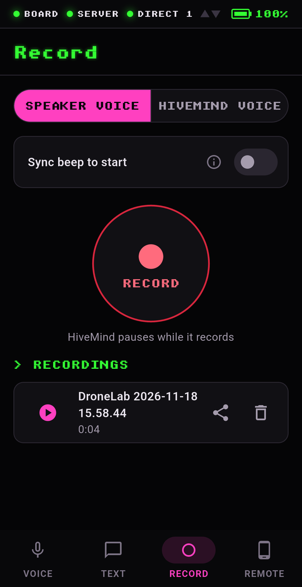

# Record

The Record tab records your voice effect straight to the phone, as it sounds coming out of the unit, over the same Bluetooth link as HiveMind.  It's for **videos**: a camera filming you in the mask hears your real voice, muffled through the mask, and the unit's speaker from outside.  Recorded here, the voice effect is clean, without the room, and can be laid over the video in place of the camera's sound.

&nbsp;

Back to [the app](README.md).

## Recording

The settings for recording are at the top, the same ones as in [Setup's Talking](voice.md#setup-talking), so you needn't go back and forth (⚙ in the title opens Setup):

- **Mic**: the mic that talks, which is the one it records from: *Unit*, *Phone*, or *Headset* (only while a Bluetooth headset is connected; if it goes, *Phone* is picked).  Changing it here changes it for talking too.
- **Speaker**: the voice effect on the unit's speaker, as you hear it.  Turn it off so the speaker can't feed back into the mic and spoil the recording.
- **Effect**: the voice effect the recording goes through.  It starts as the one you're using, and is kept for the recordings after.  HiveMind is paused while it records, so it's the recording's own, whatever the speaker's and HiveMind's are set to.  The unit's speaker plays the same effect while it records, from either mic, so a different one can't get into the recording; your own comes back once it stops.
- **Stop at 10 s**: it stops by itself at 10 seconds, the longest a sound [sent to someone's speaker](control.md#sounds) plays.
- **Sync beep**: for filming, see below.  The unit's mic only.
- **Mic level**: live whenever the tab is open, so you can check it's the right mic and it hears you before you start: the level as it records, through the effect.  With the phone's mic, peaks in the green band are right and yellow is loud (the phone's mic is open meanwhile, so Android shows it in use).  The unit evens out its own level, so with its mic, check the bar moves as you talk.

Then tap **RECORD**, at the bottom, and talk.  The button turns red and counts the time; the unit's display shows *REC*.  Tap it again to stop.  The button stays at the bottom however far you scroll; above it, *HiveMind Comms paused for recording* says comms are off meanwhile.

**HiveMind pauses while it records**, on both links, and starts again after: nobody hears you, and you don't hear them.  The status strip shows the server and direct greyed out meanwhile.  The voice is evened out by HiveMind's automatic gain, as it is on the channel.

## The sync beep

With the beep on, the unit beeps from its speaker as the recording starts, and the same beep is in the file, at the same moment.  The camera hears the beep too.  In the video editor, line up the beep in the recording with the beep in the camera's sound, and your voice lines up with your mouth for the rest of the take.

The unit's microphone hears the beep from its own speaker, so the recording leaves the microphone out for a moment while it beeps, and the beep isn't in the file twice.

## Your recordings

Each recording is listed under *Recordings*, named for when it started (*DroneLab 2026-11-18 15.58.44*), with its length:

- **Play** it on the phone.
- **Send** it (🔊), up to 10 seconds long, to play from someone's speaker: pick *Broadcast*, your server channel, or someone on the server.  Those who don't let others play sounds are greyed out.  See [Sounds](control.md#sounds).
- **Share** it (⋮): Android's share sheet sends it to Google Drive, email, a messaging app, your computer, or wherever the phone can.  That's how to get it into a video editor, or keep a copy outside the app.
- **Delete** it (⋮).

Recordings up to 10 seconds can also be sent from a conversation's [HiveMind Control](control.md#sounds) menu.

The files are **WAV**: 48 kHz, mono.  Video editors take WAV as it is, and it's exact for lining up, where MP3 adds a little silence at the start.  A minute is about 6 MB.  They're kept in the app, so uninstalling the app deletes them: share any you want to keep.

## Other ways to record

- On a computer, over Bluetooth instead of the phone, with `tools/ble_record.py`: see [Recording over Bluetooth](../features/voice-lab.md#recording-over-bluetooth).
- The raw microphone as well as the effect, or the voice effect as a microphone in a video call: see the [Voice Lab](../features/voice-lab.md).
