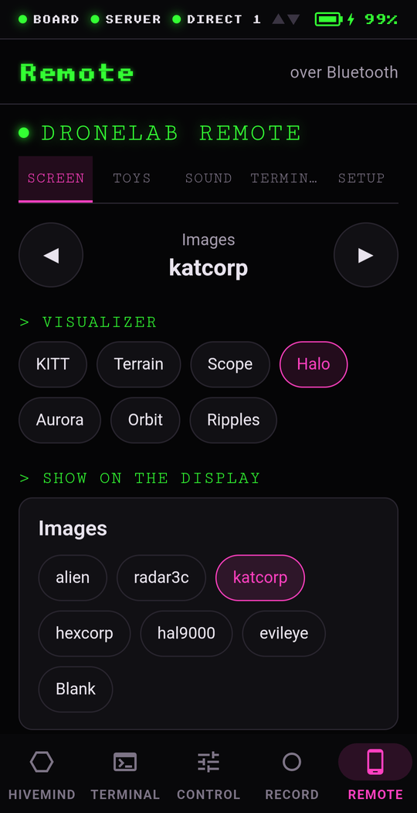

# Remote

The Remote tab puts your unit's own controls on the phone: what its display shows, its settings, your Lovense toys, the voice effect, sounds and the Terminal.  Everything you'd do by touching the display, without touching it.

Back to [the app](README.md).

## What it's for

Once the unit's screwed into the mask, its display faces outward, where you can't see it or reach it comfortably.  The Remote lets you:

- **Change what the display shows** while you're wearing it: an image, a visualizer, the Terminal, the HiveMind screen.
- **Run the show from your hand**: play a sound, switch the voice effect, turn the voice ring on, start a toy's pattern, without lifting a hand to the mask.
- **Hand control to someone else**: a handler with the phone can run the unit while you wear it.
- **Set it up** in comfort: brightness, rotation, what it shows at startup.

## What's on it

The page is the unit's own, so it always matches the unit's firmware.  It has five tabs:

- **Screen**: what's on the display now, with arrows to step through every page, the visualizer styles, and every feature's pages to jump straight to one.
- **Toys**: your own [Lovense](../features/lovense.md) toys: a slider for each motor, the patterns, the reactions, the devices, and a big **STOP**.  *From others* is the list of who can [control your toys](control.md#who-can-control-your-toys).
- **Sound**: the voice effect and its volume, the voice ring, and the sound player.  A low-profile unit has no speaker, so its voice effect isn't here: pick it as *HiveMind voice* in Setup, or on the unit.
- **Terminal**: type a message onto your own display.  *From others* is who can [put words on it](text.md#who-can-put-words-on-your-display), *Off*, *Ask* or *Accept*, and the list of who's tried.
- **Setup**: the display's settings: brightness, rotation, what it shows at startup, and the battery.

Each tab is described in full in [WiFi Hotspot Remote](../features/phone-remote.md), which is the same page.  The display and the phone control the same things, so each shows what the other does.

## The app, or the WiFi hotspot

There are two ways to reach the same page:

| | **The app's Remote tab** | **The WiFi Hotspot Remote** |
|---|---|---|
| Phones | Android, with the app | Any phone with a web browser: **iPhones**, or someone else's phone |
| Link | Bluetooth, the app's link to the unit | The unit's own WiFi hotspot, joined from the phone's WiFi settings or a QR code |
| The phone's internet | Kept | Lost over WiFi while it's joined (mobile data may still work) |
| Set up | Nothing more: it works once the app's [connected](connecting.md) | Switch on the *WiFi Hotspot Remote* in the unit's Settings, and join it |
| At once | One phone | Up to four phones |

With the app, use the Remote tab: it keeps the phone online, so HiveMind's server link keeps working.  For an iPhone, or to let a friend's phone in without the app, use the [WiFi Hotspot Remote](../features/phone-remote.md).

If the Remote tab says the unit isn't connected, it needs the app linked to the unit first: see [Connecting](connecting.md).
