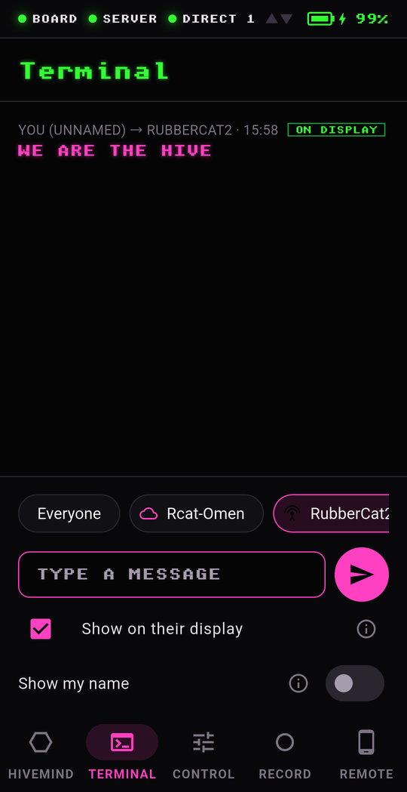
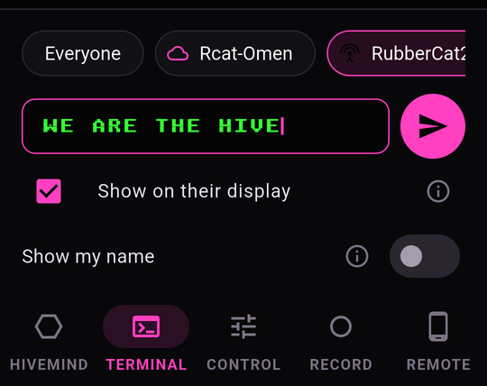

# Terminal

The Terminal tab sends text messages to other drones: to one, to several, or to the whole hive.  A message shows on their display unit's screen, in blocky green letters on its [Terminal](../features/terminal.md), and in their app's Terminal tab.  Messages to you arrive here too.

&nbsp;

Back to [the app](README.md).

## Sending a message

1. **Pick who it's for**, in the row over the box: *Everyone*, or tap one or more names.  A cloud means they're on the server, an antenna that they're nearby over direct mode.  (The *Message* button on someone in the [HiveMind](hivemind.md#whos-there) list picks just them, and brings you here.)
2. **Type it**, up to 120 letters.  The displays show plain capital letters, numbers and punctuation; anything else, like emoji, shows as `?`.
3. **Send**.

Messages go over the same links as your voice: the server, direct mode, or both, so the Terminal needs one of them connected.  *Everyone* means everyone in your server channel and your direct channel.

Two choices under the box go with each message:

- **Show on their display**: on, it's shown on their display unit's screen and in their app.  Off, it goes to their app's Terminal tab only, for something not everyone around them should see.
- **Show my name**: on, it's shown after your name (`RUBBERCAT: WE ARE THE HIVE`).  Off, just the message, with no name.

Your messages stay in the list, in pink, saying who they went to, whether your name was on (*UNNAMED* if not), and *ON DISPLAY* or *APP ONLY*.  Messages to you are in green, after the sender's name, or *UNNAMED*.  A number on the Terminal tab counts the ones you haven't seen yet.

## Is an unnamed message anonymous?

**No.**  *Show my name* off hides your name from what's **shown**: on their display, and in their app.  Anyone looking at their display can't tell who it's from, and nor can they, from the message itself.  But it isn't anonymous:

- **Their display unit knows who sent it.**  It only takes messages from those it's [allowed](#who-can-send-you-messages), so every message carries who it's from, unnamed or not.  Their display unit's *Hive Messages* page shows who sent the last one, and an unnamed message from someone new adds them to its list by name, like any other.
- **Over the server**, the message goes from your account, so whoever runs the server could see it's yours.
- **They may not take unnamed messages at all**: they can turn them off, and then yours doesn't arrive.

So it's for keeping your name off a public display, not for hiding who you are from the person you're messaging.

## Who can send you messages

Your display unit only takes messages from people you've allowed, so a stranger on the server or nearby can't put words on your display.

- The first time someone messages you, they're added to your display unit's list, **not allowed**, and their message is dropped.  Allow them, and their messages come through from then on.
- The list is on your display unit, on the Terminal feature's second page, *Hive Messages*, and in the app's [Remote](remote.md) tab, under the Terminal tab's *From others*.  Tap someone to allow them, or tap again to stop; on the display, hold them to take them off the list.
- **Accept** off ignores everyone, and adds nobody to the list.
- **Unnamed** off drops messages without a name altogether: they don't reach your display or your app.

Someone's known by their name and how they're heard, server or direct, so the same person can be on the list twice.  Names can be borrowed: on a direct channel with a passphrase only its members can send at all, but on the open channel, or a server anyone can join, someone could use a name you've allowed.

This list is separate from the one for [Control](control.md#who-can-control-your-toys), so someone can message you without being allowed near your toys.

## What shows on your display, and when

A message to you shows on your display unit's screen only if all of these are true:

1. The sender's **allowed** on your list.
2. They left **Show on their display** on.
3. It has their name, or you take **unnamed** messages.

Then it's added to the Terminal on a line of its own, and the display switches to the Terminal by itself.  A message they sent to your app only goes to your Terminal tab, and leaves the display alone.  Every message your display unit takes is also passed to your app's Terminal tab, whichever it is.

How the Terminal looks on the display, its letter sizes and what it can show, are in [Terminal](../features/terminal.md).

Over the server, messages need a Mumble server from version 1.4 on.
