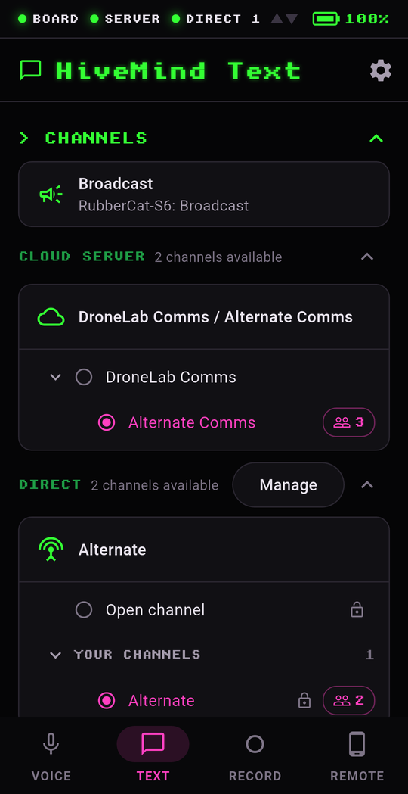
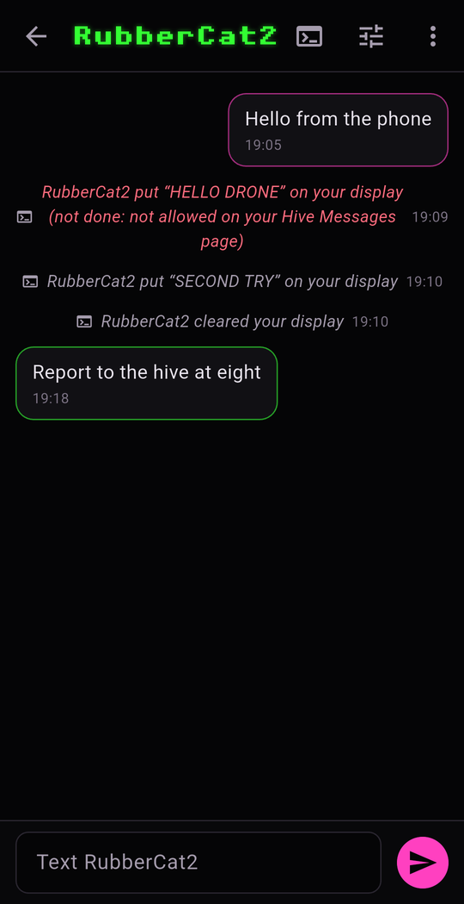
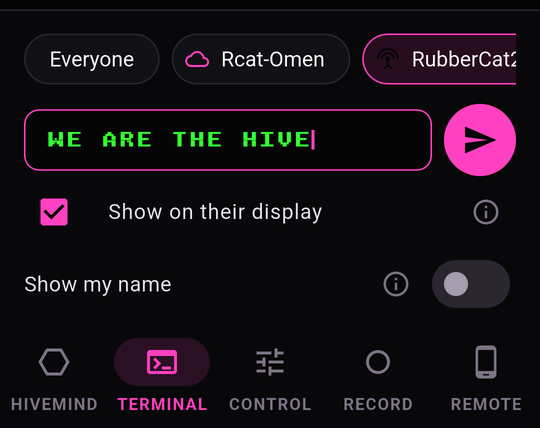

# Text

The Text tab is HiveMind by text, as [Voice](voice.md) is HiveMind by voice.  You text other drones in conversations, as in a chat app: one for everyone who can hear you, one for each channel you're on, and one for each person.  From any conversation you can also put words on their unit's display, or run their [Lovense](../features/lovense.md) toys.

&nbsp;

Back to [the app](README.md).

## Picking a conversation

The tab lists every conversation you can use now, with its last message, and a pink number for any you haven't read.  The number on the tab itself counts them all.  The gear at the top opens *Setup*, as on the Voice tab.  *Channels* lists the server's and Direct's channels as the Voice tab does (see [Channels](voice.md#channels)): the one you're on first, which opens its conversation, and the rest under it to move to.

- **Channels**:
  - **Broadcast**: everyone who can hear you, by any link: your server channel and your direct channel together.
  - **Your server channel**, with a cloud: everyone in it, on the server.
  - **Your direct channel**, with an antenna: every unit on it nearby.
- **People**: everyone about, on the server or heard nearby over direct mode, each once even if they're on both.  Tap someone's avatar for their details, as on the [Voice](voice.md#whos-there) tab: how they're linked, their unit, and muting them.  The *Message* button there opens their conversation.
- **Offline**: conversations with people who aren't about, and channels you're not on, to read back.  They're back under *Channels* or *People* once they can be reached.

Conversations are kept on the phone, the last 300 messages of each, so they're still there when the app starts again.  **Hold** one to delete it, or use the menu (⋮) inside it.  It starts afresh the next time someone texts it.  In a conversation with one person, the menu's **Details** shows who they are, as their avatar does.

## Notifications

A text that comes in while you're not looking at its conversation shows as a notification, with the conversation's latest texts and the sender's avatar.  Tap it to open the conversation.  Reading the conversation clears it.  Commands for your display or toys don't notify you: they're only noted in the conversation.

In *Setup*, under *Notifications*:

- **Text messages** turns them on or off, for every conversation.
- **Unit battery low** tells you when your unit's battery is down to 15%, unless it's charging.

The button by each (sliders) opens Android's own settings for it: its sound, whether it pops up on screen, shows on the lock screen and in the status bar, and so on.

## Texting

Type in the box at the foot of a conversation and tap send.  Anyone can text you, and you anyone: texts don't need anyone's permission, as they only go to the app, never to the display.

- **Over the server**, texts are Mumble's own text messages: those in a channel's conversation go to the channel, and those to one person go to them alone.  So people in Mumble's own apps, on a computer, see them too, and can text you back.
- **Over direct mode**, your unit carries them to the others nearby, up to 120 letters.
- **To one person**, a text goes both ways they can be reached, over the server and directly, and they see it once.  Words for their display and commands for their toys go both ways too: their unit does each once, by whichever way it allows, so allowing them for either is enough.
- **Broadcast** goes both ways at once.  Someone who hears you both ways sees it once, under their Broadcast.  (One from a Mumble app to the channel shows in the channel's conversation.)

You need a link to send: someone who can't be reached just now says so in place of the box.

## Their display

The **Terminal button** (`>_`) at the top of a conversation puts words on their unit's display, on its [Terminal](../features/terminal.md), in blocky green letters.  To a channel, it goes to everyone in it.

It shows just as you type it, with no name added, and the same choices as typing on your own Terminal:

- **Letter size** (the `T` icon): *AUTO*, the biggest letters the whole message fits in, or 8 to 48 px.
- **ADD A LINE** puts it under what's already there; **REPLACE** puts it in its place.
- **Switch to it** brings their display to the Terminal.  Off, it waits there, for when they next look.
- **Clear their display** empties their Terminal.

It only shows if they [allow you](#who-can-put-words-on-your-display).  The display has plain capital letters, numbers and punctuation: anything else, like emoji, shows as `?`.

No name is shown, but it isn't anonymous: their unit knows who sent it, as it has to in order to check they allow you, and shows the last sender on its *Hive Messages* page.  Their app notes it in your conversation too.

## Their toys

The **Control button** at the top of a conversation opens [Control](control.md), for the toys of the person, or of everyone in the channel.

## What a conversation shows

Texts, yours on the right in pink and theirs on the left in green, with who sent each in a channel.

Between them, in grey, are the commands for the display and the toys, sent each way: *You put "WE ARE THE HIVE" on their display*, or *RubberCat2 set your vibrate to 8*.  One your unit didn't do is in red, *not done*, so you can see who's trying.  It may not be allowed, or your unit may be set to ignore ones sent to everyone or to the whole channel.  Tap *change them* under it to go to those settings, in the [Remote](remote.md) tab.  Dragging a slider makes one line, not one for every step.

Someone you've muted (*Mute for me*, in their details) is muted here too: their texts and commands are ignored, and your unit doesn't do their commands, whoever they're for.

## Who can put words on your display

You choose who can put words on your display, with **Off**, **Ask** or **Accept**, as for your [toys](control.md#who-can-control-your-toys).  It's on your unit, on the Terminal feature's second page, *Hive Messages*, and in the app's [Remote](remote.md) tab, under the Terminal tab's *From others*, with the list of who's sent you something:

- **Ask**, to start with: only people you've allowed.  The first time someone sends you words, they're added to your unit's list, **not allowed**, and nothing shows.  Tap them to allow them, and their words show from then on (tap again to stop; on the display, hold them to take them off the list).
- **Accept**: anyone's words show, allowed or not.  New people are still added to the list, so you can see who's been sending, and allow them for when you go back to Ask.
- **Off**: nobody's words show, and nobody's added.

Two more choices, under it (on the unit, on the page after *Hive Messages*), ignore some commands whoever they're from, allowed or not:

- **Ignore broadcasts**: those sent to everyone who can hear the sender, from their *Broadcast*.  Those sent to the channel over the open direct channel count too, as anyone nearby can hear that.
- **Ignore channel-wide**: those sent to a whole channel, server or direct.

So with both on, only commands sent to you alone get through.

Someone's known by their identity, not their name: their app signs each command with a key only it has, and the list shows the first few characters of that key beside their name.  So it's one entry whether they reach you over the server or direct, and someone else can't pass as them by using their name.  Someone new who uses a name already on the list is marked ⚠: it's someone else.

It's a separate list from the one for your toys, so someone can put words on your display without being allowed near your toys.  Texts don't need either: they only reach your app.

Words for the display, and commands for the toys, need a Mumble server from version 1.4 on.  Texts work on any.
