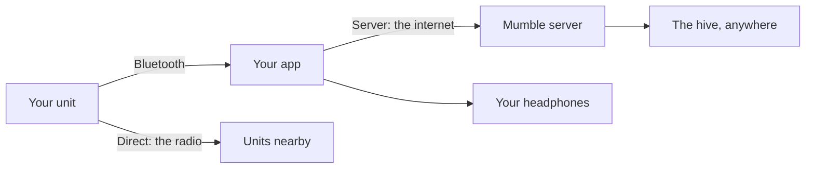
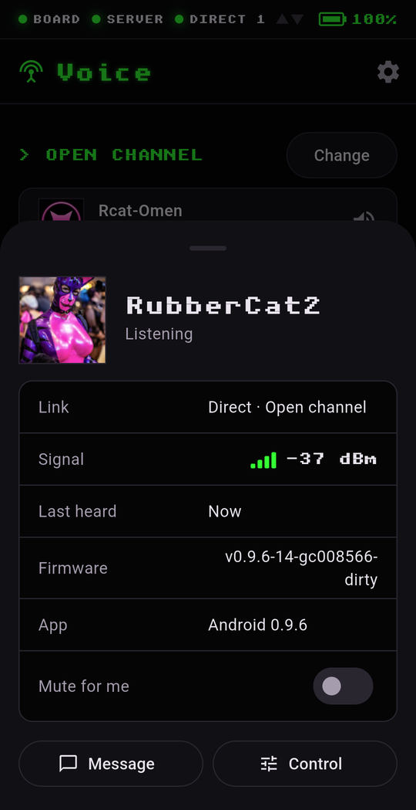

# Voice

HiveMind links every drone in the hive into one mind.  The Voice tab is HiveMind by voice: you talk, and the others hear you, like a radio.  (Its other half, by text, is the [Text](text.md) tab.)  Your unit picks up your voice, puts it through your [voice effect](../features/voice-effects.md), and sends it; the others' voices come back to your headphones, through the app.

Back to [the app](README.md).  The unit's side, with its own HiveMind screens, is in [HiveMind (Comms)](../features/comms.md).

## Two links: Server and Direct

The hive can reach you two ways, and the app brings both together on one screen:

| | **Server** (cloud) | **Direct** |
|---|---|---|
| How it travels | Your unit → your phone → the internet → the hive's [Mumble](https://www.mumble.info) server → everyone else | Your unit → the radio → units nearby, with no phone signal, internet or server |
| Reach | Anywhere with a phone signal or WiFi | A few tens of metres through people and walls, more in the open |
| Needs | The hive's server, set up in [Connecting](connecting.md#2-join-a-server-optional) | *Direct* switched on, and the others on the same [direct channel](#direct-channels) |
| Who's there | Everyone on the server's channel, including people in a Mumble app without a unit | Units nearby on your direct channel |

Use either, or both at once: at an event, direct mode keeps the drones in the room together with no signal, while the server reaches those at home.

**The two links are separate.**  You hear both at once, mixed together in your headphones, but nothing heard on one is passed on to the other: someone on the server doesn't hear a drone that's only nearby on direct, and that drone doesn't hear them.  Your own voice goes to one channel or person at a time (see [Where your voice goes](#where-your-voice-goes)).  To reach everyone in a channel, everyone needs to be on the same link.

## Who's there

The Voice tab is laid out as the [Text](text.md) tab is:

- **Channels**: your channel on the server, and your direct channel, while you're on them, with how many are there and who's talking, and every other channel under each, to move to (see [Channels](#channels)).
- **People**: everyone in your server channel and every unit heard nearby, each once, by name.  Someone who's on the server and nearby both is one row, with both.

Under each name it says how they're linked, or what they're doing:

- **TALKING**, with their avatar lit up green: they're talking.  You hear them only on the channel you've picked (see [Who you hear](#who-you-hear)).
- **CALLING...**, **CALLING YOU · TAP TO ANSWER**, **IN CALL**: a [call](#calls) with them.  **IN CALL · ON HOLD**: you've stepped away to talk somewhere else; **IN CALL · STEPPED AWAY**: they have.
- **Missed call** and the time, in red: they called and you didn't answer.  It goes once you call them back, or they call and you answer.
- **Server**, **Direct**, or both: how they can be reached.  Units over direct mode have signal bars for how well they're heard.
- **Muted**: they've muted themselves, on the server.
- **Muted by you**: you've muted them.

The **speaker button** on each row mutes that person, for you alone: the app doesn't play them, and your unit doesn't show them talking.  Their texts are ignored too, and your unit doesn't do their commands.  The app remembers by name, so they stay muted next time.

Tap someone's picture for more: how they're linked, their signal and when they were last heard, their unit's firmware and app versions (over direct mode), muting, and shortcuts to open your [conversation](text.md) with them or [control](control.md) their toys.

## Talking

### Where your voice goes

**Tap a channel or a person** to talk to them: the row turns pink, with a mic, and the line over the talk button says who, *Talking to DroneLab Comms*.  Tapping any channel in the lists under *Channels* moves you there and talks to it, all at once.  The app keeps it for next time.

- **A channel** goes its own way: your server channel over the server, your direct channel over direct.
- **One person** hears you alone, once you're in a [call](#calls) with them.  The app picks the way: direct if their unit's nearby, as it's quicker and needs no signal, else over the server.  Over direct, it's encrypted with a key only your two units have, which the apps work out from your two [identities](#setup-your-identity), so nobody needs to swap a passphrase, and others on the channel can't listen in.  It works with units on the same direct channel, running firmware from this release on; on the server, with anyone.

**When nobody would hear you**, because the channel's empty or the one you picked is out of reach, they stay picked, and the talk button turns grey and says *NOBODY TO HEAR*.  Talking then doesn't go anywhere else: press to talk and you hear a **low buzz** in your headphones, as on a trunked radio, so you know without looking.  It's the same for the unit's own talk button.  Once they're back, the button lights up again.

### Who you hear

You hear only what you're talking to, so you always know who you're answering: your server channel's voices when that's picked, your direct channel's when that is, and in a call, only the one you're calling.  The others still show *TALKING* on their rows, so you can see something's going on elsewhere.

### Calls

Talking to one person alone is a call.  **Tap someone** and the app asks *Call them?*: their app rings, with their name and avatar and *Answer* and *Decline*, and the line over your talk button says *Calling...* while it rings at theirs.  Once they answer, you hear only each other, and your talking goes to them alone.  Nobody answering in 45 seconds gives up, and they see a missed call.

The red **hang-up button** on their row ends the call, or stops calling, or declines one ringing.  Tap a channel while in a call and the call stays up, **on hold**: they hear two short beeps every few seconds until you come back, by tapping them again, or one of you hangs up.  A call ends by itself if they're out of reach for a minute.

Calls ring in your headphones, as you'll nearly always have them on, with the app showing who's calling.  To have the phone ring too, with its ringtone, switch on the *Calls* notification.  While you're calling, you hear a soft ringing tone every few seconds until they answer.

**Call waiting**: someone calling while you're talking in a call doesn't ring.  You hear two soft low beeps every few seconds instead, the notification comes silently, and the app shows *CALL WAITING*.  Answering puts the call you're in on hold; declining, or letting it go, leaves you where you were, and they see a missed call.  You can have several calls going: you talk to the one you've picked, and the others are on hold, each hearing the hold beeps.  In Setup:

- **Calls**: *Ring in headphones* on or off, and the **Headphone ring**: *Chirp* (the first choice), *Classic* or *Pulse*, with a play button to hear it.
- **Notifications**: *Calls* (off at first) rings the phone as well, and the tune button by it is where to pick its ringtone; *Missed calls* on or off.

Calls need both of you on this release of the app, and over direct mode, the unit's firmware from this release too.

**Someone on plain Mumble** (a desktop or phone Mumble app, not DroneLab) can't ring.  Tapping them asks *Talk to them privately?* instead: say *Talk* and the line's open at once, *IN CALL · MUMBLE WHISPER*.  Your talking is whispered to them alone, which their Mumble shows as a whisper, and you hear only what they whisper to you.  For them to answer you alone, they set up a shortcut in Mumble's *Settings*, *Shortcuts*: *Whisper/Shout*, to you as a user; otherwise their answer goes to the channel, which you don't hear while on the line.  There are no hold beeps or missed calls with them, as their Mumble can't take those.

### Ways to talk

Pick whichever suits you.  They all talk to whoever you've picked.

| | How | |
|---|---|---|
| **The app's button** | Hold *HOLD TO TALK* on the Voice tab, and let go to stop. | The simplest, with the phone in hand. |
| **The headphones' button** | Press play/pause on your headphones to start talking, and again to stop.  Two rising notes in your ear say you're on, two falling ones that you're off. | Hands free, phone in a pocket.  Headphones send a press, not a hold, so it's press-on, press-off; it stops by itself after two minutes, in case it's left on.  Holding the button usually starts the phone's voice assistant instead. |
| **A talk button** | A small Bluetooth camera shutter remote, paired with the unit: hold it to talk. | Hands free, and a real push-to-talk.  See [The talk button](../features/comms.md#the-talk-button) for which ones work and pairing. |
| **The unit's display** | Hold the avatar on the unit's HiveMind status screen. | For trying it out with the unit in hand. |
| **Voice mode** | Set *Talk with* to *VOICE* in Setup: the unit sends whenever it hears you speak, and stops a moment after you stop. | No buttons at all.  It sends anything loud enough, so it suits a quiet place. |

The box under the talk button says which mode the unit's in: **[ PTT ]** (push to talk: one of the buttons) or **[ VOICE ]**.  While you're talking, *TX* shows at the top, the button glows pink, and the status strip's up arrow lights.

### Hearing the hive

The others' voices play **on your phone**, not from the unit's speaker: through whatever the phone's using for sound.  **Bluetooth headphones or earbuds** are best:

- The phone's own speaker is hard to hear from inside a mask, and everyone around you hears the hive too.
- Their play/pause button can [talk](#ways-to-talk), with the phone left in a pocket.

Wired headphones work too, if the phone has a socket.

Everyone you hear, on both links, plays together.  Each voice waits a moment before it plays (the *Buffer*, in the [server settings](connecting.md#2-join-a-server-optional)), to smooth out an uneven connection.

The app keeps going with the screen off, so the phone can go in a pocket.  A notification says so while it's on.

## Channels

*Channels* has a part for each link: **Cloud Server** and **Direct**, each saying how many channels there are to pick from.  The first row is the channel you're on; under it, indented, is every channel there is, with a pink dot by yours and how many are in each.  Tap one to move to it.  The arrows fold a list away, or a channel's subchannels; the lists start open.

**On the server**, the hive's channels are made on the server itself, and nest as they do there.  Only those in the same channel hear each other.  The app goes back to it each time it connects.

### Direct channels

**Over direct mode**, units start on the *open channel*, which any unit in range can hear.  To keep it to your hive, use a channel with a passphrase: everything on it is encrypted, so units outside it can neither hear it nor send to it.  Under *Direct*, the list has the open channel, *Your channels* (made or joined on this phone) and *Heard nearby* (joining one takes its passphrase).  **Manage**, by the *Direct* label, opens the Direct Channels page:

- **Create a channel**: give it a name, which others nearby can see, and a passphrase, which they'll need to join.  A few unrelated words make a good passphrase.
- **Heard nearby**: channels about, with how many units are on each.  Tap one and type its passphrase to join.
- **Your channels**: those made or joined on this phone, to switch between.
- **Open**: back to the open channel.

Each channel has its radio frequency and range setting; the details are in [Channels](../features/comms.md#channels) and [Frequencies and Long Range](../features/comms.md#frequencies-and-long-range).

The status strip's grey down arrow means someone's talking on *another* direct channel nearby: your unit hears it on the air, but can't listen to it.

## Setup: talking

In Setup, behind the gear, while the unit's connected:

- **Talk with**: *PUSH TO TALK*, while a button's held, or *VOICE*, whenever the unit hears you speak (see [Ways to talk](#ways-to-talk)).
- **HiveMind voice**: the voice effect the hive hears: *Same as speaker*, or any of the [voice effects](../features/voice-effects.md), so you can sound natural on comms and like a robot out loud, or the other way round.  A low-profile unit has no speaker, so it has one effect, set here or on the unit's *HiveMind Voice Effect* page, which stay the same.
- **Mute speaker on Tx**: the unit's speaker goes quiet while you're talking to the hive, so those around you don't hear what goes to it.  Not shown for a low-profile unit, which has no speaker.
- **Talk tones**: two short notes up in your headphones as push to talk starts, and two down as it ends, so you know it took.  Not in voice mode, which starts at every word.  The low buzz for [nobody hearing you](#where-your-voice-goes) sounds either way.
- **Show HiveMind on the board while**: the unit's display switches to its HiveMind screen by itself when you *TALK*, when you *HEAR* someone, or *BOTH*, and goes back to what it was showing after.  *NEVER* leaves the display alone.

These are the unit's own settings, so they also show on its display, in the HiveMind feature.  Direct mode is switched on and off from the status strip at the top: tap it for the links.  It costs some battery, as the unit's radio listens the whole time.

## Setup: your identity

The app makes you an identity the first time it runs: a key pair kept in the phone's secure storage.  Others know you by it, not your name, on the server and directly both: it signs your commands, and gives the server the same certificate each time you connect.  So nobody else can pass as you by taking your name, and when someone new turns up with a name you already know, the app marks them ⚠ and says it isn't the person you knew.

*Your identity* in Setup shows its first characters.  **Back up** shows a code that brings it all back: keep it somewhere safe, as anyone with it can pass as you.  **Restore** takes that code, after reinstalling the app or on another phone, and makes that phone you; the identity it had before is gone, unless it's backed up too.  The phone's own backups leave it out.

Without the code, a new phone, or the app put back, is a new identity: others' apps show you with the ⚠, as someone new using your name, and their units don't take your commands until they allow you again.  When it really is someone you know with a new identity (ask them, as anyone can use a name), tap them, then **It's (their name), with a new identity** under the warning: the new one takes the old one's place in the app, with your conversation, and the old one's forgotten.  If you'd allowed them on your unit, allow them again there.

There's no way to call an identity back.  If your phone's lost, or someone's seen your code, whoever has it can pass as you until those who know you forget you: on their units, hold your name in the *Permissions* list to forget it, and allow your new identity instead.  So keep the code safe, and a screen lock on the phone.

## About

The **(i)** at the top of Setup, or *About DroneLab* at the bottom, shows the app's version and the phone's Android version, and the unit it's linked to: its connection and signal strength, firmware version and build time, Bluetooth and WiFi MAC addresses, enclosure (speaker or low-profile), uptime, and battery: charge, voltage, and whether it's charging.  The logo opens the project on GitHub.

## When it doesn't work

- **Nobody hears you**: check the status strip's up arrow lights pink while you talk, and that the line over the talk button names the channel or person you mean.  A buzz as you press means nobody would hear you there.
- **You can't hear anyone**: check the phone's volume and which headphones it's playing through, and that they aren't [muted by you](#whos-there).
- **A yellow warning sign by the channel's name**: units nearby run a different firmware, and can't be heard until everyone's on the same release.  See [Firmware updates](firmware-updates.md#units-on-different-versions).
- **Nobody over direct**: everyone needs direct mode on, the same direct channel, and to be within range.
- **The server won't connect**: the [links sheet](connecting.md#the-links-sheet) says why, under the server.
