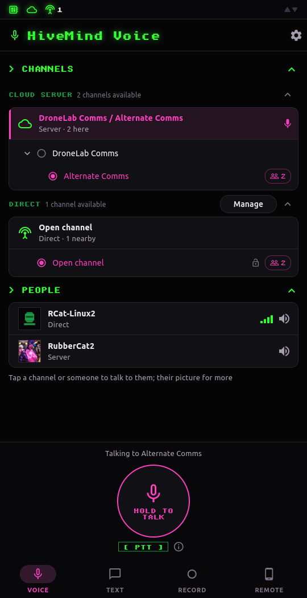
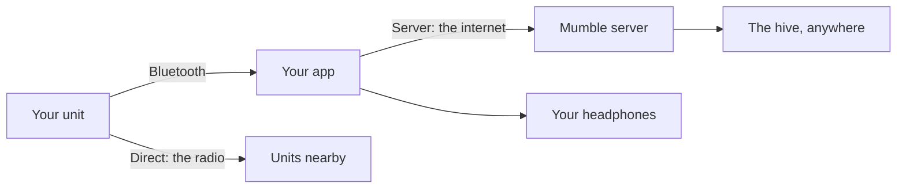
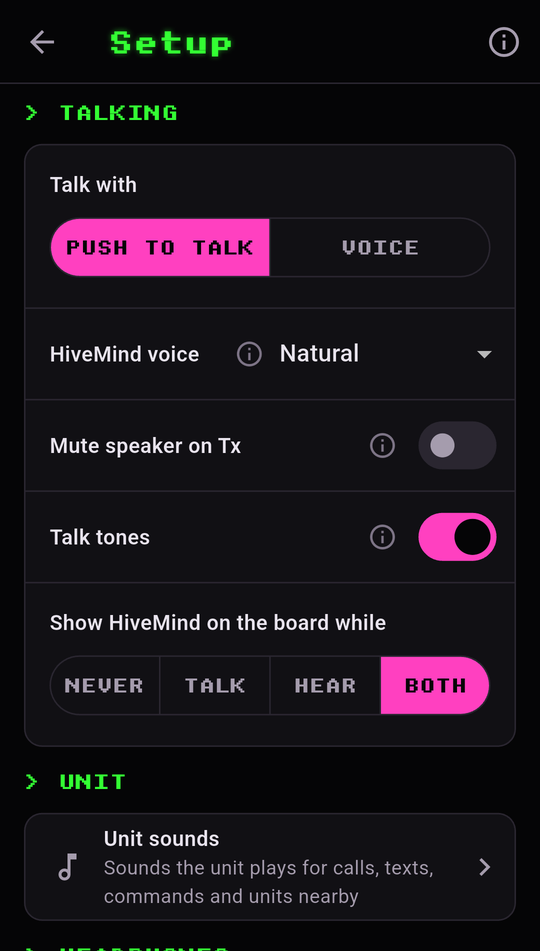

# Voice

HiveMind links every drone in the hive into one mind.  The Voice tab is HiveMind by voice: you talk, and the others hear you, like a radio.  (Its other half, by text, is the [Text](text.md) tab.)  Your unit picks up your voice, puts it through your [voice effect](../features/voice-effects.md), and sends it; the others' voices come back to your headphones, through the app.

Back to [the app](README.md).  The unit's side, with its own HiveMind screens, is in [HiveMind (Comms)](../features/comms.md).

## Two links: Server and Direct

The hive can reach you two ways, and the app brings both together on one screen:

| | **Server** (cloud) | **Direct** |
|---|---|---|
| How it travels | Your unit → your phone → the internet → the hive's [Mumble](https://www.mumble.info) server → everyone else | Your unit → the radio → units nearby, with no phone signal, internet or server |
| Reach | Anywhere with a phone signal or WiFi | A few tens of metres through people and walls, more in the open |
| Needs | The hive's server, set up in [Connecting](connecting.md#2-join-a-server-optional) | *Direct* switched on, and the others on the same [direct channel](#direct-channels) |
| Who's there | Everyone on the server's channel, including people in a Mumble app without a unit | Units nearby on your direct channel |

Use either, or both at once: at an event, direct mode keeps the drones in the room together with no signal, while the server reaches those at home.

**The two links are separate.**  You hear both at once, mixed together in your headphones, but nothing heard on one is passed on to the other: someone on the server doesn't hear a drone that's only nearby on direct, and that drone doesn't hear them.  Your own voice goes out on one link at a time (see [Where your voice goes](#where-your-voice-goes)).  To reach everyone, everyone needs to be on the same link.

## Who's there

The list shows everyone in your channel: those on the server, then the units heard over direct mode, strongest first.  The name over the list is the channel you're talking on; *Change* moves to another (see [Channels](#channels)).

Under each name it says how they're linked, or what they're doing:

- **TALKING**, with their avatar lit up green: you're hearing them.
- **Server** or **Direct**: how you hear them.  Units over direct mode have signal bars for how well they're heard.
- **Muted**: they've muted themselves, on the server.
- **Muted by you**: you've muted them.

The **speaker button** on each row mutes that person, for you alone: the app doesn't play them, and your unit doesn't show them talking.  Their texts are ignored too, and your unit doesn't do their commands.  The app remembers by name, so they stay muted next time.

Tap someone for more: how they're linked, their signal and when they were last heard, their unit's firmware and app versions (over direct mode), muting, and shortcuts to open your [conversation](text.md) with them or [control](control.md) their toys.

## Talking

### Where your voice goes

At the foot of the Voice tab, **SERVER** or **DIRECT** picks the link your voice goes out on.  Under it, the app says where it's going, and to which channel.

If nobody's there to hear you on the link you picked (the server isn't connected, or nobody else is in your channel; or no units are nearby on direct), and somebody is on the other, it goes the other way instead, and the line under the choice turns grey to say so: *Nobody's nearby, so talking to the server*.  That's decided as you start talking, and doesn't change partway through.

### Ways to talk

Pick whichever suits you.  They all work in either link.

| | How | |
|---|---|---|
| **The app's button** | Hold *HOLD TO TALK* on the Voice tab, and let go to stop. | The simplest, with the phone in hand. |
| **The headphones' button** | Press play/pause on your headphones to start talking, and again to stop.  A rising chirp in your ear says you're on, a falling one that you're off. | Hands free, phone in a pocket.  Headphones send a press, not a hold, so it's press-on, press-off; it stops by itself after two minutes, in case it's left on.  Holding the button usually starts the phone's voice assistant instead. |
| **A talk button** | A small Bluetooth camera shutter remote, paired with the unit: hold it to talk. | Hands free, and a real push-to-talk.  See [The talk button](../features/comms.md#the-talk-button) for which ones work and pairing. |
| **The unit's display** | Hold the avatar on the unit's HiveMind status screen. | For trying it out with the unit in hand. |
| **Voice mode** | Set *Talk with* to *VOICE* in Setup: the unit sends whenever it hears you speak, and stops a moment after you stop. | No buttons at all.  It sends anything loud enough, so it suits a quiet place. |

The box under the talk button says which mode the unit's in: **[ PTT ]** (push to talk: one of the buttons) or **[ VOICE ]**.  While you're talking, *TX* shows at the top, the button glows pink, and the status strip's up arrow lights.

### Hearing the hive

The others' voices play **on your phone**, not from the unit's speaker: through whatever the phone's using for sound.  **Bluetooth headphones or earbuds** are best:

- The phone's own speaker is hard to hear from inside a mask, and everyone around you hears the hive too.
- Their play/pause button can [talk](#ways-to-talk), with the phone left in a pocket.

Wired headphones work too, if the phone has a socket.

Everyone you hear, on both links, plays together.  Each voice waits a moment before it plays (the *Buffer*, in the [server settings](connecting.md#2-join-a-server-optional)), to smooth out an uneven connection.

The app keeps going with the screen off, so the phone can go in a pocket.  A notification says so while it's on.

## Channels

**On the server**, the hive's channels are made on the server itself.  *Change*, by the channel's name, picks another from the server's list, with how many are in each; only those in the same channel hear each other.  The app goes back to it each time it connects.

### Direct channels

**Over direct mode**, units start on the *open channel*, which any unit in range can hear.  To keep it to your hive, use a channel with a passphrase: everything on it is encrypted, so units outside it can neither hear it nor send to it.  In Setup, under *Direct*, tap the channel (or *Change* on the Voice tab while talking direct):

- **Create a channel**: give it a name, which others nearby can see, and a passphrase, which they'll need to join.  A few unrelated words make a good passphrase.
- **Heard nearby**: channels about, with how many units are on each.  Tap one and type its passphrase to join.
- **Your channels**: those made or joined on this phone, to switch between.
- **Open**: back to the open channel.

Each channel has its radio frequency and range setting; the details are in [Channels](../features/comms.md#channels) and [Frequencies and Long Range](../features/comms.md#frequencies-and-long-range).

The status strip's grey down arrow means someone's talking on *another* direct channel nearby: your unit hears it on the air, but can't listen to it.

## Setup: talking

In Setup, behind the gear, while the unit's connected:

- **Talk with**: *PUSH TO TALK*, while a button's held, or *VOICE*, whenever the unit hears you speak (see [Ways to talk](#ways-to-talk)).
- **HiveMind voice**: the voice effect the hive hears: *Same as speaker*, or any of the [voice effects](../features/voice-effects.md), so you can sound natural on comms and like a robot out loud, or the other way round.
- **Mute speaker on Tx**: the unit's speaker goes quiet while you're talking to the hive, so those around you don't hear what goes to it.
- **Show HiveMind on the board while**: the unit's display switches to its HiveMind screen by itself when you *TALK*, when you *HEAR* someone, or *BOTH*, and goes back to what it was showing after.  *NEVER* leaves the display alone.
- **Direct, board to board**: direct mode on or off.  It costs some battery, as the unit's radio listens the whole time.  Under it, the direct channel, and the name others see you as (your server name).

These are the unit's own settings, so they also show on its display, in the HiveMind feature.

## When it doesn't work

- **Nobody hears you**: check the status strip's up arrow lights pink while you talk, and that the line under SERVER/DIRECT names the link the others are on.
- **You can't hear anyone**: check the phone's volume and which headphones it's playing through, and that they aren't [muted by you](#whos-there).
- **A yellow warning sign by the channel's name**: units nearby run a different firmware, and can't be heard until everyone's on the same release.  See [Firmware updates](firmware-updates.md#units-on-different-versions).
- **Nobody over direct**: everyone needs direct mode on, the same direct channel, and to be within range.
- **The server won't connect**: the [links sheet](connecting.md#the-links-sheet) says why, under the server.
