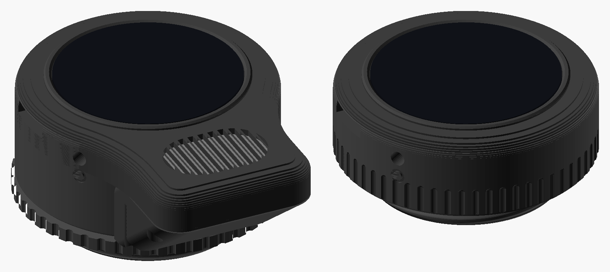

# Build Guide

**KatCorp Drone Systems** DroneLab: Owner Assembly Instructions

 

DroneLab units aren't sold.  They're built by their owners, from a Waveshare display board, a battery, a 3D printed housing and a handful of screws.  Nothing needs soldering: the battery and the speaker plug straight into the board.  This guide takes you from nothing to a unit in your mask.

## The steps

1. **[Choose a model](#choose-a-model)** (below).
2. **Order the parts** and **print the housing**: see your model's page, [speaker model](speaker-housing.md) or [low-profile model](low-profile-housing.md).  The board takes a week or two to arrive from most shops, so order first and print while you wait.
3. **Put it together**, on the same page.
4. **[Install the firmware](../building-firmware.md)** from a computer, over USB.  This can be done before the board goes into the housing, or after: the USB-C port stays reachable.
5. **[Set it up](first-start.md)**: turn the picture the right way round, level it in the mask, and load your own images and sounds.
6. **[Install the app](../installing-the-app.md)** on an Android phone, if you want [comms](../features/comms.md), recording, or to run it from your phone.

## Choose a model

| | [Speaker model](speaker-housing.md) | [Low-profile model](low-profile-housing.md) |
|---|---|---|
| Voice effects and sound | Yes | No speaker |
| Everything else (images, visualizers, comms, Lovense, terminal, remote) | Yes | Yes |
| Battery | 2000 mAh, about 13.5 hours (9.5 with comms on) | 700-850 mAh, about 4.5-5.5 hours |
| Stands out of the mask | About 33 mm | About 23 mm |
| Levelling | A turning collar: hold the display level and screw the collar in | The whole housing screws in; set once in the design |
| Printed parts | 7, one of them in TPU, and an optional USB port cover | 3, and an optional USB port cover |
| Status | Built, worn and working | Printed, waiting on parts for its first assembly |

**Pick the speaker model** if you want the voice effects: they're the headline feature, and the comms send your voice through them.  **Pick the low-profile model** for a slimmer, simpler, cheaper unit that still shows images, lights up as you talk, and does comms and device control.  (Comms on the low-profile model still works: your voice goes to the others through the effect, you just don't hear it out loud.)

## What you'll need

Each model's page has its own parts list.  On top of that:

- **A 3D printer** (or [someone to print for you](#no-3d-printer)) that prints PLA, and ideally TPU for the speaker model's gasket and the optional USB port cover (they can be PLA at a pinch, or the gasket cut from craft foam).  No special settings, but the [test prints](speaker-housing.md#2-print-the-parts) are worth doing first on a printer you haven't used for these before.
- **Small tools:** a hex key or screwdriver to fit M2 screws, a craft knife, scissors and a toothpick.
- **A USB-C cable that carries data**, not just charging, and a computer (Linux, macOS or Windows) to [install the firmware](../building-firmware.md).
- **A micro SD card** (optional), for your own images, sounds and Lovense patterns.
- **A compatible gas mask**, of course: the housings are made to fit the voice port of the MSA Millennium (an MSA trademark; DroneLab isn't made or endorsed by MSA).  The housing screws into its voice port in place of the cover.  With it fitted, the mask is a costume, not a respirator: don't rely on it for protection.

## No 3D printer?

You don't need one of your own.  The parts are ready to print, as STL files in the housing's [`stl/` folder](../../hardware/boards/waveshare_esp32s3_touch_amoled_1_75/stl/) (the travel case's are in [its own](../../hardware/boards/waveshare_esp32s3_touch_amoled_1_75/travel_case/stl/)), so anyone with a printer can make them:

- **A friend, a makerspace or a library.**  Many makerspaces and public libraries have 3D printers members can use, or will print for you for the cost of the plastic.  This is usually the cheapest way, and someone there can help if a part doesn't come out right.
- **An online printing service.**  Upload the STL files, pick a material, and the parts come in the post, usually within a week or two.  [Craftcloud](https://craftcloud3d.com/) compares prices across many print shops at once; [JLC3DP](https://jlc3dp.com/) and [PCBWay](https://www.pcbway.com/rapid-prototyping/3D-Printing/) are cheap, if slower to ship.  Expect to pay more than the plastic would cost, mostly for the body.

Which files to send: see your model's page for the list, [speaker model](speaker-housing.md#2-print-the-parts) or [low-profile model](low-profile-housing.md#2-print-the-parts).  Order the parts it lists, but not the test pieces: they're for tuning your own printer.  When you choose a material:

- **FDM in PLA or PETG** is what the parts were designed and tested in, and the cheapest.  The print shop takes care of supports.
- **Nylon (SLS or MJF)** is a good choice too: tough, with no supports to clean up, though it costs more.  It comes out a little rougher, and the fit around the display might be slightly different.
- **Avoid standard resin (SLA)** for the collar and back: it's brittle, and the thread and screw posts can crack.
- **The gasket** is meant to be TPU, which not every service offers.  Cut it from 1 mm craft foam or rubber instead: the `gasket.stl` outline makes a good template.  The USB port cover is optional, so it can be left out.

Having a print shop or service print the parts for your own unit is fine under the housings' license: see [Licenses](../../hardware/README.md#licenses).

## About the board

Both models are built around the [Waveshare ESP32-S3-Touch-AMOLED-1.75](https://docs.waveshare.com/ESP32-S3-Touch-AMOLED-1.75).  Order the **bare board**, not the -B version, which comes in its own case.  The -G version, with GPS, works too, but its GPS isn't used.  The [board notes](../hardware/waveshare_esp32s3_touch_amoled_1_75.md) have the technical details, for the curious.

## Also available

- **[Travel case](../../hardware/boards/waveshare_esp32s3_touch_amoled_1_75/travel_case/):** a hinged, clip-shut case for either model, shaped to it, that prints with no supports.  The speaker model's case is printed and works; the low-profile model's is designed, not printed yet.
