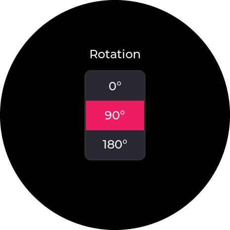
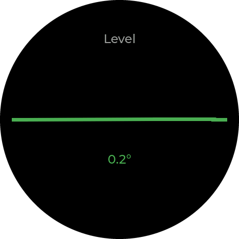
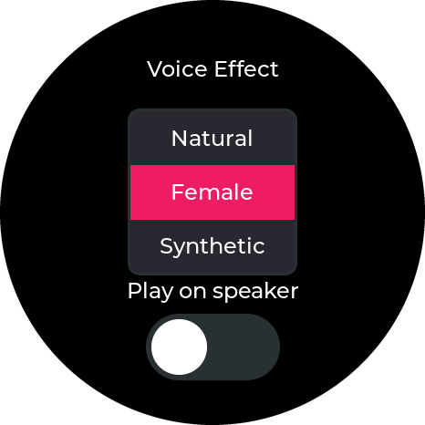

# First Start

**KatCorp Drone Systems** DroneLab: Commissioning Your Unit

 

With the unit built and the [firmware installed](../building-firmware.md), a few minutes of setup gets it ready to wear.

Back to the [Build Guide](README.md).

## 1. Charge it

Plug a USB-C cable into the port on the right side (pull out the port's cover by its notch first, if you fitted one).  Any USB port or phone charger will do.  A lightning bolt beside the battery's charge, on the *Brightness* page in Settings, shows it's charging.  From flat, the speaker model's battery takes about 5.5 hours, and the low-profile model's about 2.5.

The board learns its own battery as it goes.  The first time it runs from a full charge until it switches itself off, it learns that battery's curve, and the percentage is more accurate from then on (see [Battery Log](../features/settings.md#battery-log)).

## 2. Turn it on

Press `PWR`, the lower button on the left side, marked with a power symbol.  The DroneLab logo shows while it starts.  Hold `PWR` for 2 seconds to turn it off.

> **Photo to come:** the left side of the speaker model, with the `PWR` and `BOOT` plungers and their engraved marks, and the micro SD slot.

## 3. Find your way around

Swipe **up and down** to move between features, and **left and right** between a feature's pages.  Settings is the last feature.  See [Using the Display](../using-the-display.md).

## 4. Turn the picture the right way round

In the housing, the board sits a quarter turn round from its usual way up, so its USB-C port faces the side.  Swipe to **Settings**, then to **Rotation**, and scroll the roller to **90°**.  The picture turns about a second after you stop scrolling.

 

## 5. Level it in the mask

Screw the unit into the mask, put the mask on (or set it upright on a head form), and go to the **Level** page in Settings.  The line across the screen stays level with the ground, and turns green when the display is within a degree of level.

- **Speaker model:** turn the housing on its collar until it's level.
- **Low-profile model:** it should be level once screwed in.  If it's a little crooked, see `lp_phase_test` in the [design's README](../../hardware/boards/waveshare_esp32s3_touch_amoled_1_75/README.md#test-prints-1).

## 6. Try the voice effect (speaker model)

 

Swipe to the **Voice** feature, and to the **Voice Effect** page.  Pick a preset, and switch **Play on speaker** on.  The **Effect Volume** page, next to it, sets how loud.  Every preset holds at 100% in a finished housing, but anything close in front of the mask reflects sound back into it: if it starts to howl, turn it down.  The `BOOT` button, the upper one on the left side, switches the speaker off and on, to stop feedback quickly.

*Play on speaker* is always off when the unit starts, in case it feeds back.  See [Voice Effects](../features/voice-effects.md).

 

## 7. Add your own images and sounds

Format a micro SD card as FAT32 (most come that way), and make these folders on it:

- `images` for pictures and animated GIFs (PNG, JPG, BMP or GIF).  A 240 x 240 image fills the screen; bigger artwork, up to 466 x 466, looks sharper.  See [Images on the SD card](../features/images.md#images-on-the-sd-card).
- `sounds` for WAV, MP3 or FLAC files (speaker model).  See [Sound](../features/sound.md#sounds-on-the-sd-card).
- `patterns` for your own Lovense patterns.  See [Lovense](../features/lovense.md#patterns-on-the-sd-card).

Put the card in the slot on the left side and restart the unit: it reads the card while the logo shows.

## 8. Pick what it shows at startup

In Settings, **Startup** picks what's on screen when the unit turns on: any image, a visualizer, the terminal, or the comm status screen.

## 9. Connect your phone (optional)

[Install the DroneLab app](../installing-the-app.md) on an Android phone, and pair it with the unit, for [comms](../features/comms.md), recording, sending messages and running the unit from the phone.  Without the app, any phone can run it through the unit's [WiFi hotspot](../features/phone-remote.md).

## Something wrong?

- **The picture's shifted, or touches land in the wrong place:** connect it over USB, run `idf.py ... monitor` as in [Installing the Firmware](../building-firmware.md#4-flash-it), and [open an issue](https://github.com/rcat3/DroneLab/issues) with the log.
- **It restarted by itself:** see [Troubleshooting](../building-firmware.md#troubleshooting).
- **The voice effect howls at low volume:** check the plasticine seals around the speaker's wire and the battery, and the foam in the microphones' cell (steps 9 to 12 of the [speaker model's assembly](speaker-housing.md#the-chamber)).
