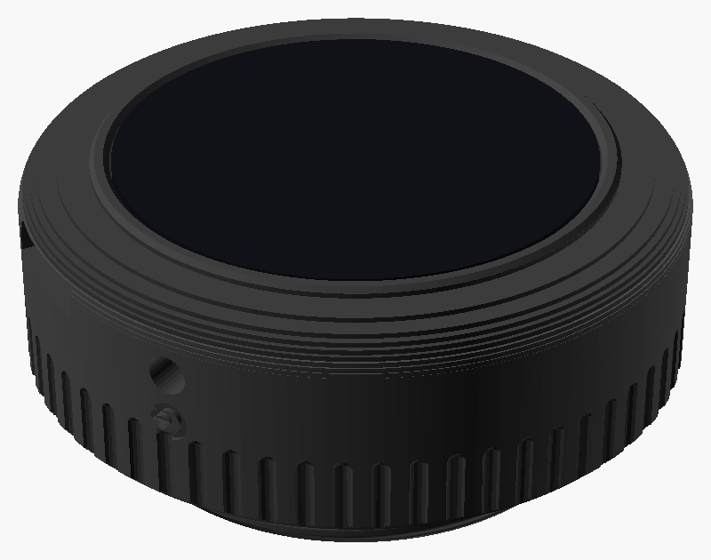
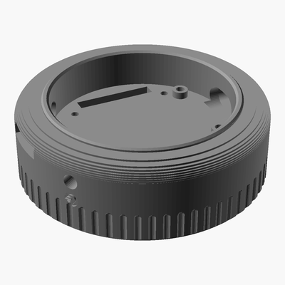
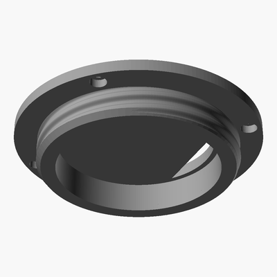
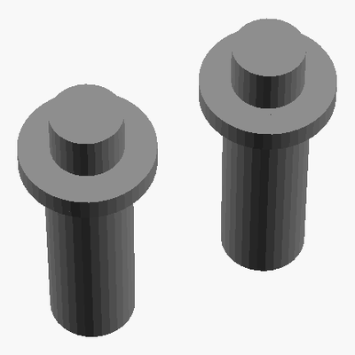
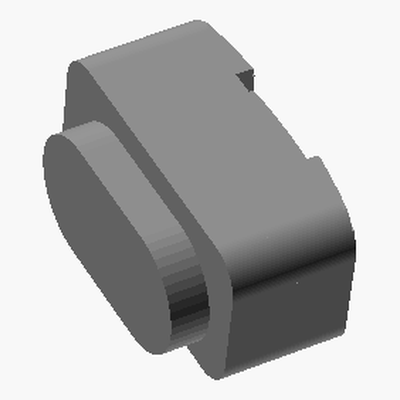
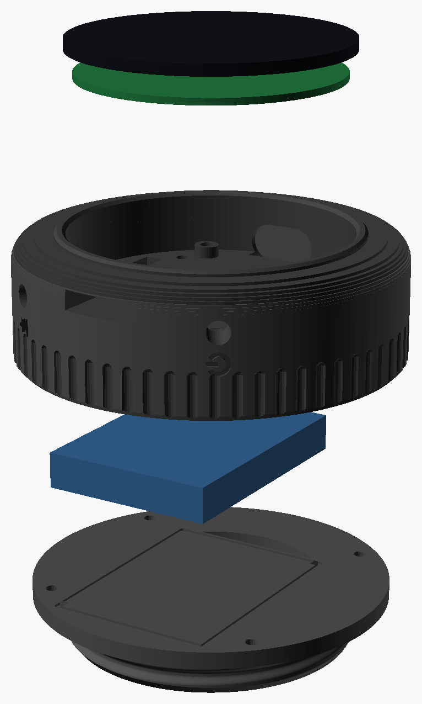
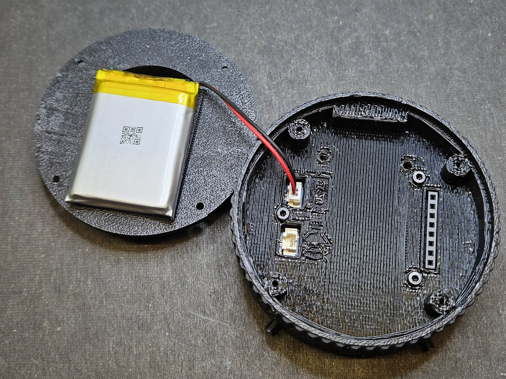
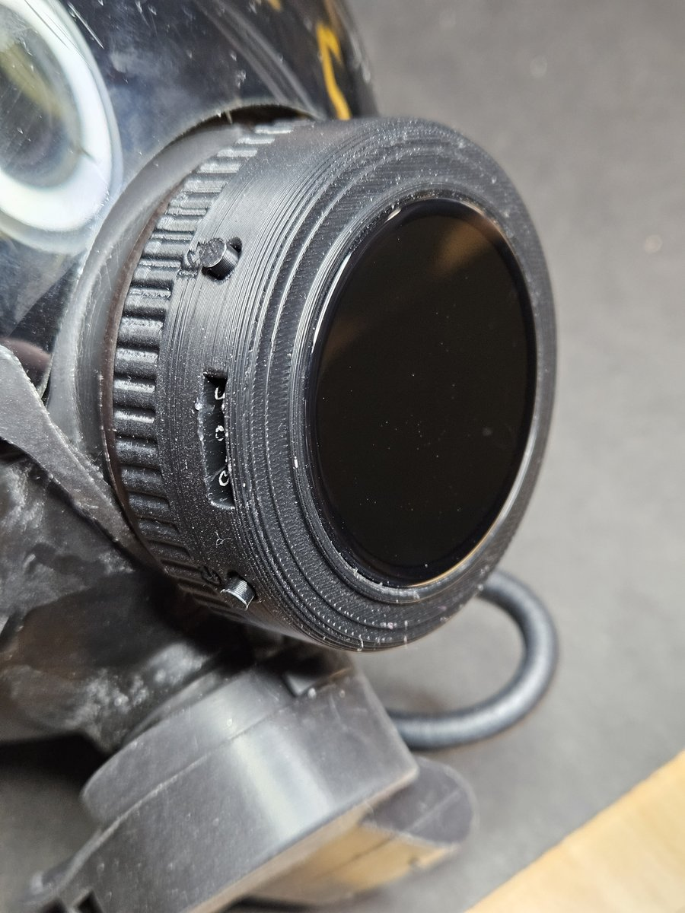

# Building the Low-Profile Model

**KatCorp Drone Systems** DroneLab Low-Profile Model: Owner Assembly Instructions Status: Built and fitted in a mask

 

The entry-level unit: the display in a slim round housing that stands only about 23 mm out of the mask, with a flat battery behind it for about 4.5-5.5 hours.  There's no speaker, so no [voice effects](../features/voice-effects.md) or [sound](../features/sound.md), but everything else works: images, the visualizers, the voice ring, [comms](../features/comms.md), [toy](../features/toys.md) control, the terminal and the remote.  The thread is part of the back, so the whole housing screws in, with fewer parts and screws than the speaker model.

It shares the display's pocket, the openings, the plungers and the microphones' sleeves with the [speaker model](speaker-housing.md), which have been checked with a print.  The battery's place, the thread and the back are new, and the first one's been built and screwed into a mask.

Back to the [Build Guide](README.md).

## 1. Order the parts

| Part | How many | Notes |
|---|---|---|
| [Waveshare ESP32-S3-Touch-AMOLED-1.75](https://docs.waveshare.com/ESP32-S3-Touch-AMOLED-1.75) | 1 | The **bare board**, not the -B version in its own case.  The speaker that comes with it isn't used |
| LiPo battery, 603040 size | 1 | 3.7 V, about 700-850 mAh, no bigger than 41 x 30.5 x 6.3 mm, with an MX1.25 2-pin plug.  The first one was built with [this one](https://www.amazon.com/dp/B09YQ2C1KR).  Check its polarity (below) |
| M2 x 4 countersunk screws | 3 | Hold the board in |
| M2 x 8 socket head screws | 4 | Hold the back on |
| Double-sided foam tape | A few cm | About 0.8 mm thick, to hold the battery |

> [!WARNING]
> ⚠️ **Check the battery's polarity before plugging it in.**  MX1.25 batteries aren't all wired the same way round, and a battery plugged in backwards can damage the board.  Check its red wire goes to the positive side of the board's battery socket, as Waveshare's documentation for the board shows it, and swap the pins in the plug if it doesn't.

## 2. Print the parts

No 3D printer?  See [having it printed for you](README.md#no-3d-printer).

**Download the parts**, ready to print: [**Low-profile model parts**](https://github.com/rcat3/DroneLab/releases/latest/download/DroneLab-low-profile-model-stl.zip) from the latest release.  The zip has the parts below, the [travel case](../../hardware/boards/waveshare_esp32s3_touch_amoled_1_75/travel_case/) in `travel_case/`, and the test pieces in `tests/`.

Or make them yourself, to change a setting: the design is [`msa_low_profile_housing.scad`](../../hardware/boards/waveshare_esp32s3_touch_amoled_1_75/msa_low_profile_housing.scad), in [OpenSCAD](https://openscad.org/).  To make the STL files, run `./render.sh low_profile` in [`hardware/boards/waveshare_esp32s3_touch_amoled_1_75`](../../hardware/boards/waveshare_esp32s3_touch_amoled_1_75/).  The parts come out turned the right way up to print.

**Print the test pieces first** (in the zip's `tests/`, or `./render.sh lp_lens_fit lp_phase_test plunger_test`):

- **`lp_lens_fit`**: the front of the housing around the display.  The board's glass should drop in with a little play, but not rattle.  If it doesn't, change `clearance` in [`board.scad`](../../hardware/boards/waveshare_esp32s3_touch_amoled_1_75/board.scad).
- **`lp_phase_test`**: the thread, with a scale on its front, to check the housing will end up level in your mask.  Screw the mask's metal voice port adapter firmly home, screw the test all the way in, hold the mask upright, and read the number at the top.  The [design's README](../../hardware/boards/waveshare_esp32s3_touch_amoled_1_75/README.md#test-prints-1) says what to do with it.
- **`plunger_test`**: button plungers in three lengths.  Pick the length that presses the board's buttons best, and set `plunger_proud` to it.

Then the parts:

| | Part | Material | How to print it |
|---|---|---|---|
|  | `lp_body` | PLA or PLA+ | Back down, with supports only for the openings in the side |
|  | `lp_back` | PLA or PLA+ | On its front, thread pointing up, no supports.  4 or more walls so the thread is solid |
|  | `plungers` | PLA or PLA+ | Two small pins |
|  | `usb_plug` (optional) | TPU | A cover for the USB-C port, to keep dust out.  Not needed.  In PLA, loosen it with the second number of `usb_tongue` |

## 3. Put it together

Front to back: the board drops into the front of the body, then the battery, taped to the back, and the back with its thread.

1. **Fit the plungers.**  Push the two plungers into their holes in the side of the body, from inside the display's pocket.
2. **Fit the board.**  Lay it in the pocket, glass forward, with its USB-C port towards the side opening on the right, and screw it to the body's floor from behind, from the chamber side, with the three M2 x 4 countersunk screws.
3. **Tape the battery to the back.**  Stick it to the front of the back with the foam tape, inside the outline engraved there, with its leads towards the opening beside it.
4. **Plug in the battery.**  ⚠️ [Check its polarity first](#1-order-the-parts), and plug it into the socket marked with a battery, through the opening in the body's floor below the middle of the board.  The socket beside it, marked with a speaker, stays empty.  Tuck the wires in beside the battery, below it.

   

5. **Close the back.**  Screw it on with the four M2 x 8 screws.  It only goes on one way round.
6. **Fit the USB plug** (optional).  If you printed it, push it into the port's pocket on the right side.

## 4. Into the mask

If anything is screwed into the mask's voice port, other than its metal adapter, take it out first.  Leave the adapter in: the housing screws into it.  Then screw the housing in by the ridges around its back.  It should end up level, with the USB-C port on the right.

The thread screws into a metal adapter in the mask, which itself screws into the mask, and it's easy to unscrew the adapter by accident when taking the housing out.  Hold the adapter still while you unscrew the housing.  If it does come loose, screw it firmly back in before putting the housing back: where it stops changes how level the housing sits.  If the housing sits a little crooked, see `lp_phase_test` in the [design's README](../../hardware/boards/waveshare_esp32s3_touch_amoled_1_75/README.md#test-prints-1).

## Next

[Install the firmware](../building-firmware.md), if you haven't already, then [set it up](first-start.md).  The first time it starts, it asks which model it is: tap **Low-profile**, which leaves out the features that need a speaker.
