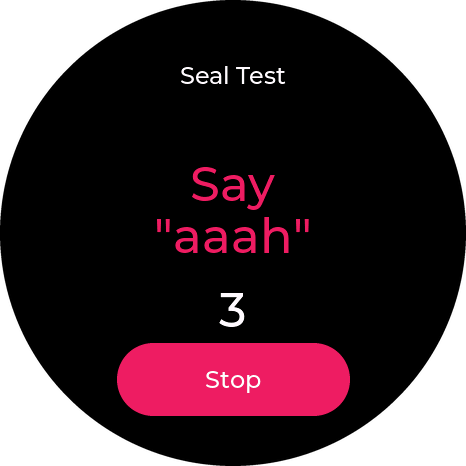

# The Seal Test

**KatCorp Drone Systems** DroneLab Speaker Model: Seal Test

 

The speaker model has a speaker and two microphones in one small housing.  The voice effects play your voice out of the speaker, so any of it that gets back into the microphones goes round again, and if enough does, it howls.  The board's echo canceller takes most of that out, so the housing doesn't need sealing (see [What's been measured](#whats-been-measured)), but a loose part rattling, a speaker not stuck to its grille, or a microphone blocked can still make it feed back early.  The Seal Test checks how far over full volume the voice effects can go before they feed back, and says what to look at if it isn't far enough.

Back to [First Start](first-start.md#6-test-the-seal-speaker-model) or the [Build Guide](README.md).

## Running it

Swipe to the **Voice** feature, and to its last page, **Seal Test**.  Screw the unit into the mask, **put the mask on**, somewhere quiet, and tap **Start**.  The screen shows what to do in big letters, to read in a mirror.

There are three tests.  Tap the pink line under the title, *< Quick test >*, to pick another:

- **Quick test**, about 20 seconds, and the one to run after building a unit:
  1. **Quiet** (3 seconds): it listens to the room.  Keep quiet and still.
  2. **Quiet** (10 seconds): it plays a hiss through the speaker.  Keep quiet and still.
  3. **A beep, then Say "aaah"** (5 seconds): say "aaah" steadily, at your normal speaking volume, until it finishes.
- **Full test**, about a minute: the same, but the hiss plays five times, to see how much the result wanders, then one band of pitches at a time, from low to high, to find which feeds back first, then loud, to hear anything rattling.  For when the quick test isn't clear, or to compare two builds.
- **Feedback check**, about 15 seconds: it plays your microphones through *Natural*, the voice effect that feeds back first, without the gate that keeps it quiet between words, turning it up a step every half second from 10 dB below full volume until it feeds back, then stops.  It squeals briefly.  It's the real thing, where the other two work it out.

Tap **Stop** to stop it early, and **Done** to go back to the tests from the results.  While it runs, the sound player and *Play on speaker* are paused, and they come back afterwards.

Wear the mask for it: the results are measured on units that were worn, and the quick and full tests need your voice.  On a desk, with nothing in front of the mask, the leak reads about 1.5 dB higher.

 

## Reading the results

The quick test shows four numbers, with one line of advice about the worst problem it found:

- **Spare**, graded: how far over full volume (100% *Effect Volume*) *Natural* could go before it feeds back.  This is the result that matters.
- **Leak**: how much of the hiss the microphones hear, against how loud the board played it.
- **Echo**: how much of it is left after echo cancelling.
- **Mics**, graded: whether the two microphones hear your voice the same.

The grades are **good**, **fair** (it works, but not as well as a good build) and **check** (something's wrong: the advice says where to look).  The numbers are in decibels (dB), a scale where every 6 dB is double or half: 10 dB is a big difference, 1 dB barely there.  Run to run, the same unit reads within a dB or two.

 

### Spare

| Spare | Grade |
|---|---|
| +6 dB or more | good |
| 0 to +6 dB | fair: it'll hold at full volume, but with little to spare, so something close in front of the mask may set it off |
| Below 0 dB | check: "Feeds back below full volume" |

The quick test works it out from the whole hiss, which is an average over every pitch, so it takes 3 dB off for the pitch that'll feed back first, to be safe.  It reads a little low: the full test, which plays each band on its own, and the feedback check usually find a few dB more.  The full test shows which band feeds back first, as *at 1.4 kHz*.

**If it says "Feeds back below full volume",** its second line says where to look first:

- **"Check the screws and battery."**: something rattles along with the speaker, which the echo canceller can't follow.  The board's three screws, the chin's four and the back's four all snug (but don't over-tighten the back's, [step 9](speaker-housing.md#the-back-and-the-collar)), and the battery taped to the back with its wires taped along its side (step 8).
- **"Check the speaker and chin."**: much more of the speaker reaches the microphones than it should.  The speaker stuck to the grille all round, by its adhesive frame (step 4), and the chin screwed on.
- **"See the build guide."**: neither stands out.  Go through both lists above.

### Leak and Echo

**Leak** is the sound that gets from the speaker to the microphones, by any way: through the mask, through the housing, or through the plastic itself.  It's about +1 dB on a good build, worn: the microphones hear the speaker about as loud as the board plays it.  The echo canceller works out how the sound gets from the speaker to the microphones, and takes that much out, which leaves the **Echo**, about -22 dB on a good build.  What it can't follow is sound that doesn't come straight from the speaker: a part buzzing or rattling along with it, or the battery shifting.

**If it says "The microphones barely hear the speaker":** the leak's far too low for a working speaker, so the speaker's not playing.  Check it's plugged into the socket marked with a speaker, not the battery's ([step 6](speaker-housing.md#the-chamber)), and its plug is pushed all the way in.

### Mics

**What it measures:** whether the two microphones hear your voice the same, while you say "aaah".  If one's blocked it hears less of everything.  The number is microphone 1 against microphone 2: it doesn't matter whether it's above or below zero, only how far from it.

| Mics | Grade |
|---|---|
| 3 dB apart or less | good |
| 3 to 4 dB apart | fair |
| More than 4 dB apart | check: "The microphones don't match" |
| No voice heard | skipped (shown as -) |

**If it says "The microphones don't match":**

- The open-cell foam in the microphones' cell sitting loosely, not packed in, and the same over both microphones ([step 7](speaker-housing.md#the-chamber)).
- The battery not covering the opening in the back beside it (step 8).

**If it says "No voice heard":** it didn't hear the "aaah" well above the room, so it skipped the microphones.  Run it again, and start speaking at the beep.

### The full test

The full test shows the same, with more detail:

- **Spare**, from the band that feeds back first, and which band that is.
- **Leak** and **Echo**, as the middle of five tries, and the lowest and highest of them.
- **Loud**: the echo with the hiss played near full volume, against played quietly, graded *good* up to 3 dB worse, *fair* up to 6 dB worse.  A loose part that only rattles when it's loud shows up here.  If it's *check*, the advice is "Something rattles when loud": see the screws and battery, above.

The board's serial log (`seal test: ...`) has every band's numbers, and what the quick test would have said.

### The feedback check

It shows where it fed back, as *Fed back at +14 dB over full volume*, or *No feedback up to +20 dB over full volume*.  It only counts a howl that lasts a third of a second, so a cough or a door doesn't stop it, but a loud noise that goes on can: if one stops it early, run it again.

### Other advice

| Advice | What happened |
|---|---|
| **"All good."** | Everything *good*. |
| **"Works, but could be better."** | Nothing to *check*, but at least one is *fair*.  See that result. |
| **"Too noisy here."** | The room was too loud for the hiss to stand out by at least 10 dB, so it couldn't be measured.  Try somewhere quieter. |

## What's been measured

The speaker model used to be sealed inside, with plasticine around the speaker's wire, behind the speaker and around the chamber, and foam squares sealing each microphone to the board.  To see whether it needed to be, the same board was tested in a housing built that way and in one with none of it, worn, with the full test and three feedback checks each:

| | Sealed | Not sealed |
|---|---|---|
| Feedback check | +13, +14, +14 dB | +15, +15, +16 dB |
| Spare (full test) | +12.5 dB, at 1.4 kHz | +11.5 dB, at 4 kHz |
| Leak | +0.8 dB | +1.0 dB |
| Echo | -20.6 dB | -22.1 dB |
| Mics | 2.1 dB | 1.2 dB |

They're the same, within what the test wanders run to run.  Nearly all the speaker's sound that reaches the microphones goes round the outside, through the mask, not through the housing, so sealing the inside hardly changes it: without the sealing, the microphones only heard more of the speaker between about 2.8 and 4 kHz, and the echo canceller took that out too.  A second unit built without sealing read the same (+11.9 dB spare, +13 to +16 dB on the feedback check).  Recordings of the voice from both housings sounded much the same too.

These were measured before the speaker was turned up by 3 dB, so a unit now reads about 3 dB less spare.

If yours reads well outside these, either way, the exact figures are in the board's serial log: please [open an issue](https://github.com/rcat3/DroneLab/issues) or post them in [Discussions](https://github.com/rcat3/DroneLab/discussions).

## How it works

The test plays a steady pink noise, with the lows the small speaker can't play taken out, at a fixed level, so every unit is tested with the same sound, and no sound file is needed.  The full test's bands are the same, filtered to half an octave at a time, from 250 Hz to 5.7 kHz.  The board's audio chip hears the speaker's own signal alongside the microphones (see the [board notes](../hardware/waveshare_esp32s3_touch_amoled_1_75.md#board-notes)), which is what the leak and the echo are measured against.  The spare comes from the echo, and how much *Natural* turns your voice up at full volume, at each pitch: where the two add up to more than nothing, it feeds back.

The values are in [`core/audio/seal_test.c`](../../core/audio/seal_test.c).  The phone remote's API can run it too: `POST /api/seal?start=1` for the quick test, `2` for the full test, `3` for the feedback check, and `0` to stop, with its progress and result in `/api/state` under `seal`.
