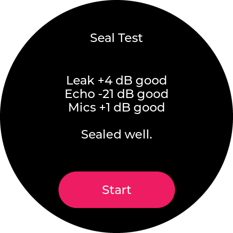

# The Seal Test

**KatCorp Drone Systems** DroneLab Speaker Model: Seal Test

 

The speaker model has a speaker and two microphones in one small housing.  The voice effects play your voice out of the speaker, so any of it that gets back into the microphones goes round again, and if enough does, it howls.  The board cancels most of the speaker's echo, but the rest is down to the build: the plasticine that seals the speaker off, the foam that seals the microphones to the board, and nothing rattling.  The Seal Test checks those, in about 20 seconds, and says what to fix.

Back to [First Start](first-start.md#6-test-the-seal-speaker-model) or the [Build Guide](README.md).

## Running it

Swipe to the **Voice** feature, and to its last page, **Seal Test**.  Screw the unit into the mask, **put the mask on**, somewhere quiet, and tap **Start**.  The screen shows what to do in big letters, to read in a mirror:

1. **Quiet** (3 seconds): it listens to the room.  Keep quiet and still.
2. **Quiet** (10 seconds): it plays a hiss through the speaker.  Keep quiet and still.
3. **A beep, then Say "aaah"** (4 seconds): say "aaah" steadily, at your normal speaking volume, until it finishes.

Tap **Stop** to stop it early.  While it runs, the sound player and *Play on speaker* are paused, and they come back afterwards.

Wear the mask for it: the results are measured against units that were worn, and the third step needs your voice.  On a desk, with nothing in front of the mask, the leak reads about 1.5 dB higher, still within *good* on a good build.

 

## Reading the results

It shows three results, each a number and a grade, and one line of advice about the worst problem it found:

- **good**: as good as the units it was measured against.
- **fair**: it works, but the voice effects will start to feed back at a lower volume than on a good build.  Worth fixing if you want them loud.
- **check**: something's wrong.  The advice says where to look, and the tables below say what to check.

The numbers are in decibels (dB), a scale where every 6 dB is double or half: 10 dB is a big difference, 1 dB barely there.  A smaller number (further below zero) is better for the leak and the echo.

 

### Leak

**What it measures:** how loud the hiss is in the microphones, against how loud the board played it.  It's the sound that gets from the speaker to the microphones through the housing: round the plasticine, through gaps around the speaker's wire, or through the plastic itself.  The echo canceller takes most of it out again, but the more there is, the more it has to.

| Leak | Grade |
|---|---|
| +5 dB or less | good |
| +5 to +7.5 dB | fair |
| More than +7.5 dB | check: "The speaker leaks in" |
| Less than -12.5 dB | check: "The microphones barely hear the speaker" |

**If it says "The speaker leaks in":**

- The plasticine around the speaker's wire, where it goes from the speaker's pocket into the chamber (step 9 of the [speaker model's assembly](speaker-housing.md#the-chamber)).  It has to fill the opening all round the wire, with no gaps.
- The plasticine behind the speaker, filling the pod up to the chin (step 6).
- The speaker stuck to the grille all round, by its adhesive frame (step 5), and the chin screwed on tight.
- The thin layer of plasticine around the chamber's wall (step 10).

**If it says "The microphones barely hear the speaker":** far too quiet to be a good seal, so the speaker's not playing.  Check it's plugged into the socket marked with a speaker, not the battery's (step 8), and its plug is pushed all the way in.

### Echo

**What it measures:** how much of the hiss is left in the microphones after the board's echo canceller has taken the speaker's sound out, again against how loud the board played it.  This is what feeds back, so it matters most.  The echo canceller works out how the sound gets from the speaker to the microphones, and takes that much out.  What it can't follow is sound that doesn't come straight from the speaker: a part buzzing or rattling along with it, or the battery shifting.

| Echo | Grade |
|---|---|
| -18.8 dB or less | good |
| -18.8 to -15.8 dB | fair |
| More than -15.8 dB | check: "Something rattles" |

**If it says "Something rattles":**

- The board's three screws, the chin's four and the back's four, all snug (but don't over-tighten the back's, [step 13](speaker-housing.md#the-back-and-the-collar)).
- The battery taped to the back and held still, with its wires taped along its side (step 12).
- The speaker stuck firmly to the grille (step 5).
- A bad leak can make the echo worse too: fix the leak first.

### Mics

**What it measures:** whether the two microphones hear your voice the same, while you say "aaah".  Each microphone is sealed against the board by a foam square on its sleeve, so it hears the voice port and nothing else.  If one's unsealed it hears less of your voice, and more of the inside of the housing; if one's blocked it hears less of everything.  The number is microphone 1 against microphone 2: it doesn't matter whether it's above or below zero, only how far from it.

| Mics | Grade |
|---|---|
| 3 dB apart or less | good |
| 3 to 4 dB apart | fair |
| More than 4 dB apart | check: "The microphones don't match" |
| No voice heard | skipped (shown as -) |

**If it says "The microphones don't match":**

- Both foam squares in place on the two microphone sleeves, each with its hole lined up with the sleeve's hole (step 1).  This is what a missing square looks like: a unit with only one sealed read 5.1 dB apart.
- The open-cell foam in the microphones' cell sitting loosely, not packed in (step 11).
- The battery not covering the opening in the back beside it (step 12).

**If it says "No voice heard":** it didn't hear the "aaah" well above the room, so it skipped the microphones.  Run it again, and start speaking at the beep.

### Other advice

| Advice | What happened |
|---|---|
| **"Sealed well."** | All three good. |
| **"Works, but could be better."** | Nothing to *check*, but at least one is *fair*.  See that result's list. |
| **"Too noisy here."** | The room was too loud for the hiss to stand out by at least 10 dB, so it couldn't be measured.  Try somewhere quieter. |

## What it's measured against

The grades come from the first two speaker models built, both worn, with the plasticine, the foam and the battery as the [assembly](speaker-housing.md) describes:

| | Unit 1 | Unit 2 | Reference |
|---|---|---|---|
| Leak | +1.3 to +2.1 dB | +3.3 dB | +2.5 dB |
| Echo | -21.2 to -21.4 dB | -22.3 dB | -21.8 dB |
| Mics | 5.1 dB (one microphone unsealed) | 1.8 dB | |

*good* is within 2.5 dB of the reference leak and 3 dB of the reference echo, and *fair* within 5 and 6 dB.  The first housing built, before it had any plasticine, leaked about 4 dB more and was about 10 dB worse after echo cancelling, measured with music rather than this test's hiss.  Run to run, the same unit reads within about half a dB.

These are early numbers, from two units, and they'll be refined as more are built.  If yours reads well outside them, either way, the exact figures are in the board's serial log (`seal test: ...`): please [open an issue](https://github.com/rcat3/DroneLab/issues) or post them in [Discussions](https://github.com/rcat3/DroneLab/discussions).

## How it works

The test plays a steady pink noise, with the lows the small speaker can't play taken out, at a fixed level, so every unit is tested with the same sound, and no sound file is needed.  The board's audio chip hears the speaker's own signal alongside the microphones (see the [board notes](../hardware/waveshare_esp32s3_touch_amoled_1_75.md#board-notes)), which is what the leak and the echo are measured against, so the speaker's volume doesn't change them.  Each is the middle of eight one-second readings, after two seconds for the echo canceller to settle.

The values are in [`core/audio/seal_test.c`](../../core/audio/seal_test.c).  The phone remote's API can run it too: `POST /api/seal?start=1`, with its progress and result in `/api/state` under `seal`.
