# Building the Speaker Model

**KatCorp Drone Systems** DroneLab Speaker Model: Owner Assembly Instructions Status: Built, worn and working

 

[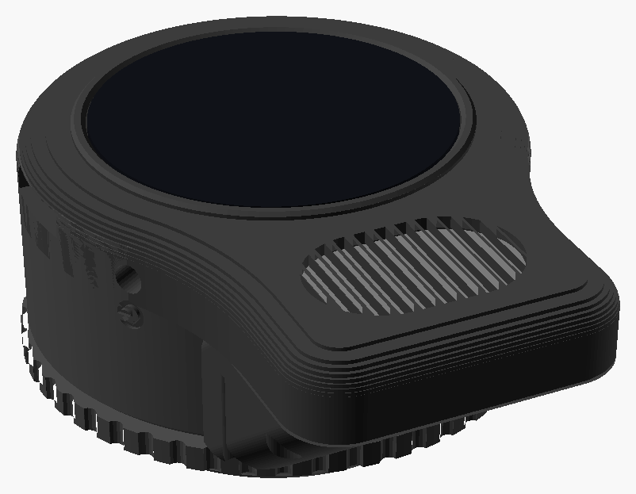](../../hardware/boards/waveshare_esp32s3_touch_amoled_1_75/README.md#the-speaker-housing)

The full unit: the display, a speaker facing out in a pod below it for [voice effects](../features/voice-effects.md) and [sound](../features/sound.md), and a 2000 mAh battery in a chamber behind, for about 13.5 hours.  A turning collar carries the thread, so you hold the display level while you screw the collar into the mask.  It stands about 33 mm out of the mask, and the pod's sloped chin clears the filter mount below the voice port.

Back to the [Build Guide](README.md).

## 1. Order the parts

> **Photo to come:** all the parts for the speaker model laid out: the board, speaker, battery, printed parts, screws, plasticine and foam.

| Part | How many | Notes |
|---|---|---|
| [Waveshare ESP32-S3-Touch-AMOLED-1.75](https://docs.waveshare.com/ESP32-S3-Touch-AMOLED-1.75) | 1 | The **bare board**, not the -B version in its own case |
| Speaker module | 1 | [This one](https://www.amazon.com/dp/B0F3CY5ZD2) or the same size: a sealed box 35 x 25 x 6.5 mm with an oval cone on the front, 4 ohm, with an MX1.25 2-pin plug (or one crimped on).  **Not the speaker that comes with the board:** it's smaller than the pod is made for, and won't work in it.  Set it aside |
| LiPo battery, 103450 size | 1 | 3.7 V, 2000 mAh, no bigger than 50.5 x 34 x 9.9 mm, with an MX1.25 2-pin plug |
| M2 x 4 countersunk screws | 3 | Hold the board in |
| M2 x 8 socket head screws | 8 | Four hold the chin on, four hold the back on |
| M2 x 6 socket head screws | 4 | Hold the washer that keeps the collar on |
| Plasticine | About 20 g | Modelling clay that never hardens, a lump about the size of a walnut.  It seals the speaker off from the microphones, and holds the battery.  **Don't leave it out:** without it, the voice effects feed back |
| Double-sided foam tape | A small piece | About 1 mm thick, to hold the battery to the back |
| Soft foam sheet | A scrap | About 2 mm thick, such as craft foam |
| Open-cell foam | A small block | Soft and spongy, that air passes through, as used behind speaker grilles.  A block about 25 x 11 x 15 mm fills the microphones' cell |

> [!WARNING]
> ⚠️ **Check the battery's polarity before plugging it in.**  MX1.25 batteries aren't all wired the same way round, and a battery plugged in backwards can damage the board.  Check its red wire goes to the positive side of the board's battery socket, as Waveshare's documentation for the board shows it, and swap the pins in the plug if it doesn't.

## 2. Print the parts

No 3D printer?  See [having it printed for you](README.md#no-3d-printer).

**Download the parts**, ready to print: [**Speaker model parts**](https://github.com/rcat3/DroneLab/releases/latest/download/DroneLab-speaker-model-stl.zip) from the latest release.  The zip has the parts below, the [travel case](../../hardware/boards/waveshare_esp32s3_touch_amoled_1_75/travel_case/) in `travel_case/`, and the test pieces in `tests/`.

Or make them yourself, to change a setting: the design is [`msa_speaker_housing.scad`](../../hardware/boards/waveshare_esp32s3_touch_amoled_1_75/msa_speaker_housing.scad), in [OpenSCAD](https://openscad.org/).  To make the STL files, run `./render.sh speaker` in [`hardware/boards/waveshare_esp32s3_touch_amoled_1_75`](../../hardware/boards/waveshare_esp32s3_touch_amoled_1_75/) (or open the file in OpenSCAD, set `part`, render and export).  The parts come out turned the right way up to print.

**Print the test pieces first** (in the zip's `tests/`, or `./render.sh tests`), on a printer you haven't printed these on before.  They're small and quick, and save a wasted body:

- **`lens_fit`**: the front of the housing around the display.  The board's glass should drop in with a little play, but not rattle.  If it doesn't, change `clearance` in [`board.scad`](../../hardware/boards/waveshare_esp32s3_touch_amoled_1_75/board.scad).
- **`plunger_test`**: button plungers in three lengths.  Pick the length that presses the board's buttons best, and set `plunger_proud` to it.
- **`pod_test`**: the speaker's pod on its own, to check the speaker fits.

Then the parts:

| | Part | Material | How to print it |
|---|---|---|---|
| 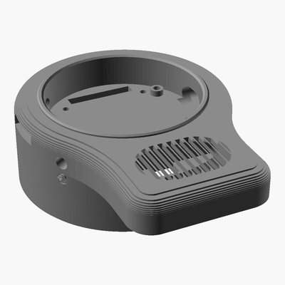 | `body` | PLA or PLA+ | Tilted up at an angle, with tree supports (see the picture below).  The ribs inside need supports too |
| 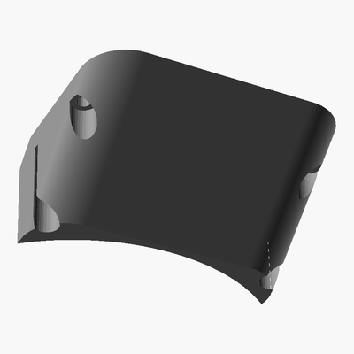 | `chin` | PLA or PLA+ | On its flat face, no supports |
| 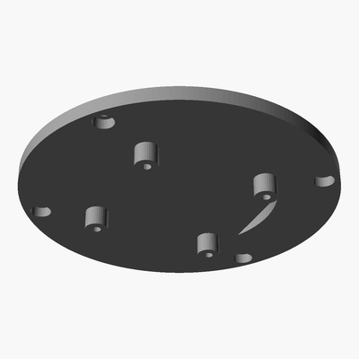 | `back` | PLA or PLA+ | As it comes out, with 4 or more walls so the posts are solid |
| 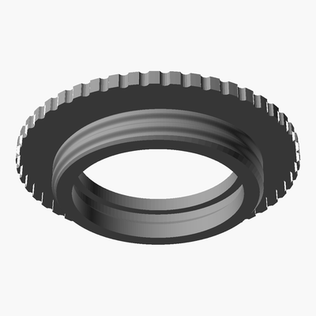 | `collar` | PLA or PLA+ | Grip down, as it comes out |
| 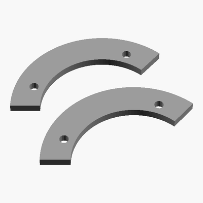 | `washer` | PLA or PLA+ | Two halves, flat |
|  | `gasket` | TPU | Flat.  Or cut it from 1 mm rubber or craft foam |
| 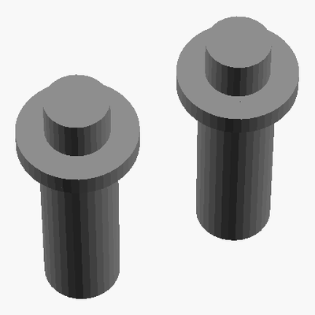 | `plungers` | PLA or PLA+ | Two small pins |
| 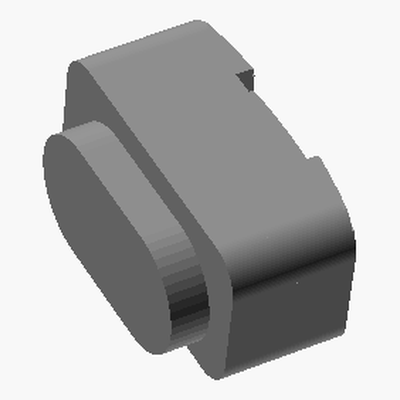 | `usb_plug` (optional) | TPU | A cover for the USB-C port, to keep dust out.  Not needed.  In PLA, loosen it with the second number of `usb_tongue` |

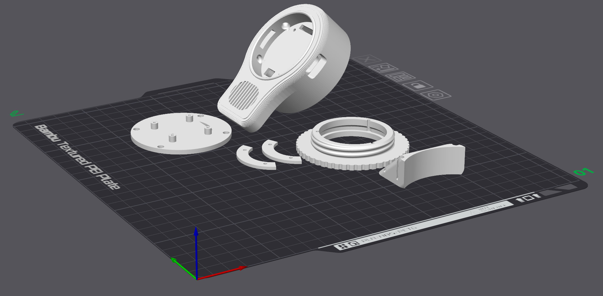

> **Tip:** print the body tilted up at an angle, as in the picture, not flat on its back or its front.  It comes out best that way.  This is the layout Bambu Studio's auto arrange came up with for the parts, so your slicer's arrange or auto-orient button may well do it for you.  The other parts lie flat, as they come out of the zip.

The [design's README](../../hardware/boards/waveshare_esp32s3_touch_amoled_1_75/README.md) explains how the housing works, with every setting worth knowing about.

## 3. Put it together

Here's how the parts go together, front to back: the board drops into the front of the body, the speaker into the pod and the chin behind it, then the battery, the back, the gasket, the collar, and the washer, through the collar's threaded end.

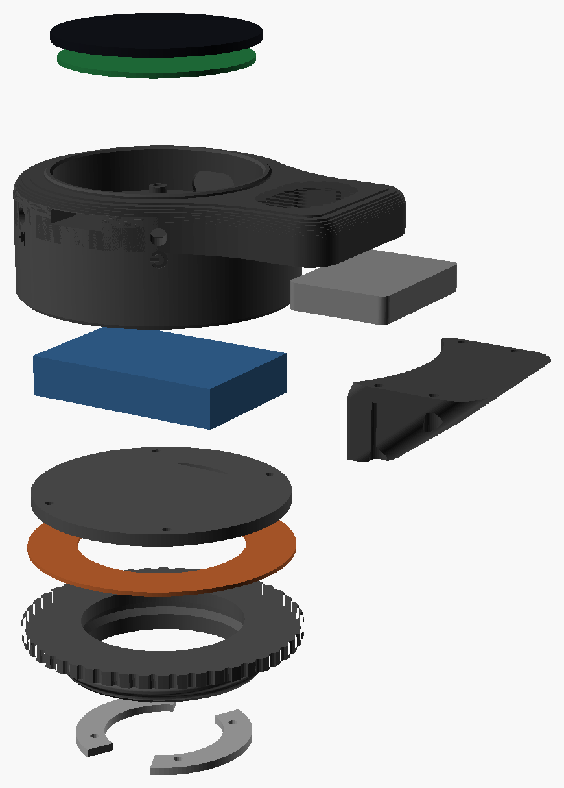

> [!IMPORTANT]
> **Don't skip the plasticine.**  The speaker and the microphones share one small housing, and the plasticine is what keeps the speaker's sound away from the microphones.  Without it, the [voice effects](../features/voice-effects.md) howl with feedback, even at low volume and even with the echo cancelling.  It goes in three places: behind the speaker (step 6), around the speaker's wire where it enters the chamber (step 9), and around the chamber's wall (step 10).  Press it in firmly, with no gaps.

### The board

1. **Seal the microphones.**  Cut two small squares of the soft foam sheet, about 8 mm across, and poke a hole through the middle of each with a toothpick.  Inside the display's pocket, two small round sleeves stand up from the body's floor, on the right towards the USB-C opening: one around each microphone's hole.  Stretch a square over the end of each sleeve, with its hole lined up with the sleeve's hole.  They seal the microphones against the board, so they only hear the voice port.

   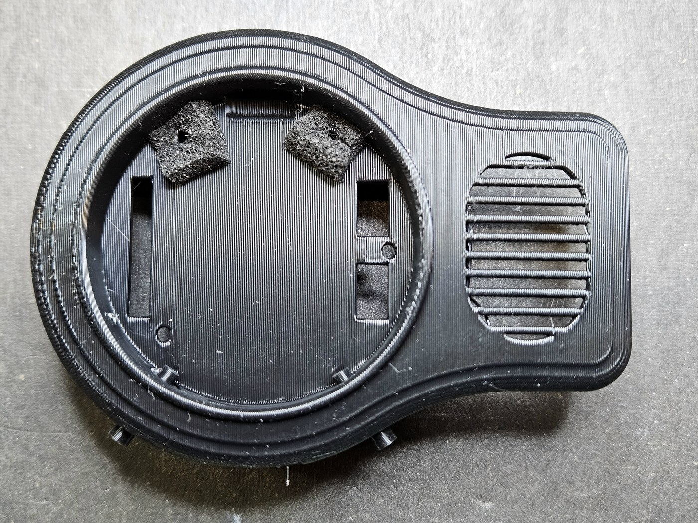

2. **Fit the plungers.**  Push the two plungers into their holes in the side of the body, from inside the display's pocket.  The marks beside them on the outside are a power symbol for `PWR` and an arrow for `BOOT`.
3. **Fit the board.**  Lay it in the pocket, glass forward, with its USB-C port towards the side opening on the right, and screw it to the body's floor from behind, from the chamber side, with the three M2 x 4 countersunk screws.

### The speaker

4. **Feed the speaker's plug through.**  Push the speaker's plug through the opening at the inner end of the speaker's pocket, into the chamber behind the board.

   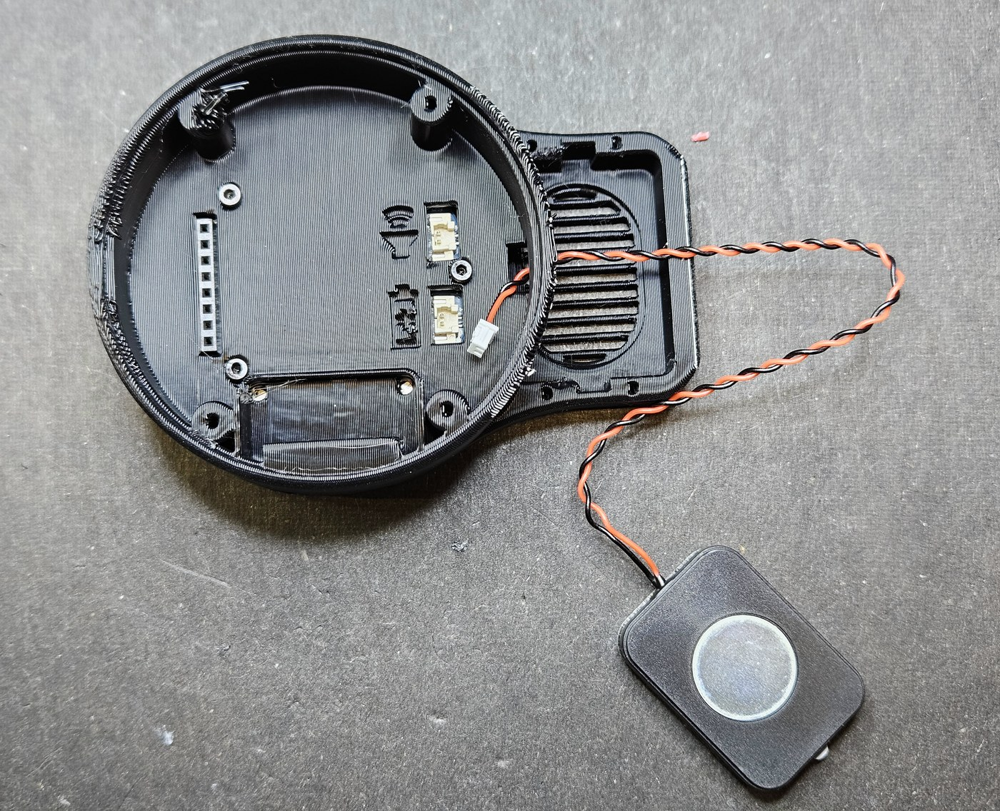

5. **Fit the speaker.**  Peel the backing off the adhesive on the speaker's front face, and stick it into its pocket from the back of the pod, cone facing out through the grille, pressed firmly against the grille all round, with its wire in the notch in the side of the pocket, and run the wire behind the speaker to the opening.
6. **Pad it with plasticine** (don't skip it).  Spread a thin layer of plasticine over the back of the speaker, so it fills the space between the speaker and the chin.

   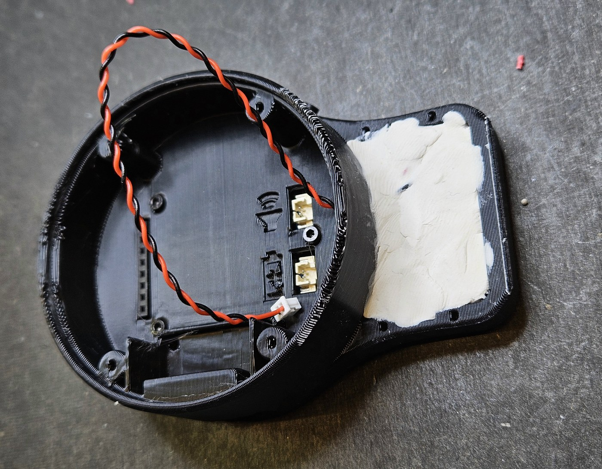

7. **Close the pod.**  Screw the chin on with four M2 x 8 screws, from its sloped underside.

### The chamber

8. **Plug in the speaker.**  Plug it into the board's speaker socket, through the opening in the body's floor marked with a speaker.
9. **Seal the speaker off** (don't skip it).  Press plasticine into the opening between the speaker's pocket and the chamber, all round the wire.  The microphones listen into the chamber, so the less of the speaker that reaches it, the louder the voice effect can go before it feeds back.  Keep plasticine off the board and out of its sockets.
10. **Line the chamber with plasticine** (don't skip it).  Press a thin layer of plasticine onto the inside of the chamber's wall, all the way round, including the outer wall of the microphones' cell, in a band about as deep as the battery.  It deadens the speaker's sound echoing around the chamber, and helps hold the battery.  Keep it thin: too thick, and the battery won't fit.  Keep it off the sockets, the openings in the body's floor and the screw holes.
11. **Fill the microphones' cell.**  The cell is the narrow space on the USB-C side, walled off by the ribs.  Cut a block of the open-cell foam to fit it, roughly 25 x 11 x 15 mm, trimmed to the curve of the wall, and drop it in.  It must sit loosely, not packed in or squashed: the microphones hear you through it, so it has to be open-cell foam, which sound passes through.

   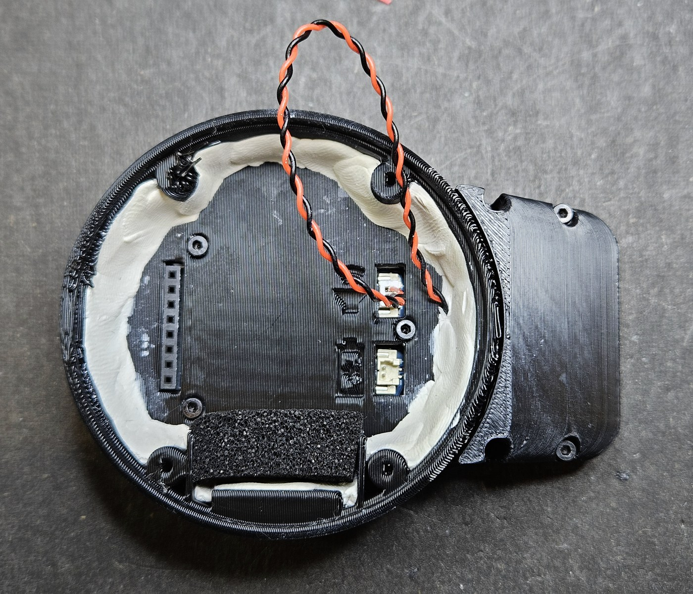

### The back and the collar

12. **Tape the battery to the back.**  Stick a small piece of the double-sided foam tape on one flat face of the battery, and stick the battery to the inside of the back with it, lined up so it'll drop into the chamber inside the ring of plasticine, with its wires towards the battery socket.  The battery goes in with the back, so it's taped on first.
13. **Close the back.**  ⚠️ [Check the battery's polarity first](#1-order-the-parts), and plug it into the socket marked with a battery.  Then lower the back into place, with the battery going in inside the ring of plasticine, its side against the ribs, and the wires tucked in beside it.  Screw the back on with four M2 x 8 screws.  They cut their own thread in the body.
14. **Fit the gasket and collar.**  Put the gasket over the four posts on the back, then the collar, grip first, so its thread points away from the housing.
    > **Photo to come:** the back with the gasket and collar on, the washer halves beside it.

15. **Fit the washer.**  Drop each half of the washer into the collar through its threaded end, line its holes up with two of the posts, and screw it down with two M2 x 6 screws.  Tighten them evenly, and stop when the collar turns firmly but smoothly: the gasket's friction is what keeps the housing from turning by itself once it's in the mask.
16. **Fit the USB plug** (optional).  If you printed it, push it into the port's pocket on the right side.  The notch at its top edge is for a fingernail to pull it out again.

## 4. Into the mask

> **Photo to come:** the finished speaker model screwed into a mask.

Unscrew the mask's original voice port cover.  Hold the housing level, display forward, with the pod at the bottom, and turn the collar's grip to screw it into the port until it's snug.  If the display ends up a little crooked, hold the collar still and turn the housing.

The thread screws into a metal adapter in the mask, which itself screws into the mask.  Hold that adapter still when you unscrew the housing, so it doesn't come out with it.

## Next

[Install the firmware](../building-firmware.md), if you haven't already, then [set it up](first-start.md).
