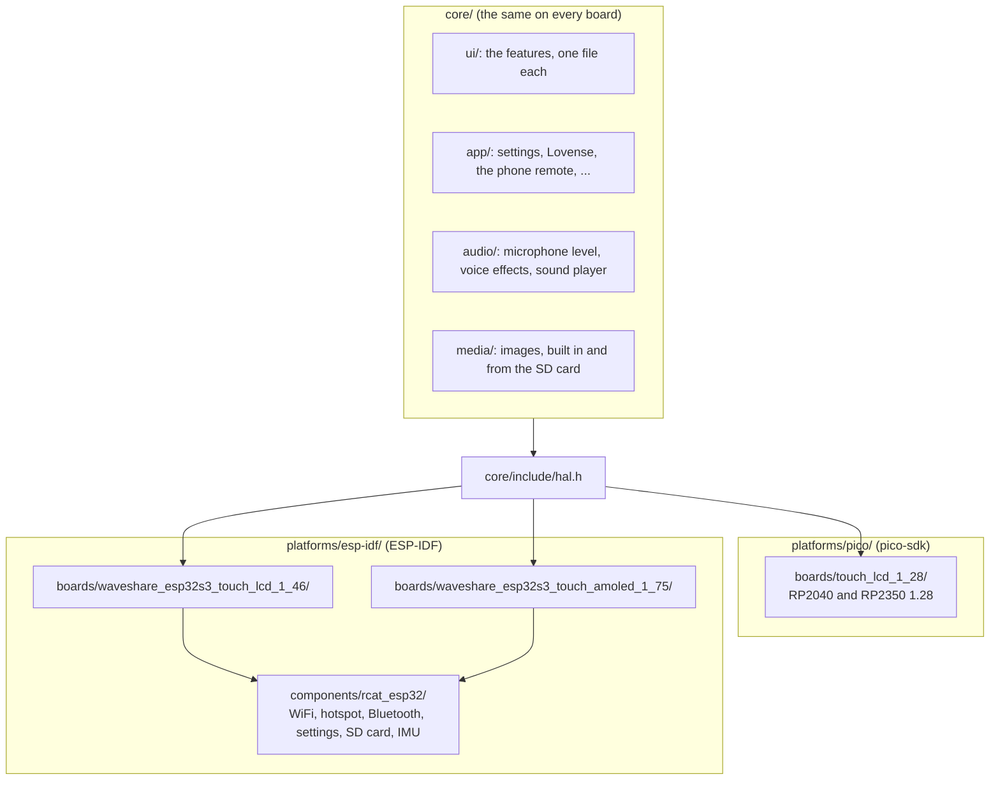

# Developing

This is for working on the firmware itself: how it's put together, and how to add to it.

- [Adding a feature](adding-a-feature.md): a new section of the display, like Images or Level.
- [The hardware abstraction layer](hardware-abstraction.md): how the application reaches the hardware, and how to give it something new.
- [Adding a board](adding-a-board.md): supporting another display, in the firmware and with a housing.
- [Contributing](contributing.md): sending a change as a pull request, and how contributions are licensed.
- [Releases](#releases): how the firmware, the web installer and the printable parts are published.

## How it's put together

The application doesn't know which board it's on.  Everything it does is in `core/`, which is plain C and [LVGL](https://lvgl.io), and it reaches the hardware only through a small set of functions in [`core/include/hal.h`](../../core/include/hal.h): the display, touch, backlight, battery, settings storage, microphone, speaker, SD card, WiFi, Bluetooth and accelerometer.  Each board implements those functions for its own hardware, with its SDK.



A few ideas run through it:

- **A board without some hardware just says so.**  A HAL function the board can't do returns `false` (or does nothing), and the feature that needs it hides itself.  So the same application runs on a board with no microphone or WiFi, without any `#if` for the board.
- **Features are modules.**  Each section of the display is one file, `core/ui/feature_<name>.c`, and can be switched on or off for a build in the platform's `features.cmake`.  Switched off, its file isn't compiled at all.
- **Boards share what they can.**  The ESP32 boards share everything that doesn't depend on the board in one component, so a new ESP32 board only needs its own display, touch, audio and power code.
- **Sizes come from the board.**  Everything on screen is laid out for 240x240 and scaled with `ui_px()`, and the images are converted at build time for the board's screen size, so the same layout and the same image files work on every screen.
- **The hardware follows the same pattern.**  The 3D printable housings are organized by board, and what every housing for a mask shares (its thread, the turning collar, the shape of the mask around the port) is in one place (see [`hardware/`](../../hardware/)).

## Project layout

- `core/` - The application itself.  This code doesn't depend on any particular board.
  - `core/include/hal.h` - The functions each board has to provide.
  - `core/ui/` - The features (`feature_<name>.c`), the navigation between them, and shared UI parts.
  - `core/app/` - Settings, the Lovense devices and patterns, the WiFi hotspot remote and its web page, comms and the talk button, messages for the Terminal.
  - `core/audio/` - The microphone level, voice effects, the Voice Lab stream, and the sound player and its decoders.
  - `core/media/` - The built-in images and the SD card's images.
  - `core/features.cmake` - The list of optional features.  Each platform's `features.cmake` picks which ones to build.
- `platforms/pico/` - Build files for the RP2040 and RP2350 boards.  `boards/*.cmake` lists the supported boards, and `boards/touch_lcd_1_28/` has the HAL and Waveshare's drivers for the 1.28" round display.
- `platforms/esp-idf/` - Build files for the ESP32-S3 boards.  `boards/` has one folder per board, with its HAL, pin assignments, drivers and settings, and `components/rcat_esp32/` has the parts of the HAL that are the same on all of them.
- `hardware/` - The 3D printable housings, PCBs and cases, by board (see [its README](../../hardware/)).
- `third_party/lvgl/` - The [LVGL](https://lvgl.io) graphics library (git submodule).
- `third_party/dr_libs/` - The [dr_libs](https://github.com/mackron/dr_libs) WAV, MP3 and FLAC decoders (git submodule).
- `app/` - The DroneLab phone app, in Flutter: the [comms](../features/comms.md) and the remote, over Bluetooth (see [its README](../../app/README.md)).
- `imgs/` - The built-in images.
- `docs/` - This documentation.
- `tools/` - Scripts, below.

## Tools

- `tools/img2c.py` - Converts an image or GIF into a C file for a screen size.  The build runs it for every image in `imgs/`.
- `tools/prepare_sd.py` - Resizes and re-encodes images for an SD card (see [Images on the SD card](../features/images.md#images-on-the-sd-card)).
- `tools/voice_monitor.py` - Plays and records the microphone stream from the [Voice Lab](../features/voice-lab.md), with voice effects.
- `tools/gen_remote_page.py` - Turns `core/app/remote_page.html`, the [WiFi Hotspot Remote](../features/phone-remote.md)'s page, into the C file that's built in, and copies it into the app.  Run it after changing the page.
- `tools/ble_record.py` - Records the board's voice effect on a computer over Bluetooth, as the app's Record tab does, or plays it to a sound device (a video call's microphone, through a virtual audio cable), with no hotspot to join (see [Recording over Bluetooth](../features/voice-lab.md#recording-over-bluetooth)).
- `tools/ble_pair.py` - Pairs a Linux computer with a board over Bluetooth, asking for the code the board shows, for `ble_record.py` and `comm_bridge.py`.
- `tools/comm_bridge.py` - Stands in for the phone app on a computer, for trying the [comms](../features/comms.md): plays or saves what the board sends, or passes it on to a Mumble server.
- `tools/mumble/` - Runs comms' [Mumble](https://www.mumble.info) server with Docker.
- `tools/gen_terminal_font.py` - Makes the [Terminal](../features/terminal.md)'s font, `core/ui/terminal_font.c`.
- `tools/gen_lv_conf.py` - Generates the platforms' `lv_conf.h` files (LVGL's settings) from LVGL's template.  Run it after updating the LVGL submodule.
- `tools/doc_renders/render.sh` - Renders the pictures of the housings, their parts and the travel cases in `docs/images/`.  Run it after changing a housing's or a case's design.
- `tools/gen_logo.py` - Draws the DroneLab logo shown at startup, `core/ui/assets/dronelab_logo.png`, and prints where its blinking cursor goes (`SPLASH_CURSOR` in `core/app/app.c`).  It needs two free fonts from Google Fonts, listed at its top.
- `tools/gen_app_icon.py` - Draws the app's icon from the logo, for Android and the iPhone.  It needs the same fonts.
- `tools/doc_renders/gen_doc_logos.py` - Draws the documentation's logos in `docs/images/`: the DroneLab banner, and KatCorp's logo and mark, from the cat in `imgs/RCatLogo.bmp`.  It needs the same fonts.
- `tools/doc_renders/make_diagram.py` - Draws the README's How it works diagram (`docs/images/how_it_works.jpg`) from `tools/doc_renders/diagram/`, with the unit rendered from its design and screenshots on its display, and the Features page's tiles for the features with no screen of their own.  It needs OpenSCAD, Google Chrome and the same fonts.  Run it after retaking the screenshots or changing the speaker housing.
- `tools/screenshots.py` - Takes screenshots over USB, and the documentation's set in `docs/images/screens/` (see [Screenshots](#screenshots)).
- `tools/release/build_firmware.sh` - Builds a release's firmware and the web installer (see [Releases](#releases)).
- `tools/release/build_models.sh` - Renders a release's printable parts, one zip per model (see [Releases](#releases)).

## Screenshots

On the board, holding `PWR` and pressing `BOOT` saves a screenshot to the SD card ([`core/app/screenshot.c`](../../core/app/screenshot.c)).  It has LVGL draw the whole screen again and copies each part as it's flushed (`LV_EVENT_FLUSH_START`), so the picture is exactly what's on the display, overlays and Rotation included, on any board.  The HAL reports the buttons with `rcat_hal_screenshot_pressed()`; the 1.75" board tells the shared ESP32 code how to read `PWR` with `rcat_esp32_set_power_key()`, and doesn't turn off while `PWR` is held for one.

For the documentation, `tools/screenshots.py` takes them over USB instead, with no SD card or buttons.  It needs firmware built with the development console ([`core/app/console.h`](../../core/app/console.h)), which takes the [remote's API](../../core/app/remote.h) requests and screenshot commands on the USB serial port:

```
idf.py -C platforms/esp-idf -B build-s3-175-console -DBOARD=waveshare_esp32s3_touch_amoled_1_75 -DRCAT_SERIAL_CONSOLE=1 build flash
python3 tools/screenshots.py shot out.png                 # what's on screen now
python3 tools/screenshots.py show Visualizer 0 vis.png    # a feature's page
python3 tools/screenshots.py docs                         # the documentation's set
```

`docs` plays a track on the speaker for the visualizers (one with "Roboto" in its name, if the card has it), uses a connected Lovense device if there is one, and puts the settings it changed back afterwards.  The Level wants the board standing upright.  The console isn't in release builds: it takes internal RAM, which the SD card and the radio need.

## Releases

A release is published on GitHub, with a tag like `v0.9.2`.  The app's APKs are built and attached by hand (see [`app/README.md`](../../app/README.md)).  The firmware is built by the [Firmware workflow](../../.github/workflows/firmware.yml) when the release is published: it runs `tools/release/build_firmware.sh` in Espressif's ESP-IDF container, attaches `DroneLab-firmware-1.75.bin` to the release, and puts the web installer on the project's GitHub Pages site, <https://rcat3.github.io/DroneLab/>.  The workflow can also be run by hand from the Actions tab, to update the installer without a release.

The web installer is [ESP Web Tools](https://esphome.github.io/esp-web-tools/), with the page in [`tools/release/flasher/`](../../tools/release/flasher/) and a manifest the script writes.  It writes the bootloader, partition table, firmware and OTA data at their own addresses, from the build's `flash_args`, and leaves the rest of the flash alone, so an update keeps the settings.  The one-file image skips the OTA data, which would pad it out to 14 MB, and is for writing to an erased board.

The printable parts are rendered by the [Models workflow](../../.github/workflows/models.yml), also when the release is published: it runs `tools/release/build_models.sh` with Ubuntu's OpenSCAD, and attaches `DroneLab-speaker-model-stl.zip` and `DroneLab-low-profile-model-stl.zip`.  Each has the housing's parts with the designs' default settings, its travel case in `travel_case/`, the test prints in `tests/`, and a `README.txt` with the materials and license.  It takes about 10 minutes.  Run by hand from the Actions tab, it leaves the zips as the run's artifact, or attaches them to the release whose tag you give it, to add them to an older release.  The docs link to the zips by name through `releases/latest/download/`, so keep the names.

To try the installer locally, run `tools/release/build_firmware.sh` and serve `dist/flasher` over `http://localhost` (`python3 -m http.server -d dist/flasher`), which browsers allow to reach USB like https.

## Threads

The UI runs on a single loop, which just runs LVGL's timers (see `app_run()` in [`core/app/app.c`](../../core/app/app.c)).  Anything a feature does regularly, like drawing the Visualizer's frames or polling the Lovense devices, is an LVGL timer (`lv_timer_create()`), so it runs on that loop and can use LVGL freely.  The microphone and speaker callbacks run on the board's audio tasks, and Bluetooth on its own task, so they mustn't call LVGL.  They leave their results where the UI's timers pick them up.

## Crashes and hangs

On the ESP32-S3 boards, the task watchdog watches each core's idle task, and on the 1.75" board the audio task as well.  If one of them goes 5 seconds without checking in, the board restarts rather than carrying on half stuck.  An idle task misses its check-in when something on its core keeps the core busy, like a loop that never ends.  The audio task misses its check-in when it stops for any reason, whether it's busy or blocked: the sound stops and the Visualizer freezes, but the display still works.

Before restarting, after a crash as well as a watchdog restart, the board:

- prints what went wrong and a backtrace to the USB serial port, which only helps if `idf.py monitor` is running at the time
- saves a core dump, the state and stack of every task, to the `coredump` partition (128 KB, at `0xe13000`, after the battery log)

When it starts up again, the log says why it restarted (task watchdog, interrupt watchdog, crash or brownout) and whether there's a core dump (see `report_last_reset()` in [`platforms/esp-idf/main/main.c`](../../platforms/esp-idf/main/main.c)).  To read the core dump, connect the board over USB and run:

```
idf.py -C platforms/esp-idf -B build-s3-175 -p /dev/ttyACM0 coredump-info
```

Use the build folder of the firmware that's on the board, so the addresses match its code.  It prints why the board stopped, the backtrace of the task that was running, and every other task's state and backtrace.  For a watchdog restart, look for the task that was meant to check in, such as `audio`, and where it was stuck.

Things to know:

- **Only the latest one is kept.**  Each core dump erases the partition and replaces the last one.  It can't spill past the end: one too big for the partition isn't saved.  A core dump stays until the next crash replaces it.
- **The partition is only made when flashing over USB.**  An update over WiFi doesn't change the partition table, so a board that has only ever had updates over WiFi since this was added has no `coredump` partition.  It still restarts, without the core dump.
- **A new task that runs all the time should be watched too.**  Call `esp_task_wdt_add(NULL)` when it starts and `esp_task_wdt_reset()` each time round its loop, as `audio_task()` in the 1.75" board's `hal_board.c` does.  And don't keep a core busy for seconds at a time without blocking, or its idle task misses its check-in and the board restarts.
- **The settings are in [`platforms/esp-idf/sdkconfig.defaults`](../../platforms/esp-idf/sdkconfig.defaults)** (`CONFIG_ESP_TASK_WDT_PANIC` and `CONFIG_ESP_COREDUMP_*`).  An existing build folder keeps its old configuration, so build in a new one after changing them.
- **The RP2040 and RP2350 boards don't have any of this.**

## Checking a change

Build every platform the change touches, as described in [Installing the Firmware](../building-firmware.md).  A change to `core/` or `hal.h` touches all of them: the RP2040, the RP2350 and both ESP32-S3 boards.  Every build should finish without warnings.  It's also worth building once with the new feature switched off.
