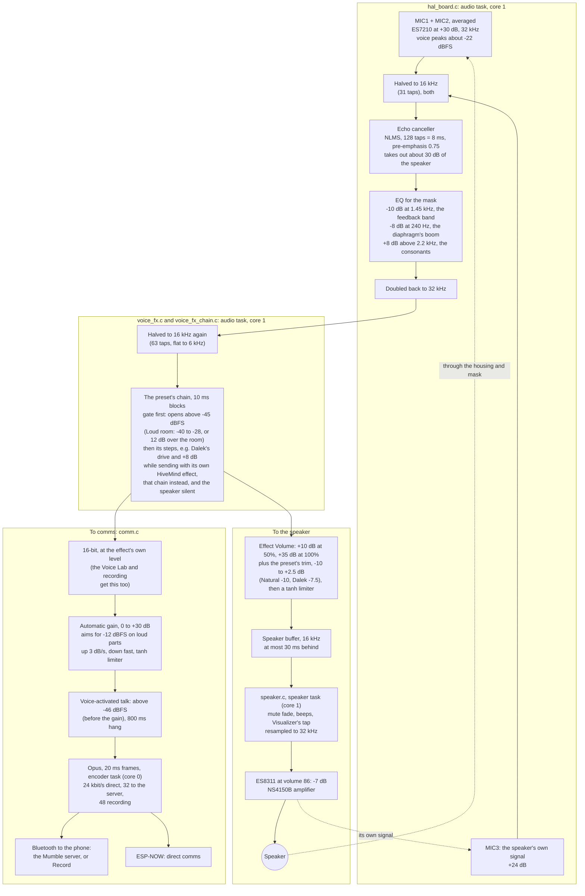

# Voice effects and the processor

*The ESP32-S3-Touch-AMOLED-1.75*

The voice effects run in real time on one core of an ESP32-S3, beside the echo canceller and the speaker, and they're very sensitive to how busy that core is.  When the audio task can't finish each block in time, the effect comes out garbled or as noise.  That can sound a lot like feedback, but it isn't.  This page is what's been learned getting them to keep up.  The effects themselves are in [`core/audio/voice_fx_chain.c`](../../core/audio/voice_fx_chain.c), the microphone and speaker side in [`core/audio/voice_fx.c`](../../core/audio/voice_fx.c), and the echo canceller in the board's [`hal_board.c`](../../platforms/esp-idf/boards/waveshare_esp32s3_touch_amoled_1_75/hal_board.c).

## Where it runs

- **Core 1** has the `audio` task (priority 5: the microphones, the echo canceller, the voice effect) and the `speaker` task (priority 6).  The microphones deliver a block every 5 ms.
- **Core 0** has LVGL (the UI loop), Bluetooth and WiFi.
- The two cores share the **caches**: 16 KB for code and 64 KB for data.  Anything run from flash, or kept in PSRAM, is read through them.  So the cores are independent for computing but not for memory: a busy display on core 0 slows the audio on core 1.

## The voice's path

From the microphones to the speaker, and to comms, with the gains and levels on the way.  Levels are dBFS (decibels below full scale): worn, a voice peaks around -22 dBFS in the microphones and speech is mostly -17 to -31.  The dotted lines are what the echo canceller hears: the speaker's own signal, wired back into the microphone chip, and the speaker's sound coming back through the housing and the mask.

Things it shows:

- **The loop.**  Whatever the effect plays comes back into the microphones.  The echo canceller takes most of it out, but what's left goes round again, gained up by the Effect Volume and the preset.  If the loop's gain gets past 1 anywhere, it feeds back.  That's why each preset has a trim, and why a preset with a lot of gain of its own, like Dalek, needs a big cut.
- **Comms don't depend on the Effect Volume.**  The speaker's gain is added after the chain, on its way to the speaker only.  Comms get the effect at the microphones' level and bring it up with their own automatic gain.
- **The speaker's level is set in two places**: the ES8311's volume, fixed in the firmware, and the Effect Volume.  Changing the first changes every preset's loop gain at once.
- **The chain sees only what's left after the echo canceller.**  The gate measures that, so echo the canceller misses can hold the gate open.

## Feedback or overload

Before tuning anything, find out which it is:

- **Record the effect with the speaker on** (the app's Record tab, or `tools/ble_record.py`).  Feedback is in the recording, and so is overload.  Then record with the speaker off.  If that recording is clean, the cause is the speaker: feedback, or the CPU the speaker path adds.
- **Turn the Effect Volume down.**  Feedback goes away.  Overload doesn't.
- **Change what's on the screen.**  If it gets worse with the [Voice Ring](../features/voice-ring.md) or the [Sound Visualizer](../features/visualizer.md) up, it's overload.

## Measuring

- `VOICE_FX_DEBUG 1` in `voice_fx.c` prints, every 5 seconds, how much of a core the preset takes and the longest gap between the microphone's blocks.
- `AUDIO_DEBUG 1` in `hal_board.c` prints every second the levels, the echo canceller's pickup and what's left after it, and how busy the whole audio task is.  The pickup figures are only meaningful while the speaker plays something you're not saying, such as a sound file (`POST /api/sound`).  While you talk, your own voice is mixed into them.
- Both time with `clock()`, which on the ESP32 is time that passes, not time spent on the CPU: time the higher priority speaker task takes on the same core counts too.  That's what matters here.
- Watch the **whole audio task** figure while you talk, with the busiest screen up.  An average of 90% or more means its busiest moments go over 100%, and you'll hear it.  It should have about a third of a core to spare.
- Leave them at 0 in commits.

Measured in November 2026, worn, with comms on:

| | Effect alone, silent | Whole audio task, talking |
|---|---|---|
| Synthetic, code in flash, screen busy | about 50% | 96%: garbled |
| Synthetic, code in internal RAM, Visualizer up | 25% | 59-67% |
| AI, code in flash | 48-55% | 85-97% |
| AI, code in internal RAM | 25% | |

## Lessons

- **Keep the per-sample code out of flash.**  From flash, the effects' code shares the 16 KB code cache with everything core 0 runs, and the display's drawing kept pushing it out.  The heavier presets then took twice as long, and went over the edge whenever the Voice Ring or a Visualizer was drawing.  [`audio_iram.lf`](../../platforms/esp-idf/boards/waveshare_esp32s3_touch_amoled_1_75/audio_iram.lf), a linker fragment, puts the effects, the audio and speaker tasks and the maths functions they call (`tanhf`, `sinf`, `powf` and so on) in internal RAM, about 25 KB.  **Any new code the audio runs for each sample or block goes in it too.**  Check where it ended up with `xtensa-esp32s3-elf-nm build-s3-175-ptt/dronelab.elf | grep <name>`: `403...` is internal RAM, `42...` is flash.
- **No `double` in per-sample loops.**  The ESP32-S3's floating point unit is single precision, so doubles are done in software.  An early pitch shifter with double sample positions took 97% of a core.  A computer runs them at full speed, so a host test won't show it.  Use `float` and integers.
- **Two effect chains at once is too many.**  When comms have their own effect, only one chain runs at a time, and the speaker goes quiet while sending (`voice_fx_set_comm_sending`).  Two of the heavier presets together overran the core and the watchdog restarted the board.
- **Internal RAM is the limit, not CPU alone.**  With Bluetooth and direct comms on, the board has about 27 KB of internal RAM free.  Bluetooth takes about 34 KB of it, and WiFi with ESP-NOW about 35 KB more.  The room for the code above came from the display: it used to draw a turned picture into a third 30 KB buffer, and now turns it over in place, so Rotation is only 0 or 180 degrees on this board (`RCAT_HALF_TURNS_ONLY`).  Big buffers in `core/` go in PSRAM (`lv_malloc`), not in static variables.
- **Gentler drawing doesn't fix it.**  Making the Voice Ring redraw less often made no difference that could be measured or heard.  Moving the code into internal RAM did.
- **Louder speakers need the presets' trims rechecked.**  Each preset's `speaker_db` is set so that they all feed back at about the same Effect Volume.  When the speaker went up 3 dB, Dalek, the loudest after its drive and gain, fed itself through the gate, as a hiss that carried on after the voice stopped.  Its trim came down 10 dB.  After any change to the speaker's level, try every preset at 100% and listen after you stop talking.
- **A gate held open by its own output sounds like noise, not a howl**, on the ring modulated presets.  That's feedback too.

## Trying an effect on a computer first

`tools/voice_monitor.py` runs the same presets on a computer, and the app runs the board's own C code (`app/native/voice_fx_app.c`) for the phone's microphone, which is handy for tuning how they sound.  Neither says anything about speed on the board: check every new or changed effect on the board, with `VOICE_FX_DEBUG`, the busiest screen up and comms on, before calling it done.
