# Features

Everything a DroneLab unit can do, in one place.  On the display, the features are stacked one above the other: swipe up and down to move between them, and left and right between each feature's pages (see [Using the Display](../using-the-display.md)).  Most of them can also be run from a phone, with the [DroneLab app](../app/installing.md) or the [WiFi Hotspot Remote](phone-remote.md), so nobody has to reach the display in the mask.

Every feature runs on the [ESP32-S3-Touch-AMOLED-1.75](../hardware/waveshare_esp32s3_touch_amoled_1_75.md).  The [low-profile model](../build/low-profile-housing.md) has no speaker, so the ones marked *speaker model* need the [speaker model](../build/speaker-housing.md).

## Voice

<table>
<tr>
<td width="190" align="center"><a href="voice-effects.md">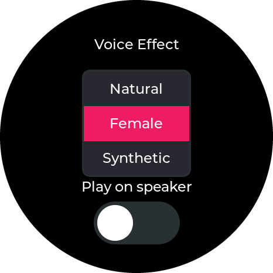</a> <a href="voice-effects.md">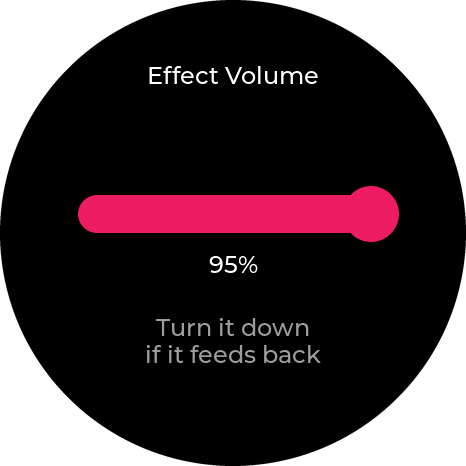</a></td>
<td>
<h3>Voice Changing Effects</h3>

<i>Speaker model</i>

A new voice, made on the unit as you speak and played out of the speaker below the display.  Ten presets: <i>Natural</i>, a clean voice amplifier with the mask's boom and hiss taken out; <i>Female</i>; <i>Synthetic</i>; the monotone <i>Android</i> and <i>Robot</i>; <i>AI</i>; <i>Deep</i>; a ring-modulated <i>Dalek</i> and <i>Drone</i>; and <i>Borg</i>, your voice as a collective speaking in unison.

The unit hears its own speaker and cancels it out of its microphones, so every preset goes to full volume without feedback.  The hive can hear you through a different effect from the one played out loud.

<a href="voice-effects.md">Voice Effects →</a>

</td>
</tr>
<tr>
<td width="190" align="center"><a href="sound.md">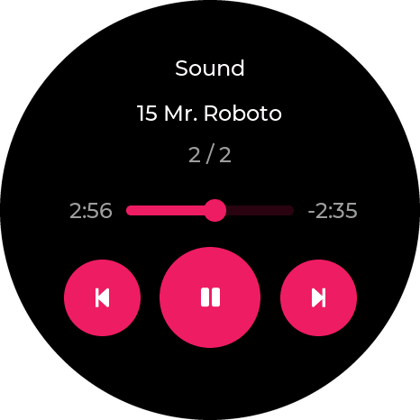</a></td>
<td>
<h3>Sound</h3>

<i>Speaker model</i>

A music and sound effect player.  It plays WAV, MP3 and FLAC files from the micro SD card through the speaker, and keeps playing while you look at other features.  It repeats everything or one track, or plays once, and it can start playing as soon as the unit turns on.  The Visualizer dances to it.

<a href="sound.md">Sound →</a>

</td>
</tr>
<tr>
<td width="190" align="center"><a href="voice-lab.md">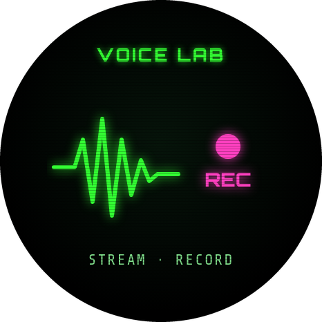</a></td>
<td>
<h3>Voice Lab</h3>

Records the voice effect for videos, straight to the phone from the app's <i>Record</i> tab, or to a computer over Bluetooth, with a sync beep to line it up with the camera.  It also feeds the effect to a video call or streaming software as a microphone.  For tinkerers, it streams the raw microphone over WiFi to a computer, to try out new effects in the mask before they're built into the firmware.

<a href="voice-lab.md">Voice Lab →</a>

</td>
</tr>
</table>

## The hive

<table>
<tr>
<td width="190" align="center"><a href="comms.md">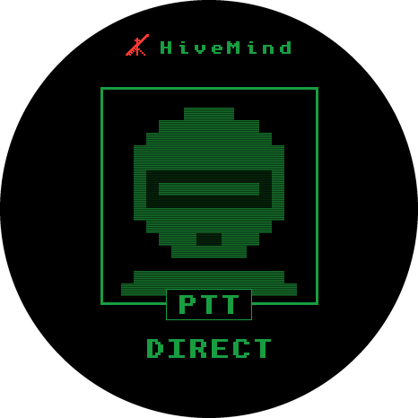</a> <a href="comms.md">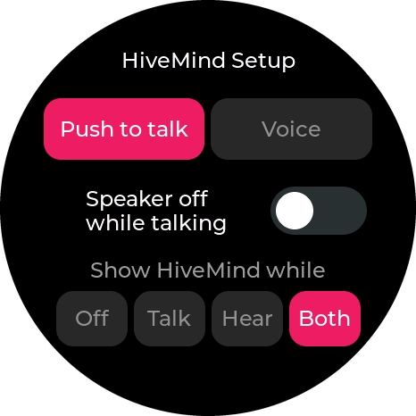</a></td>
<td>
<h3>HiveMind (Comms)</h3>

Link every drone in the hive into one mind.  Push to talk, or just speak, and your voice, through the effect of your choice, goes into every other drone's headphones.  The display shows who's transmitting, with their avatar.  Messages for the Terminal and commands for Lovense toys travel the same link, if the drone receiving them has allowed it.  A cheap Bluetooth camera remote makes a talk button.

<ul>
<li><b>Cloud mode:</b> through the wearer's phone to the hive's <a href="https://www.mumble.info">Mumble</a> server, so distance doesn't matter, and people without a mask join from any Mumble app.</li>
<li><b>Direct mode</b> <i>(in development)</i>: unit to unit over the radio, with no server, internet or phone signal.  Encrypted channels, Long Range, and relaying through the drones in between.</li>
</ul>

<a href="comms.md">HiveMind (Comms) →</a>

</td>
</tr>
</table>

## On the display

<table>
<tr>
<td width="190" align="center"></td>
<td>
<h3>Images</h3>

Any picture or animated GIF, round and glowing on the AMOLED, where black is truly off.  A few are built in, and your own go on a micro SD card: PNG, BMP, JPG or GIF.  Swipe through them, and pick one to show whenever the unit turns on.

<a href="images.md">Images →</a>

</td>
</tr>
<tr>
<td width="190" align="center"><a href="voice-ring.md">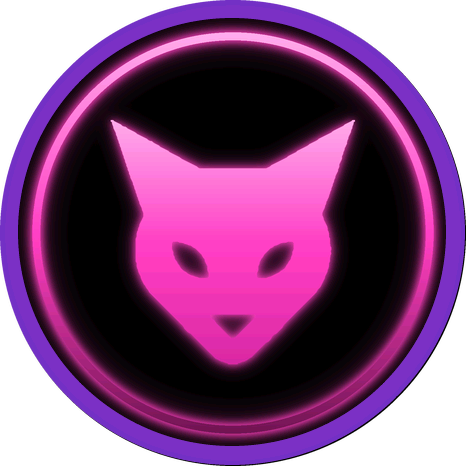</a></td>
<td>
<h3>Voice Ring</h3>

A ring of light around the edge of the image that glows and pulses as the wearer speaks, so everyone can see which drone is talking.  Nine colors.

<a href="voice-ring.md">Voice Ring →</a>

</td>
</tr>
<tr>
<td width="190" align="center"><a href="visualizer.md">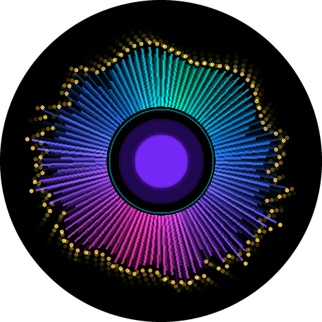</a></td>
<td>
<h3>Visualizer</h3>

Seven animated pictures of the wearer's voice, and of whatever the speaker is playing: KITT's voice box, a 3D spectrum terrain, an oscilloscope, a spinning halo, an aurora, orbits and ripples.  Tap to move on to the next.

<a href="visualizer.md">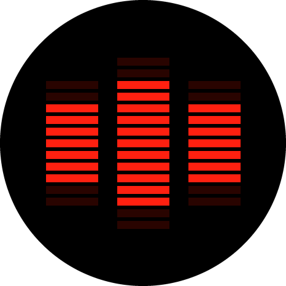</a> <a href="visualizer.md">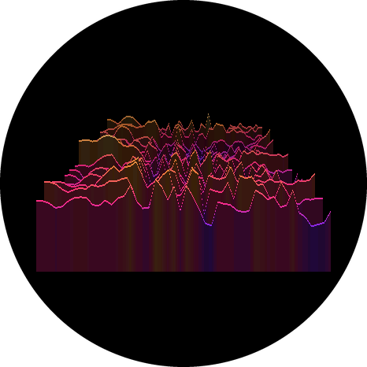</a>  <a href="visualizer.md">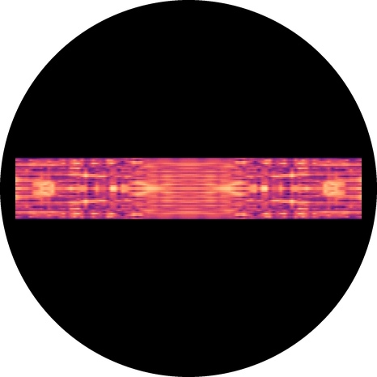</a> <a href="visualizer.md">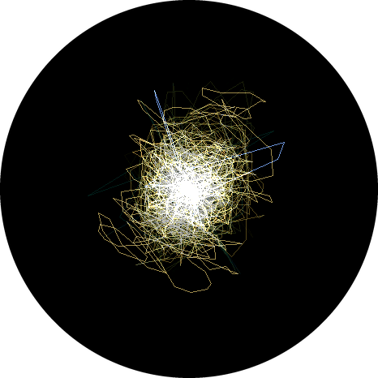</a> <a href="visualizer.md">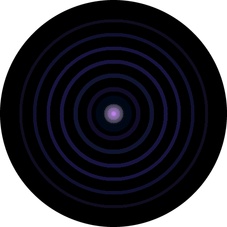</a>

<a href="visualizer.md">Visualizer →</a>

</td>
</tr>
<tr>
<td width="190" align="center"><a href="terminal.md">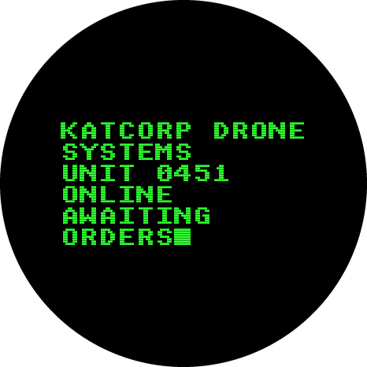</a></td>
<td>
<h3>Terminal</h3>

An old green-screen terminal: text typed on a phone appears on the display in blocky green letters, typing itself out behind a blinking cursor, with faint scan lines.  Authorized handlers can send it messages from their own phones, over HiveMind.

<a href="terminal.md">Terminal →</a>

</td>
</tr>
</table>

## Control

<table>
<tr>
<td width="190" align="center"><a href="lovense.md">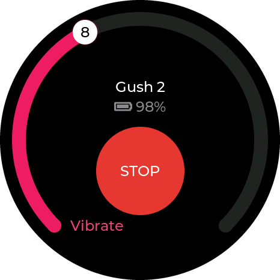</a> <a href="lovense.md">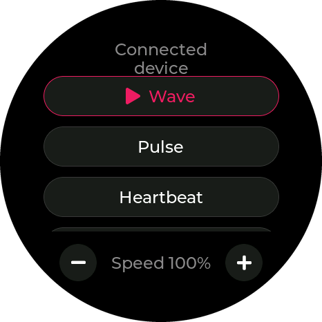</a> <a href="lovense.md">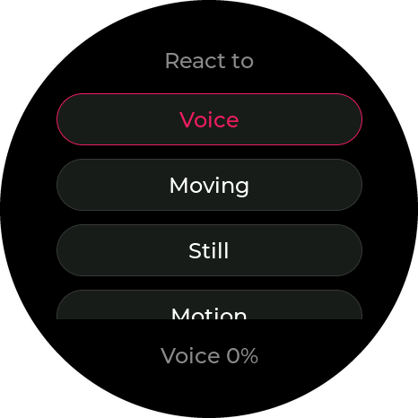</a></td>
<td>
<h3>Lovense toy control</h3>

Runs up to three Lovense devices at once over Bluetooth, with no Lovense app.  Set a level for each kind of motor, play patterns (built in, or your own from the SD card), or let the toys react to the wearer's voice, movement or stillness.  Others in the hive can send commands from their phones, but only once the wearer has authorized them.

<a href="lovense.md">Lovense →</a>

</td>
</tr>
<tr>
<td width="190" align="center"><a href="phone-remote.md">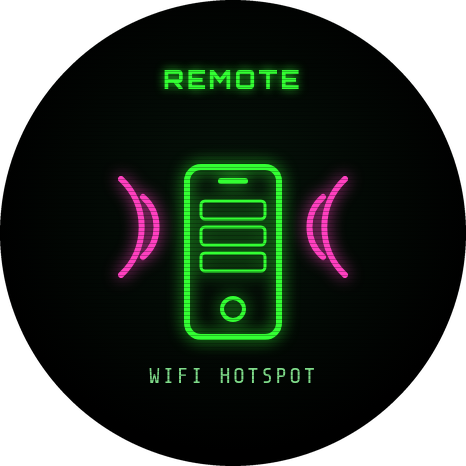</a></td>
<td>
<h3>Remote control</h3>

Run the whole unit from a phone, without seeing the display: what it shows, its brightness and settings, the Lovense toys, the voice ring, the voice effect, the sound player and the Terminal.  The <a href="../app/installing.md">DroneLab app</a> for Android does it over Bluetooth, and keeps the phone on the internet.  Phones without the app, iPhones included, join the unit's own WiFi hotspot and use a web browser.

<a href="phone-remote.md">WiFi Hotspot Remote →</a> · <a href="../app/remote.md">The app's Remote →</a>

</td>
</tr>
</table>

## Setup

<table>
<tr>
<td width="190" align="center"><a href="settings.md">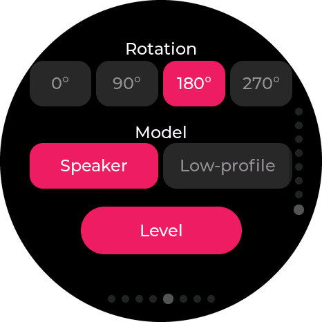</a> <a href="level.md">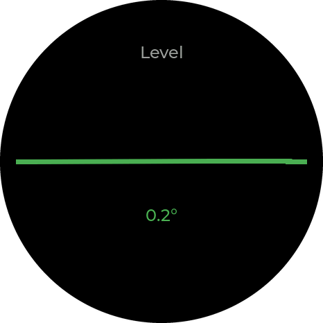</a></td>
<td>
<h3>Settings</h3>

Everything that applies to the whole unit: brightness, pairing with the phone app, the WiFi hotspot, the display's rotation and the unit's model, and what's shown at startup.  A built-in spirit level lines the display up in the mask, and turns green when it's level.  The battery's level and a log of its charge are here too.

<a href="settings.md">Settings →</a> · <a href="level.md">Level →</a>

</td>
</tr>
</table>

Each feature can be left out of the firmware when building it yourself (see [Choosing features](../building-firmware.md#choosing-features)), and a feature that needs hardware the board doesn't have hides itself.
