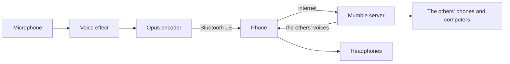

# Comm

*The ESP32-S3-Touch-AMOLED-1.75, with the DroneLab app on an Android phone.  New: it works end to end, and is still being tried out.*

The comm channel lets a group talk to each other, like a radio.  The board sends the wearer's voice, through the [voice effect](voice-effects.md), to their phone over Bluetooth, and the phone passes it on to a [Mumble](https://www.mumble.info) server on the internet that everyone's on.  What the others say comes back through the phone, to the wearer's headphones.  People without a display join from a Mumble app: [Mumla](https://mumla-app.gitlab.io/) on Android, or Mumble on a computer.

The board only sends while the wearer talks: in *Push to talk*, while the talk button is held, and in *Voice*, whenever it hears them speak.



## On the display

Switch on the *Phone App* page in [Settings](settings.md), after Brightness.  The board starts advertising over Bluetooth for the app to connect, under the board's name (`DroneLab-` and four letters, the same as its WiFi hotspot's), shown at the bottom of the page, with the app's version once it's connected.  It stays on, or off, from one startup to the next.  The voice effect has to run the whole time it's on, so it uses more battery than with the voice effect off.

Everything else is in the *Comm* feature, swiping up and down, after Sound.  It's left out on boards without the comm channel.

### The status screen

The first page shows how the channel's doing at a glance, as a green screen like the [Terminal](terminal.md)'s:

- At the top, *Comms* and an antenna: red and struck through with no uplink (the phone running the app), yellow without its waves while the app's connected but the server isn't, and green with its waves once everything's connected.
- In the middle, an avatar in a frame, with a tag on its bottom edge:
  - **RX**: whoever's talking, their avatar in full color and the frame lit up, with their name underneath, and "+1" and so on for others talking at once.
  - **TX**: your own avatar, in full color, the frame white-hot, and a ring round the edge of the screen.
  - *PTT* or *VOX*, the mode, while it's quiet: your avatar, dim and green, with how things are underneath: how many others are online, or what's missing.

Holding the avatar talks, for trying it out with the display in hand.  It waits a moment before it starts, so a swipe across it doesn't, and once it's talking the page holds still until you let go.  In the mask, the app, the headphones' button or the talk button does the talking.

The status screen can be picked to show when the display turns on, in [Settings](settings.md#startup).

### Avatars

Each person's avatar is their [Mumble](https://www.mumble.info) avatar, so desktop Mumble shows the same pictures, and anyone who's set one in Mumble shows up with it on the boards.  Set yours in the app, under the server settings: *Choose a picture* cuts it square from the middle, and the app gives it to the server each time it connects.  Anyone without one shows as a head in a visor.

The app fetches everyone's from the server, shrinks them to the board's size, and sends them to the board in the background, yours and whoever's talking first, about a second each.  The board keeps 16, until the app's link drops.

### Comm Setup

- *Push to talk* or *Voice*: the board only sends while the wearer talks.  In *Push to talk*, while the talk button (or the app's, or the core) is held, and in *Voice*, whenever it hears them speak.
- *Speaker off while talking*: the speaker goes quiet while the board's sending, voice effect and sound files alike, so those nearby don't hear what goes to the group.
- *Show Comm while*: *Talk*, *Hear* or *Both* comes to the status screen by itself while the board's sending, while someone else is talking, or both, and goes back to the page you were on two seconds after it stops.  If you swipe somewhere else in the meantime, it stays where you went.  It waits while you're touching the screen.

### Comm Voice

The voice effect for what the others hear: *Same as speaker*, or any of the [voice effects](voice-effects.md), so you can sound natural on the channel and like a robot out loud, or the other way round.  With two different effects the voice runs through both, which takes more of the board's processor: the heaviest two together take about 70% of one of its cores.

### The talk button

A Bluetooth camera shutter remote can be the talk button: hold it to talk, in either mode.  It has to be a Bluetooth LE one, which shows up as a keyboard (the ATUMTEK one does); the cheapest ones are often older Bluetooth only, which the board can't use.

1. On the *Talk Button* page, after *Comm Setup*, tap *Pair a button*.
2. Put the remote in pairing mode: switch it on, or hold its button until it blinks.  The board pairs with the nearest one it finds, and shows its name.

The board remembers it.  The remote goes to sleep after a minute or so; pressing it wakes it, the board connects again, and that press counts, a moment late.  It's only used while the Phone App is on.  *Forget it* unpairs it.  A remote usually remembers only the last thing it paired with, so pairing it with the board unpairs it from a computer or phone it was used with.

## The app

The DroneLab app, in [`app/`](../../app/), is the phone's side, for Android for now.  The Comm tab shows the board, the server and direct comms, one line each, with the talk button, the channel's people and the boards nearby; what's set once is in *Comm Settings*, behind the gear.  Set up the server there (its address, your name, the server password and your avatar), connect to it, then *Find* the board and pick yours.  The app passes the board's voice on to the server and plays the others to your headphones, and tells the board who's talking, for its status screen.  It has its own *Hold to talk*, and the board's settings can be changed in *Comm Settings* too: the mode, the [Comm Voice](#comm-voice), *Speaker off while talking*, when to show the Comm screen, and [direct comms](direct.md) and its group.

The server can have channels, so that several groups can share it: only those in the same channel hear each other.  *Change*, by the channel's name in the app, moves you to another, and the app goes back to it each time it connects.  Channels are made on the server, from Mumble on a computer, logged in as its SuperUser, or as someone it lets make them.

Each person on the channel has a speaker button in the app, which mutes them for you alone: the app doesn't play them, and the board doesn't show them talking.  The app remembers who by name, so they stay muted the next time they join.

The first time the app connects, the phone asks to pair, and the board shows a 6-digit code over whatever's on its screen: type it into the phone.  The board only talks to a phone that's paired like that, so nobody else nearby can listen in or take over, and the phone and board remember each other after that.

A new phone can only pair while pairing's open: for two minutes after the *Phone App* is switched on, or after *Pair a phone* on the *Paired Phones* page in Settings, and until a phone's paired.  The rest of the time, a phone that isn't paired is turned away before any code's shown, as the screen faces outward while the mask's worn, where anyone could read it.  Phones paired already can always connect.  With several boards about, pick yours by its name, shown on the *Phone App* page: if you pick someone else's, the code shows on theirs, not yours.

The app's *Remote* tab is the [WiFi Hotspot Remote](phone-remote.md)'s page, run over the same Bluetooth link instead of the board's WiFi hotspot, so the phone keeps its internet for the comm channel.  It needs the *Phone App* on, like the rest of the app.

The headphones' play/pause button talks too, while the app's connected to the board and the server.  Headphones send a press rather than a hold, so a press starts talking and another stops it, with a rising chirp in your ear as it starts and a falling one as it stops.  It stops by itself after two minutes, in case it's been left on.  Holding the button down usually starts the phone's voice assistant instead.

It keeps going with the screen off, with a notification while it's on.  It trusts the server's certificate the first time it connects, and if the certificate changes after that it won't connect without asking, as that could be someone pretending to be the server.

Voice goes to and from the server over UDP, which is quicker on a patchy connection, as a lost packet doesn't hold up the ones after it.  Where UDP is blocked, it goes inside the connection to the server instead, and the server card says which.  The server needs both its TCP and UDP port open (64738).

The *Buffer* (in the server settings) is how long the others' voices wait before they play, to ride out an uneven connection: 60 ms to start, more on mobile data.  It doesn't grow by itself, so the delay stays put.

The app's *Record* tab records the board's voice to the phone, for videos: see [Recording in the app](voice-lab.md#recording-in-the-app).

See [`app/README.md`](../../app/README.md) to build it.

## Trying it without the app

`tools/comm_bridge.py` stands in for the phone, on a computer with Bluetooth.  It can play what the board sends, save it to a file, or pass it on to a Mumble server, and pressing Enter talks:

```
python3 tools/comm_bridge.py --play
python3 tools/comm_bridge.py --wav comm.wav
python3 tools/comm_bridge.py --mumble 192.168.1.10 --password secret --user Pup
```

The computer has to pair with the board first, as the app does: in `bluetoothctl`, `agent on`, `pair` and the board's address, and type in the code the board shows.  See the top of the script for more.  It needs `pip install bleak`, and for `--play`, `numpy` and `sounddevice`.  [`tools/mumble/`](../../tools/mumble/) runs a Mumble server with Docker.

## How it works

The board is a Bluetooth LE peripheral with one service.  It notifies the phone with the voice, as 20 ms Opus packets of 16 kHz mono at about 24 kb/s, and with its status.  The phone writes to it to talk, to change the mode, and to say how the server's doing and who's talking.  The messages are described at the top of [`core/app/comm.h`](../../core/app/comm.h).

The Opus packets go on to Mumble as they are, so the phone doesn't need to decode or encode anything.  `comm_bridge.py` shows how: it logs in to Mumble and sends the packets inside its TCP connection.

The voice is turned up by an automatic gain, separate from the speaker's volume, which evens out the voice effects' levels: it settles at about 17 to 21 dB.  The settings to tune are at the top of [`core/app/comm.c`](../../core/app/comm.c): how loud the voice is made (`AGC_TARGET_DB`), how loud speech has to be for voice mode (`VOX_DB`), and how long it keeps talking after the voice stops (`VOX_HANG_MS`).  `COMM_DEBUG` prints how loud the voice is, the gain, and how long encoding takes, every two seconds.
