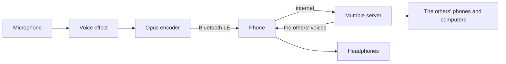

# Comm

*The ESP32-S3-Touch-AMOLED-1.75.  In development: the board's side works, and the Android app is being tried out.*

The comm channel lets a group talk to each other, like a radio.  The board sends the wearer's voice, through the [voice effect](voice-effects.md), to their phone over Bluetooth, and the phone passes it on to a [Mumble](https://www.mumble.info) server on the internet that everyone's on.  What the others say comes back through the phone, to the wearer's headphones.  People without a display can join from the Mumble app.

The board only sends while the wearer talks: in *Push to talk*, while the talk button is held, and in *Voice*, whenever it hears them speak.



## On the display

The *Comm* page is in [Settings](settings.md), after the Phone Remote.

1. Switch it on.  The board starts advertising over Bluetooth for a phone to connect, under the phone remote's name (`DroneLab-` and four letters), shown at the bottom of the page.
2. Pick *Push to talk* or *Voice*.
3. The title shows what it's doing: waiting for a phone, connected, or talking.  *Hold to talk* is for trying it out with the display in hand.  In the mask, the phone, or a button paired with it, does the talking.

It stays on, or off, from one startup to the next.  The voice effect has to run the whole time it's on, so it uses more battery than with the voice effect off.

## The app

The DroneLab app, in [`app/`](../../app/), is the phone's side, for Android for now.  Set up the server (the gear at the top: its address, your name and the server password), connect to it, then *Find the board* and pick yours.  The app passes the board's voice on to the server and plays the others to your headphones.  It has its own *Hold to talk*, and the board's mode can be changed from it too.

It keeps going with the screen off, with a notification while it's on.  It trusts the server's certificate the first time it connects, and if the certificate changes after that it won't connect without asking, as that could be someone pretending to be the server.

The *Buffer* (in the server settings) is how long the others' voices wait before they play, to ride out an uneven connection: 60 ms to start, more on mobile data.  It doesn't grow by itself, so the delay stays put.

See [`app/README.md`](../../app/README.md) to build it.

## Trying it without the app

`tools/comm_bridge.py` stands in for the phone, on a computer with Bluetooth.  It can play what the board sends, save it to a file, or pass it on to a Mumble server, and pressing Enter talks:

```
python3 tools/comm_bridge.py --play
python3 tools/comm_bridge.py --wav comm.wav
python3 tools/comm_bridge.py --mumble 192.168.1.10 --password secret --user Pup
```

See the top of the script for more.  It needs `pip install bleak`, and for `--play`, `numpy` and `sounddevice`.  [`tools/mumble/`](../../tools/mumble/) runs a Mumble server with Docker.

## How it works

The board is a Bluetooth LE peripheral with one service.  It notifies the phone with the voice, as 20 ms Opus packets of 16 kHz mono at about 24 kb/s, and with its status.  The phone writes to it to talk and to change the mode.  The messages are described at the top of [`core/app/comm.h`](../../core/app/comm.h).

The Opus packets go on to Mumble as they are, so the phone doesn't need to decode or encode anything.  `comm_bridge.py` shows how: it logs in to Mumble and sends the packets inside its TCP connection.

The voice is turned up by an automatic gain, separate from the speaker's volume, which evens out the voice effects' levels: it settles at about 11 to 15 dB.  The settings to tune are at the top of [`core/app/comm.c`](../../core/app/comm.c): how loud the voice is made (`AGC_TARGET_DB`), how loud speech has to be for voice mode (`VOX_DB`), and how long it keeps talking after the voice stops (`VOX_HANG_MS`).  `COMM_DEBUG` prints how loud the voice is, the gain, and how long encoding takes, every two seconds.
