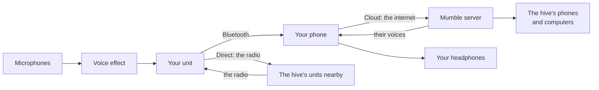
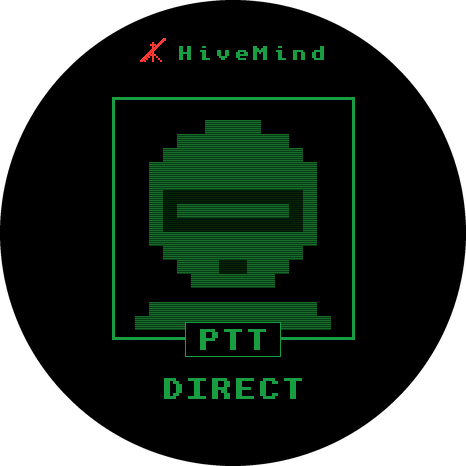
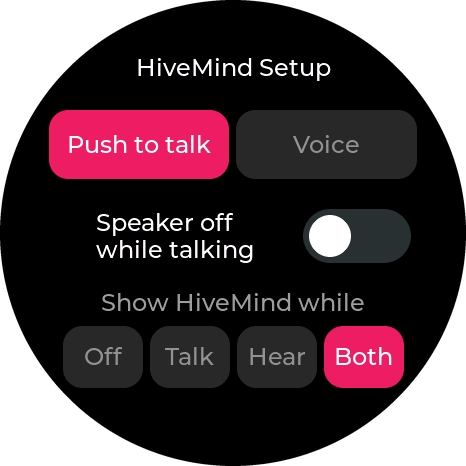

# HiveMind (Comms)

*The ESP32-S3-Touch-AMOLED-1.75, with the DroneLab app on an Android phone.  New: cloud mode works end to end and is still being tried out; direct mode is in development.*

HiveMind links every drone in the hive into one mind: they talk to each other, like a radio.  On the unit it's the *HiveMind* feature; in the app it's the *HiveMind* tab too.  Each unit sends its wearer's voice, through the [voice effect](voice-effects.md), and the others' voices come back to the wearer's headphones, through their phone.  The display shows who's talking, with their avatar.  The unit only sends while the wearer talks: with *Push to talk*, while the talk button is held, and in *Voice* mode, whenever it hears them speak.

It has two modes, which can be on together:

| | Cloud | Direct |
|---|---|---|
| How the voice travels | Over Bluetooth to the wearer's phone, and on over the internet to a [Mumble](https://www.mumble.info) server the hive shares | Unit to unit over the radio (ESP-NOW, on the WiFi radio) |
| Range | Anywhere with a phone signal or WiFi | A few tens of metres through people and walls, more in the open |
| Needs | A Mumble server, and a phone with internet | Nothing else: no server, internet or phone signal.  A phone is still needed to listen |
| Who can join | Anyone on the server, including people without a unit, from a Mumble app: [Mumla](https://mumla-app.gitlab.io/) on Android, or Mumble on a computer | Other DroneLab units nearby, on the same channel |
| Privacy | Whoever runs the server, and anyone it lets in | Channels with a passphrase are encrypted end to end |
| Shown on the unit and in the app as | *Server* | *Direct* |
| Status | Works, still being tried out | In development: not yet tried with two units that can both talk |



You hear both modes at once: the app plays the server's voices and the direct ones together.  Talking goes one way at a time (see [Talk on](#talk-on)).  Nothing heard one way is passed on the other.

## Getting started

1. [Install the app](../installing-the-app.md) and pair it with your unit: on the unit, switch on the *Phone App* page in [Settings](settings.md), after Brightness.
2. **For cloud mode**, the hive needs a Mumble server (see [Setting up a Mumble server](#setting-up-a-mumble-server)).  Enter it in the app's *Setup*, behind the gear on the HiveMind tab (*Join the server*): its address, your name and the server password, then connect.
3. **For direct mode**, switch on *Direct*: on the unit's *Direct* page, in the HiveMind feature, or in the app's *Setup*, behind the gear on the HiveMind tab.  Then [pick a channel](#channels).
4. Talk: hold the talk button, or set *Voice* mode and just speak.

The *Phone App* stays on, or off, from one startup to the next.  The voice effect has to run the whole time it's on, so it uses more battery: the [speaker model](../build/speaker-housing.md)'s 2000 mAh battery runs about 9.5 hours with comms on, against about 13.5 without.  Direct mode costs a little more again, as the radio has to listen the whole time.

Everything else is in the *HiveMind* feature on the unit, swiping up and down, after Sound.

## Setting up a Mumble server

Cloud mode needs one [Mumble](https://www.mumble.info) server for the whole hive: one person sets it up, and everyone else just connects to it.  Mumble is free, open-source voice chat, and its server is small enough for a Raspberry Pi.  There are three ways to get one:

- **Use one someone already runs.**  If anyone in the hive, or a friendly community, has a Mumble server, ask for its address and password.  A server can have channels, so several hives can share one.
- **Rent one.**  Many hosting companies rent Mumble servers, priced by how many people can be on at once; a small one costs little.  Search for *Mumble server hosting*.
- **Run your own**, on any computer that stays on: a home server, a Raspberry Pi, or a small cloud server.  [`tools/mumble/`](../../tools/mumble/) has a ready-made Docker setup and instructions: copy one file, set two passwords, and start it.  To reach it from outside your home, forward port 64738 (TCP and UDP) on the router.  Mumble's own [server documentation](https://www.mumble.info/documentation/mumble-server/) covers installing it without Docker, and every setting.

Whichever you use, everyone needs its **address**, its **port** (64738, unless it says otherwise) and its **password**, if it has one.  The server should be Mumble 1.4 or newer for the app's *Terminal* and *Control* tabs.  Channels are made from Mumble on a computer, logged in as the server's *SuperUser*.

## On the display

|  |  |
|:-:|:-:|
| The status screen | HiveMind Setup |

### The status screen

The first page shows how comms are doing at a glance, as a green screen like the [Terminal](terminal.md)'s:

- At the top, *HiveMind* and an antenna: red and struck through with no uplink (the phone running the app), yellow without its waves while the app's connected but the server isn't, and green with its waves once everything's connected.
- In the middle, an avatar in a frame, with a tag on its bottom edge:
  - **RX**: whoever's talking, their avatar in full color and the frame lit up, with their name underneath, and "+1" and so on for others talking at once.
  - **TX**: your own avatar, in full color, the frame white-hot, and a ring round the edge of the screen.  A cloud (cloud mode) or a handheld radio (direct mode) shows where it's going, with the channel's name.
  - *PTT* or *VOX*, the mode, while it's quiet: your avatar, dim and green, with how things are underneath: how many others are online, or what's missing.  With no phone, it says how many units are nearby in direct mode.

Holding the avatar talks, for trying it out with the display in hand.  It waits a moment before it starts, so a swipe across it doesn't, and once it's talking the page holds still until you let go.  In the mask, the app, the headphones' button or the talk button does the talking.

The status screen can be picked to show when the display turns on, in [Settings](settings.md#startup).

### HiveMind Setup

- *Push to talk* or *Voice*: in *Push to talk*, the unit sends while the talk button (or the app's, or the avatar) is held, and in *Voice*, whenever it hears you speak.
- *Speaker off while talking*: the speaker goes quiet while the unit's sending, voice effect and sound files alike, so those nearby don't hear what goes to the hive.
- *Show HiveMind while*: *Talk*, *Hear* or *Both* comes to the status screen by itself while the unit's sending, while someone else is talking, or both, and goes back to the page you were on two seconds after it stops.  If you swipe somewhere else in the meantime, it stays where you went.  It waits while you're touching the screen.

### HiveMind Voice

Titled *HiveMind Voice Effect* on the screen: the voice effect for what the hive hears: *Same as speaker*, or any of the [voice effects](voice-effects.md), so you can sound natural on comms and like a robot out loud, or the other way round.  With two different effects the voice runs through both, which takes more of the unit's processor: the heaviest two together take about 70% of one of its cores.

### Talk on

Talking goes one way at a time: cloud (*Server*) or *Direct*.  *Server* or *Direct*, above the app's Hold to talk, or *Talk on* on the unit's *Direct* page, says which.  If nobody's there to hear you that way (the server isn't connected, or nobody else is in your channel; or no units on your direct channel are nearby) and somebody is the other way, it goes the other way instead, and the app says so under the choice.  That's decided as you start talking, and doesn't change partway through.

### The talk button

A Bluetooth camera shutter remote can be the talk button: hold it to talk, in either mode.  It has to be a Bluetooth LE one, which shows up as a keyboard, and one that reports the button being held, not just pressed.  The cheap *AB Shutter3* remotes work.  The ATUMTEK one pairs, but only sends a press, so it can't hold the channel open.

1. On the *Talk Button* page, after *HiveMind Setup*, tap *Pair a button*.
2. Put the remote in pairing mode: switch it on, or hold its button until it blinks.  The unit pairs with the nearest one it finds, and shows its name.

The unit remembers it.  The remote goes to sleep after a minute or so; pressing it wakes it, the unit connects again, and that press counts, a moment late.  It's only used while the Phone App is on.  *Forget it* unpairs it.  A remote usually remembers only the last thing it paired with, so pairing it with the unit unpairs it from a computer or phone it was used with.

The headphones' play/pause button talks too, while the app's connected.  Headphones send a press rather than a hold, so a press starts talking and another stops it, with a rising chirp in your ear as it starts and a falling one as it stops.  It stops by itself after two minutes, in case it's been left on.  Holding the button down usually starts the phone's voice assistant instead.

### Avatars

Each person's avatar is their [Mumble](https://www.mumble.info) avatar, so desktop Mumble shows the same pictures, and anyone who's set one in Mumble shows up with it on the units.  Set yours in the app's *Setup*: *Choose* cuts it square from the middle.  Anyone without one shows as a head in a visor.

In cloud mode, the app gives yours to the server each time it connects, fetches everyone's, shrinks them to the unit's size, and sends them to the unit in the background, yours and whoever's talking first, about a second each.  The unit keeps 16, until the app's link drops.

In direct mode, each unit sends its wearer's avatar to the others on its channel over the radio, at the size the unit shows it (112x112), a little at a time.  The pixels go every eighth one each way first, then every fourth, every second and the rest, so a talker shows straight away as big blocks of their picture, which sharpen as more comes in.  All of it goes soon after a new unit's heard and every five minutes, about twenty seconds' worth of small packets; the coarsest two layers go every half minute; and none of it while the wearer's talking.  Pieces that don't arrive are asked for again and resent, so a picture fills in within seconds.  The unit needs its phone to have given it the avatar once since it started.

## Cloud mode

The unit sends its wearer's voice to their phone over Bluetooth, and the app passes it on to a [Mumble](https://www.mumble.info) server on the internet that the hive shares.  What the others say comes back through the phone, to the wearer's headphones.  People without a unit join from a Mumble app.

The server can have channels, so that several hives can share it: only those in the same channel hear each other.  *Change*, by the channel's name in the app, moves you to another, and the app goes back to it each time it connects.  Channels are made on the server, from Mumble on a computer, logged in as its SuperUser, or as someone it lets make them.

Each person on the channel has a speaker button in the app, which mutes them for you alone: the app doesn't play them, and the unit doesn't show them talking.  The app remembers who by name, so they stay muted the next time they join.

Voice goes to and from the server over UDP, which is quicker on a patchy connection, as a lost packet doesn't hold up the ones after it.  Where UDP is blocked, it goes inside the connection to the server instead, and the server card says which.  The server needs both its TCP and UDP port open (64738).

The *Buffer* (in the server settings) is how long the others' voices wait before they play, to ride out an uneven connection: 60 ms to start, more on mobile data.  It doesn't grow by itself, so the delay stays put.

The app trusts the server's certificate the first time it connects, and if the certificate changes after that it won't connect without asking, as that could be someone pretending to be the server.

## Direct mode

*In development: not yet tried with two units that can both talk.*

Direct mode carries the hive's voices unit to unit over the radio, with no internet, server or phone signal in between: for halls, basements and the middle of nowhere.  Each unit broadcasts its wearer's voice, through the voice effect, to the units in range, and passes what it hears from the others to its phone, which plays it to your headphones.  So a phone is still needed to listen, but it doesn't need any signal.

The unit's *Direct* page, in the HiveMind feature, switches it on, and lists the units it hears, strongest first, with bars for how well.  It talks the same way as in cloud mode: the talk button, holding the avatar on the status screen, voice mode, or the app's Hold to talk.

### Channels

Units start on the **open channel**, which any unit in range can hear.  To keep it to your hive, use a channel with a passphrase: in the app's *Setup*, under *Direct*, tap the channel, or *Change* on the HiveMind tab while talking direct.

- **Create a channel**: give it a name, which others nearby can see, and a passphrase, which they'll need to join.  A few unrelated words make a good passphrase.
- **Heard nearby**: every unit on a channel says so every couple of seconds, with its channel's name (not its passphrase), so the channels about show up in the list, with how many units are on each.  Tap one and type its passphrase to join; a wrong one's caught straight away, without trying it on the air.
- **Your channels**: those made or joined on this phone, to switch between.  *Delete* takes one off this phone; it carries on for anyone else who has its passphrase.

The app turns the channel's name and passphrase into a key (PBKDF2, deliberately slow), and the unit encrypts everything with it (AES-128-GCM), so units outside the channel can neither hear it nor send to it, however they're changed.  The passphrase never leaves the phone.  What's not hidden: that a channel's there, its name, and how many are on it; and anyone who's been given the passphrase is on it, so start a new channel if someone shouldn't be any more.  The unit keeps its channel's key in its settings, so someone with the unit itself could read it out.

The app's status strip shows a grey arrow when someone's talking on another channel nearby: the unit hears it on the air, but can't listen to it.

### Frequencies and Long Range

Each channel has a radio frequency, 1, 6 or 11 (the three WiFi channels that don't overlap), and can use **Long Range**, Espressif's own slower mode (500 kb/s): it reaches further, but fewer units can share the channel, as each packet takes about twice as long to send.  Both are chosen when the channel's made, and come with it to everyone who joins.  The open channel is on frequency 6, in Long Range.  Every unit hears both ordinary and Long Range broadcasts, so it doesn't matter which a unit on the channel sends.  The open channel is on 6, so a new channel is best on 1 or 11, where it doesn't share the air with it.

A unit only hears its own frequency, so opening the app's *Direct Channels* screen has it listen on each of the three for a couple of seconds, to find the channels on the others; what's said on its own meanwhile is missed.  It can't while the hotspot's on.  The hotspot moves to the channel's frequency, if it's on.

### Relaying

A unit that hears one of its channel's broadcasts only weakly, as from the edge of its range, passes it on once, after a short random wait, unless it hears another unit do so first.  So two units just out of range of each other still hear each other through one in between, without every unit repeating everything.

### Range and battery

The radio has to listen the whole time direct mode is on, which costs about 80 mA more than with it off.  Range is a few tens of metres through people and walls, more in the open, and more again with Long Range or an antenna outside the mask.  Joining a network on another channel, for the Voice Lab, takes the unit off its direct channel's frequency while it lasts.

## The app

The DroneLab app, in [`app/`](../../app/), is the phone's side, for Android for now: see [Installing the App](../installing-the-app.md) to get it.

A **status strip** along the top of every tab shows the unit, the server and direct mode, each with a light; arrows for your voice going out (pink) and others' coming in (green, or grey for someone on another direct channel nearby, not heard); and the unit's battery.  Tap it to connect or disconnect each.

The **HiveMind tab** lists everyone in your channel: those on the server, and the units heard over direct mode, with bars for how well each is heard.  Whoever's talking glows green.  Tap someone for more: how they're linked, their unit's firmware and app versions (over direct mode), muting them, and shortcuts to message or control them.  At the foot are *Server* or *Direct*, for where talking goes, and *Hold to talk*.  It keeps going with the screen off, with a notification while it's on.

What's set once is in *Setup*, behind the gear: getting connected (pairing the unit, joining the server, your avatar), the unit's talking settings (the mode, the [HiveMind Voice](#hivemind-voice), *Mute speaker on Tx*, when to show the HiveMind screen), direct mode and its channel, and who you've muted.  The (i) buttons explain each.

The first time the app connects, the phone asks to pair, and the unit shows a 6-digit code over whatever's on its screen: type it into the phone.  The unit only talks to a phone that's paired like that, so nobody else nearby can listen in or take over, and the phone and unit remember each other after that.  A new phone can only pair while pairing's open: for two minutes after the *Phone App* is switched on, or after *Pair a phone* on the *Paired Phones* page in Settings, and until a phone's paired.  The rest of the time, a phone that isn't paired is turned away before any code's shown, as the screen faces outward while the mask's worn, where anyone could read it.  With several units about, pick yours by its name, shown on the *Phone App* page (`DroneLab-` and four letters): if you pick someone else's, the code shows on theirs, not yours.

The **Remote tab** is the [WiFi Hotspot Remote](phone-remote.md)'s page, run over the same Bluetooth link instead of the unit's WiFi hotspot, so the phone keeps its internet.

The **Record tab** records the unit's voice to the phone, for videos: see [Recording in the app](voice-lab.md#recording-in-the-app).

The **Terminal tab** holds messages: those from others, as their units pass them on, the server's own text messages, and yours.  Messages go to the others' [Terminal](terminal.md#messages-from-others): *Show on their display* puts them on their unit's screen as well as in their app; untick it for their app only.

The **Control tab** sends commands for the others' [Lovense](lovense.md) devices: a level for each kind of motor, a pattern and its speed, and a reaction, with *STOP* always at the foot of the screen.

Messages and commands go to everyone in your server channel and your direct channel, or to those you pick, and each unit only takes them if its wearer has allowed you, in a list for each: see [Commands from others](lovense.md#commands-from-others).  Over the server they go as Mumble plugin data, which the Mumble apps don't show, so it needs a server from Mumble 1.4 on.

## Trying it out

### Without the app

`tools/comm_bridge.py` stands in for the phone, on a computer with Bluetooth.  It can play what the unit sends, save it to a file, or pass it on to a Mumble server, and pressing Enter talks:

```
python3 tools/comm_bridge.py --play
python3 tools/comm_bridge.py --wav comm.wav
python3 tools/comm_bridge.py --mumble 192.168.1.10 --password secret --user Pup
```

The computer has to pair with the unit first, as the app does: `tools/ble_pair.py`, or in `bluetoothctl`, `agent on`, `pair` and the unit's address, and type in the code the unit shows.  See the top of the script for more.  It needs `pip install bleak`, and for `--play`, `numpy` and `sounddevice`.

### Direct mode with one unit

A unit built with `-DRCAT_DIRECT_ECHO=1` only echoes back what it hears, as a unit called `ECHO-` and four letters, so one unit that can talk, with its phone, hears itself come back.  Once it's had a whole avatar, it takes that on as its own, so the avatar comes back too.  It's on a channel called *Echo Test*, with the passphrase `dronelab`, which shows up as heard nearby, for trying joining one:

```
idf.py -C platforms/esp-idf -B build-s3-146-echo -DBOARD=waveshare_esp32s3_touch_lcd_1_46 -DRCAT_DIRECT_ECHO=1 build flash
```

The 1.46" board, which can't send voice of its own, works for this.

## How it works

The unit is a Bluetooth LE peripheral with one service.  It notifies the phone with the voice, as 20 ms Opus packets of 16 kHz mono at about 24 kb/s, and with its status.  The phone writes to it to talk, to change the mode, and to say how the server's doing and who's talking.  The messages are described at the top of [`core/app/comm.h`](../../core/app/comm.h).

In cloud mode the Opus packets go on to Mumble as they are, so the phone doesn't need to decode or encode anything.  `comm_bridge.py` shows how: it logs in to Mumble and sends the packets inside its TCP connection.  In direct mode the unit broadcasts the same packets itself: see the top of [`core/app/direct.h`](../../core/app/direct.h) for what's broadcast, and `comm.h` (0x07 and 0x08) for how it reaches the phone.

The voice is turned up by an automatic gain, separate from the speaker's volume, which evens out the voice effects' levels: it settles at about 17 to 21 dB.  The settings to tune are at the top of [`core/app/comm.c`](../../core/app/comm.c): how loud the voice is made (`AGC_TARGET_DB`), how loud speech has to be for voice mode (`VOX_DB`), and how long it keeps talking after the voice stops (`VOX_HANG_MS`).  `COMM_DEBUG` prints how loud the voice is, the gain, and how long encoding takes, every two seconds.
