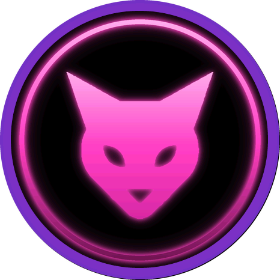
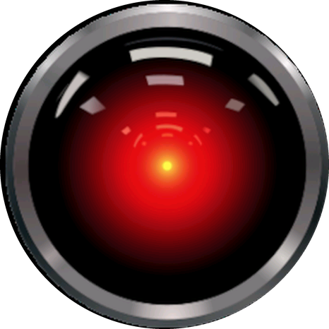

# Images

The Images feature shows a page for each image, then a blank (black) page at the end.  Swipe left and right to move between them.  Images can be still pictures (PNG, BMP or JPG) or animated GIFs, which play over and over.

Any image, or the blank page, can be picked to show when the display turns on, in [Settings](settings.md#startup).

While the Images feature is on screen, the [Voice Ring](voice-ring.md) can glow around the edge with your voice.

|  |  |
|:-:|:-:|
| With the voice ring | A built-in image |

The images built into the firmware are in the `imgs/` folder.  The first is KatCorp's logo, the cat in its ring, which is what a new unit shows when it starts, until another image is picked in *Startup*.  The ESP32-S3 boards can also show images from their micro SD card, which come first, so with a card in, a new unit starts on the card's first image.

## Pictures from others

Others in your hive can show you a picture from their app, if you allow them *Display* in [Permissions](../app/permissions.md) (see [Their display](../app/text.md#their-display)).  Your display switches to it, for a while or until you swipe away.  A built-in one is its own page.  One they sent from their phone gets a page of its own at the end of Images, after the card's and the built-in ones, just before the blank page, so you can swipe back to it later.  *Received* shows at the top for a moment each time it comes on screen.  Tap it, or hold it, to delete it.  The unit keeps the last three, in memory only: they're gone when it restarts.

## Adding or changing built-in images

1. Put the image in the `imgs/` folder.  PNG, BMP, JPG and animated GIF files all work.
2. Add it to the list in [`core/media/image_list.c`](../../core/media/image_list.c).  Images are shown in the order they're listed.  The name is the file name without the extension, so `imgs/your_image.png` is `your_image`.  The second value says whether the image is an animated GIF: `false` for a still image, `true` for an animated GIF.

   ```
   LV_IMAGE_DECLARE(your_image);

   const builtin_image_t builtin_images[] = {
       ...
       IMAGE(your_image, false),
   };
   ```

3. Rebuild and flash (see [Installing the Firmware](../building-firmware.md)).  The build converts the images automatically, for the board's screen size.
4. Run `python3 tools/gen_app_pictures.py`, so the app offers it to show on others' displays, and rebuild the app.

The image name is also what shows up in the *Startup* setting.  To remove an image, just take it out of the list.  Images in `imgs/` that aren't in the list don't take up any space in the firmware.

## Image sizes

Images are drawn for a 240x240 screen.  On a bigger screen they're scaled up by the same amount, so a 240x240 image fills the 466x466 screen of the ESP32-S3-Touch-AMOLED-1.75, and a 120x120 image fills the middle half of any of the screens.  If an image is bigger than 240x240, it's treated as full screen artwork and scaled to fit each screen, so higher resolution artwork looks sharper on the bigger screens.

Animated GIFs that need resizing are re-encoded, without transparent pixels and with a black background, so a resized GIF can come out bigger than the original file.  GIFs that are already the right size are used as they are.

The conversion is done by `tools/img2c.py`.  You don't normally need to run it yourself, but you can (for example `python3 tools/img2c.py imgs/hexcorp.bmp --size 466 --out hexcorp.c`) to see what it produces.

## Animated GIF memory use

Animated GIFs are decoded in RAM while they're on screen, about 2 bytes x width x height each, plus about 24 kB for the decoder.  The board decodes them into its 8 MB of PSRAM, so even full screen GIFs fit easily.

Built into the firmware, though, a full screen GIF converted for the 466 pixel screen takes up a lot of its space, so put big ones on the SD card instead.  Lines in `core/media/image_list.c` inside `#if RCAT_LARGE_IMAGES`, like the full screen `radar3c` GIF, are only built in when the board's `board.cmake` turns `RCAT_LARGE_IMAGES` on, and it's off for the 1.75".

## Images on the SD card

*ESP32-S3 boards*

The ESP32-S3 boards can also show images from their micro SD card, so you can change them without rebuilding the firmware.

1. Format the card as FAT32 (most cards come that way) and make a folder called `images` on it.  If there's no `images` folder, the top level of the card is used instead.
2. Copy PNG, JPG, BMP or animated GIF files into it.
3. Put the card in the board and switch it on.  It reads the card while the DroneLab logo is on screen.

The images from the card come first, sorted by file name, followed by the built-in images.  They can be picked in the *Startup* setting by their file name (without the extension).  If a card image has the same name as a built-in image, the card image is the one picked.  The card is read when the board starts, so restart it after changing the card by hand.  Pictures the app saves to it, though, appear straight away: see [saving to the unit's SD card](../app/remote.md#saving-pictures-and-sounds-to-the-units-sd-card).

Images are sized for the screen the same way as the built-in images.  Still images are resized once, when they're loaded.  Animated GIFs are scaled while they play, which costs a little time on every frame and looks slightly softer.  For the best results, prepare images on your computer first with `tools/prepare_sd.py`.  It resizes GIFs and still images ahead of time and marks them as prepared, so the board shows them as they are:

```
python3 tools/prepare_sd.py my_images/*.gif my_images/*.png --size 466 --out /media/you/SDCARD/images
```

Use the path where your card is mounted.  `--size` is the board's screen size: 466 for the ESP32-S3-Touch-AMOLED-1.75.

Limits:

- Up to 32 images are loaded from the card.
- Images can be up to 1024x1024 pixels.
- BMP files must be 16, 24 or 32-bit (not 1, 4 or 8-bit).  Files that can't be read are skipped, and the reason is printed in the board's log.
- File names can be long, but only the first 23 characters (without the extension) are used for the *Startup* setting.
- Hidden files (like the `._` files macOS leaves on cards) are ignored.
