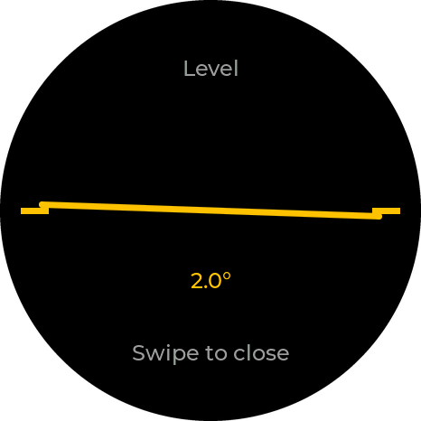

# Level

*Boards with a supported accelerometer: the ESP32-S3 boards*

Opened with the **Level** button on Settings' [Setup](settings.md#setup) page.  A spirit level, for lining the display up when it's mounted on the mask, over the whole screen: swipe in any direction to close it, as it says at the bottom.  A line across the screen stays level with the ground, and turns green once the screen is within a degree of it.  The angle is shown under it.  It assumes the wearer is sitting or standing upright.

Use it with the [Rotation](settings.md#rotation) buttons above it on the Setup page, which turn the picture in 90 degree steps.

The RP2040 and RP2350 1.28" boards (see [Other Boards](../other-boards.md)) have an accelerometer too, but the firmware doesn't support it yet, so the Level is left out of their build.
