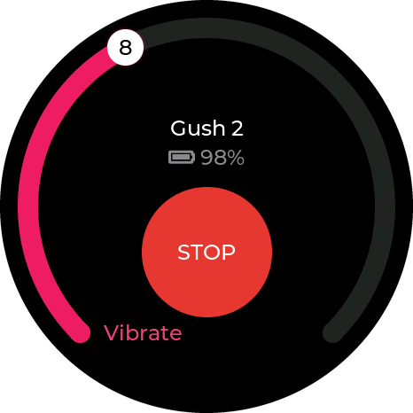
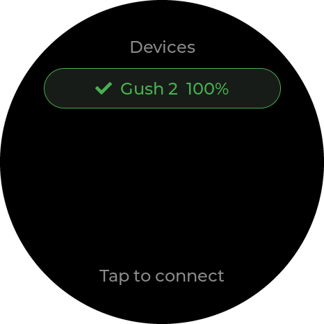
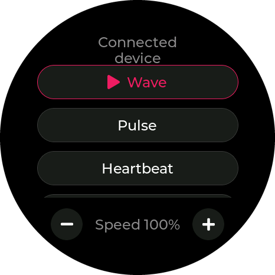
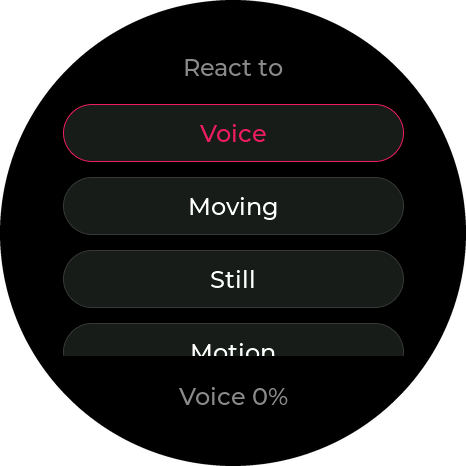

# Lovense

*Boards with Bluetooth: the ESP32-S3 boards*

The Lovense feature controls up to three Lovense devices at once, over Bluetooth.  The connections stay up while you look at other features, so the levels stay as they were set.  Everything here can also be done from a phone, with the [WiFi Hotspot Remote](phone-remote.md).

It talks to the devices over Bluetooth itself, without Lovense's app.  It isn't made, supported or endorsed by Lovense, and a firmware update on a device could change how it responds.

|  |  |  |  |
|:-:|:-:|:-:|:-:|
| Control | Devices | Patterns | React to |

Its pages, left to right:

- **Control**: a ring around the edge for each of the device's motors (vibration, rotation, the Max's air pump and so on), with the level on its knob, 0 to 20 for most.  Drag a knob around its ring to set the level.  Only the knobs respond, so you can swipe from anywhere else.  The device's name is in the middle, with arrows either side to step through the connected devices.  **STOP** stops every device, and any pattern, as soon as you touch it.
- **Devices**: turn your devices on and they show up here while it's on screen.  Tap one to connect (it turns green), or tap it again to stop it and disconnect.  Bluetooth only starts the first time it's needed.
- **Patterns**: tap a pattern to play it, and tap it again to stop it.  The arrows at the top pick which device it plays on, or all of them, and **-**/**+** at the bottom set the speed.  While a pattern plays, each ring on the Control page sets how high that motor goes, and a thin line inside the ring shows the level as it plays.  Six patterns are built in, and you can add your own (see [Patterns on the SD card](#patterns-on-the-sd-card)).
- **React to**: drives the devices from your voice or how you move, on top of any pattern.  *Voice* follows how loud you talk.  *Moving* runs while you move and stops soon after you stop.  *Still* runs only once you've held still with the display upright for a second (set the display's [Rotation](settings.md#rotation) first, so upright is right).  *Motion* gets stronger the more you move, and *Tilt* the further you tilt from upright.  Tap the one that's on to turn it off.  The line under the list shows what it's sensing.  As with patterns, the rings on the Control page set how high each motor goes.  **STOP** turns the reaction off too.
- **Options**: *Motor Hold*: on, a motor keeps its level when you let go of its knob; off, it springs back to 0.
- **Others** (*Hive Commands*): who may send commands to your devices over the [comms](comms.md) (see [Commands from others](#commands-from-others)).  *Off*, *Ask* or *Accept* says whose commands are done: nobody's, those you've allowed, or anyone's.  Tap someone to allow them (they turn green, with a tick), or tap again to stop allowing them; hold them to take them off the list.  The line at the bottom says who sent the last command that was done.
- **Ignore** (the last): commands to ignore whoever they're from: *Broadcasts* (and those to the open direct channel) and those *To a whole channel*.

## Commands from others

*The ESP32-S3-Touch-AMOLED-1.75, with comms*

Others in your hive can send commands to your devices, from *Control* in the DroneLab app (see [Control](../app/control.md)): stop, set each kind of motor (all your vibrators, say) to a level, play a pattern, change the patterns' speed, or start a reaction (*React to*), to your own voice or movement, as your board senses them.  They come over the Mumble server, through your phone, or board to board over [direct mode](comms.md#direct-mode).  Your board does them as if you'd used its own controls, and they stay set until they're changed: **STOP**, on the Control page, stops them as it stops everything else, and a STOP sent by someone else stops reactions too.

Whose commands are done is up to you, with **Off**, **Ask** or **Accept** on the *Hive Commands* page, or under *From others* in the remote's *Toys* tab (in the app's *Remote* tab too):

- **Ask**, to start with: only those you've allowed are obeyed.  The first time someone sends you a command, they're added to the *Permissions* list, not allowed, and you tick them there.
- **Accept**: everyone's commands are done, allowed or not.  Anyone new is still added to the list, so you can see who's been sending, and tick them for when you go back to Ask.
- **Off**: commands are ignored, and nobody's added.  The list remembers up to 12 people, kept when the board's switched off.  It's the Lovense feature's own: the [Terminal](terminal.md#messages-from-others) has a separate one, for words on your display.

The *Ignore* page, after it (and the same switches under *From others* in the remote), ignores some commands whoever they're from: **Broadcasts**, sent to everyone who can hear the sender (with those to the channel on the open direct channel, which anyone nearby can hear), and those **To a whole channel**.  With both on, only commands sent to you alone get through.  And anyone you've muted in the app is ignored, whatever's set here.

Someone's known by their name, and whether they're heard in cloud or direct mode, so the same person can be on the list twice.  A name can be borrowed: on a direct channel with a passphrase only its members can send anything, but on the open channel, or on a server anyone can join, someone could use the name of a person you've allowed.

A pattern plays if your board has one by the same name: the six built-in ones always do, and patterns on the SD card only if yours has one with that name too.  A level of 20 is each motor's top, so the air pump's 3.

## Patterns on the SD card

Put pattern files in a folder called `patterns` on the SD card, as `.txt` or `.pat` files.  Each file shows up on the Patterns page, named after the file, after the six built-in patterns.

The files use Lovense's own pattern format, so patterns written for their developer tools work as they are:

```
V:1;F:v;S:100#0;4;8;12;16;20;16;12;8;4
```

- `F` is the motors the levels drive: `v` vibrate, `r` rotate, `p` the Max's air pump, and `t`, `f` or `o` thrusting.  Several can be listed, separated by commas.  A number after the letter picks one motor of that kind, so `v2` is the second vibrator on a device with two.  Leave `F` empty to drive every motor.
- `S` is how long each level lasts, in milliseconds.  It has to be at least 100, which is as fast as the devices take commands.
- After the `#` come the levels, 0 to 20, separated by `;`.  They can run over several lines.  When they run out, the pattern starts again.

A file can hold several of these one after another, each with its own `F` and `S`.  They play together, and each one repeats at its own length, so a short vibration pattern can run against a long, slow rotation.  For example:

```
V:1;F:v1;S:200#20;0;20;0;0;0
V:1;F:v2;S:100#0;2;4;6;8;10;12;14;16;18;20
```

The levels are scaled to the device's own range (0 to 3 for the air pump), and then by how high each ring is set on the Control page.  Up to 32 patterns are listed, built-in ones included.
