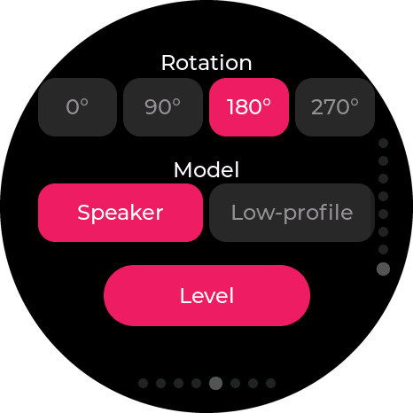
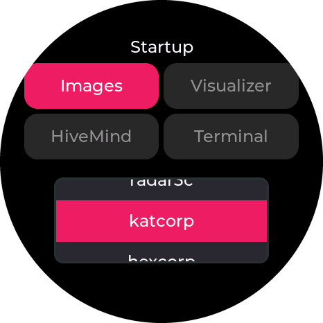

# Settings

*All boards*

Settings that apply to the whole display.  Settings that belong to a single feature, like the [Voice Ring](voice-ring.md)'s color or the [Sound](sound.md) volume, are on that feature's own pages.

The [WiFi Hotspot Remote](phone-remote.md)'s Setup tab can set the brightness, rotation and startup page too, and shows the battery and uptime.

Settings are saved about two seconds after you change them, and are restored when the display is powered back on.  They also survive flashing new firmware.

## Brightness

How bright the screen is, with the battery's charge above it, in percent and volts, and how long the display's been on since it was last switched on or restarted.  At the bottom are the firmware's version, the board's WiFi MAC address, and when the firmware was built.  The MAC address is set at the factory and different on every board, so it serves as the unit's serial number: quote it when reporting a problem with a particular unit.  On the ESP32-S3-Touch-AMOLED-1.75, which has no backlight, the screen dims itself.

The percentage is worked out from the voltage, along a discharge curve the board learns for itself (see [Battery Log](#battery-log) below), so it reads high while USB is plugged in and charging, and settles back once it's unplugged.  On the ESP32-S3-Touch-AMOLED-1.75, the power chip also says when it's charging, and a lightning bolt shows then; the percentage stays at 99% or below until the charger finishes, and then shows 100%.  That power chip has a fuel gauge too, but it isn't used: without a profile for the battery it read up to 15% high halfway through a run, and reached 0% half an hour before the board switched off.  The voltage is smoothed over about 10 seconds, so the percentage doesn't jump around as the screen's brightness or the speaker changes how much the board draws.

## Phone App

*The ESP32-S3-Touch-AMOLED-1.75*

The Bluetooth link to the DroneLab app on a phone: [comms](comms.md), sending your voice to the hive, and the remote, run from the app.  The app is the better remote, as the phone stays on the internet.  The comms's own settings, its modes and the talk button, are in the [Comm](comms.md#getting-started) feature.

## Paired Phones

*The ESP32-S3-Touch-AMOLED-1.75*

How many phones are paired with the Phone App's link.  *Pair a phone* lets a new phone pair, for two minutes (it's open for two minutes after the Phone App's switched on, too); the rest of the time, only phones paired already can connect, so nobody can read the code off the display while it's worn and pair with it.  *Forget them* (tap it twice) unpairs them all, for when a phone's been lost: each has to pair again, with a new code.  It keeps the talk button.

## WiFi Hotspot Remote

*Boards with WiFi*

Runs the display from a phone's web browser, over the board's own WiFi hotspot, for phones without the app.  While it's off, *At power-up* sets it to switch itself on whenever the display starts.  See [WiFi Hotspot Remote](phone-remote.md).

## Setup

Everything for fitting the display in the mask, on one page.

### Rotation

Turns the whole display, touch included, in 90 degree steps: tap **0°**, **90°**, **180°** or **270°**.  It helps when the display ends up sitting at an angle in the mask, and some housings turn the board a quarter turn, which this puts right (each board's build guide says which).  On the ESP32-S3-Touch-AMOLED-1.75 it starts at 180 degrees, to suit its housings.

### Model

*The ESP32-S3-Touch-AMOLED-1.75*

Which housing the board's in: **Speaker** (the [speaker model](../build/speaker-housing.md)) or **Low-profile** (the [low-profile model](../build/low-profile-housing.md)), which has no speaker.  A new board asks the first time it starts.  On the low-profile model, the [Sound](sound.md) feature, *Play on speaker*, *Effect Volume* and the [Seal Test](../build/seal-test.md) are left out, and so are the phone remote's speaker controls.  The *Voice Effect* page stays: it picks the effect [HiveMind](comms.md) sends your voice through.

What uses the speaker is set up as the board starts, so changing it asks to restart: tap **Restart**, or **Later** to restart some other time.  Boards set up before there was a choice count as the speaker model.  The phone remote's API sets it with `POST /api/display?speaker=1` (speaker) or `speaker=2` (low-profile), and `restart=1` to restart.

### Level

*Boards with a supported accelerometer: the ESP32-S3 boards*

The **Level** button opens a spirit level, for lining the display up on the mask, over the whole screen.  Swipe in any direction to close it.  See [Level](level.md).

## Startup

What's shown when the display turns on.  Tap **Images**, **Visualizer**, **HiveMind** or **Terminal** (whichever the board has).  With **Images**, scroll the list under them to the image, or *Blank* for the blank page (see [Images](images.md)).  The [Visualizer](visualizer.md) starts on the style it was last on, and [HiveMind](comms.md) on its status screen.

## Battery Log

The boards learn how their battery's voltage falls as it runs down, so the percentage on the Brightness page is right for that board and its battery.  Every board reads its voltage a little differently, and every battery is a little different, so a curve measured on one board can be out by 10-20% on another.

The board records the battery's voltage once a minute, all the time it's on.  When it starts up, it looks back at the last run, and learns from it if that was a complete one:

- it started with the battery full, so charge it until the charger stops;
- it wasn't charged partway through;
- it ran until the battery was flat, and the display switched off or stopped responding.

A run that's switched off early, or that started part charged, is just left out.  Until the board's learned from a run, it uses a curve measured for its model.  Each complete run after the first is blended in, so the curve keeps up as the battery ages.

The page shows which curve the board's using, how long this run's been going, and how long the last one went, with whether it was learned from, or why not.  **Hold to forget** goes back to the model's curve, for after the battery's been changed.

The log stays in flash, and the last run's stays there until the new one's been going ten minutes.  So within ten minutes of plugging a board back in, `tools/battery_log.py` can read it over USB, as `tools/battery_log.py esp32 --port /dev/ttyACM0`, from ESP-IDF's environment.  It writes the log to `battery_log.csv`, and prints the curve the run shows, as a table for the board's `rcat_hal_battery_curve()`: that's how a model's default curve is made.  Near empty, the reading stops following the battery and sits flat until the board stops; the curve ends where that starts, so 0% leaves those last minutes in hand.  After the first 17 hours or so, the log records every 2 minutes instead, and so on, so it never runs out of room.
