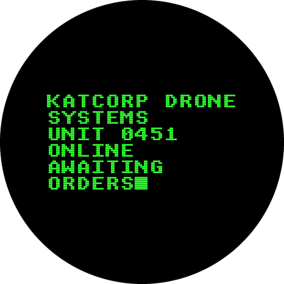

# Terminal

*Boards with WiFi: the ESP32-S3 boards*

The Terminal shows what's typed on the [WiFi Hotspot Remote](phone-remote.md) like an old green-screen terminal: blocky green letters that type themselves out behind a block cursor, which blinks once they're done, with faint scan lines over the screen.  It shows a `>` prompt until something's sent.

The letter size is picked on the phone.  *Auto* uses the biggest letters the whole message fits in (so a word or two fills the screen), down to 16 px, or pick one of 8, 16, 24, 32, 40 or 48 px.  A message too long for the size scrolls like a terminal, keeping the newest lines on screen.

The display only has plain letters, numbers and punctuation, so curly quotes and dashes become straight ones, and anything else (emoji, accents) becomes `?`.

It can be picked to show when the display turns on, in [Settings](settings.md#startup).

## Messages from others

*The ESP32-S3-Touch-AMOLED-1.75, with comms*

Others in your hive can put words on your Terminal from the DroneLab app, from their conversation with you, or with a channel you're on, in its [Text](../app/text.md#their-display) tab, in cloud or [direct mode](comms.md#direct-mode).  They have the same choices you do on the remote: the letter size, and adding a line or replacing what's there.  Your display switches to the Terminal, for the time they pick (5 s to 5 min) before going back to what it was showing, or until you swipe away; you can swipe away at any time, and their *Clear* takes it back too.  It shows just as they typed it, with no name, but their name is noted in your app's conversation with them, and on the *Hive Display* page.

You choose who can in the app's [Permissions](../app/permissions.md), with requests to accept or decline and a log of every command: **Ask** (*Allowed*), to start with, only those you've allowed; **Anyone**; or **Off** (*Nobody*).  It can also ignore **Broadcasts**, sent to everyone who can hear the sender (with those to the channel on the open direct channel, which anyone nearby can hear), and those **To a whole channel**.  Anyone you've muted in the app is ignored too.  Your unit keeps the last settings your app gave it, so they hold while your phone's away.

The Terminal's second page, *Hive Display*, shows the setting, who's allowed, and who sent the last message.  It's one permission, *Display*, for words and [pictures from others](images.md#pictures-from-others).  **Turn off** there stops anyone's words and pictures showing at once, without your phone; switch it back on in the app.  It works as the [Toys feature's](toys.md#commands-from-others) permission does, but is one of its own, so someone can be allowed to put things on your display without being allowed near your toys.  Texts from others in the app need neither: they go to your app, not the display.

The Terminal's font is LVGL's 8x8 unscii font with each pixel drawn as a square block.  `tools/gen_terminal_font.py` makes `core/ui/terminal_font.c` from it.
