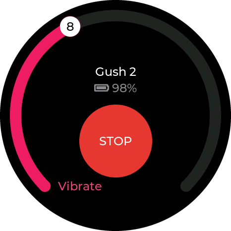
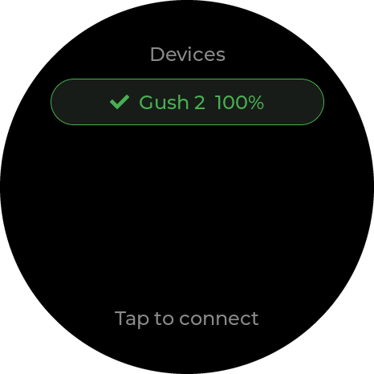
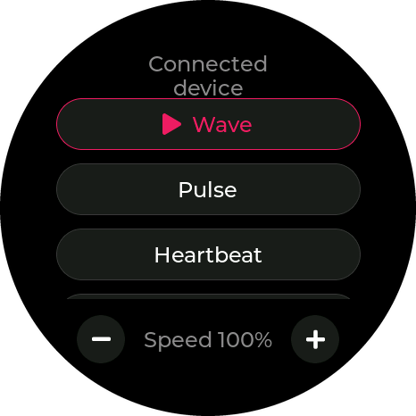
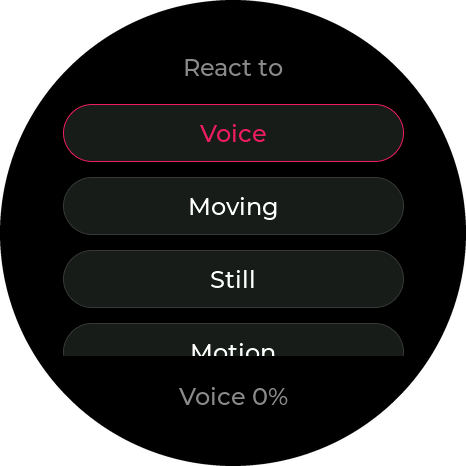

# Toys

*Boards with Bluetooth: the ESP32-S3 boards*

The Toys feature is the unit's side of **HiveMind Control**: the toys it runs itself, over Bluetooth, for you and for others in your hive.  It connects to up to three toys at once, and the connections stay up while you look at other features, so the levels stay as they were set.  Everything here can also be done from a phone, with the [WiFi Hotspot Remote](phone-remote.md) or the app's [Remote](../app/remote.md) tab.

It runs **Lovense** toys, which it talks to over Bluetooth itself, without Lovense's app.  It also has drivers for **We-Vibe**, **Magic Motion** and **Kiiroo** (with OhMiBod) vibrators, *untested*: they follow the [Buttplug project](https://github.com/buttplugio/buttplug)'s descriptions of those toys, but nobody has tried one with a unit yet.  If you have one, please [open an issue](https://github.com/rcat3/DroneLab/issues) or post in [Discussions](https://github.com/rcat3/DroneLab/discussions) to say whether it works, with the toy's name as it shows under *Devices*.  Kiiroo's strokers (Keon, Onyx) aren't supported.

None of this is made, supported or endorsed by those makers, and a firmware update on a toy could change how it responds.  More makers can be added, each with a driver of its own (see `core/app/toy_driver.h`).

|  |  |  |  |
|:-:|:-:|:-:|:-:|
| Control | Devices | Patterns | React to |

## Channels

Vibe toys (vibrators, and the toys that rotate, pump or thrust) are run by **channel**: **V1** to **V6**, each with a level from 0 to 20.  Each of your toys' outputs (each motor, the Max's air pump and so on) follows one channel, or none.  To start with, a toy's first output follows V1, its second V2, and so on, so an Edge's two motors are V1 and V2, and a Lush on its own is V1.

You change which channel each output follows under *Devices* in the remote's or app's *Toys* tab, and it's remembered for that toy.  Two toys can follow the same channel and move together, and any output can follow any channel: a Nora's rotation can be V1 if you'd rather.

Whoever's controlling, you or someone in your hive, sets channels, never particular toys.  So everyone in a channel can have different toys, and all take the same commands: someone sending V1 and V2 runs whatever each person has put on V1 and V2.  A level of 20 is each output's top, so the air pump's 3.

## The pages

Left to right:

- **Toy Visualizer**: not the [Sound Visualizer](visualizer.md) of your voice and sound, but what each channel a connected toy follows has run at over the last few seconds, as a glowing line in its own color scrolling across the screen, with where it is now at the head on the right.  While a pattern or reaction drives a channel, a dotted line shows how high it can go.  Each channel's name and level are along the top, and **STOP**, under the lines, stops everything as soon as you touch it.  You can have the display start on it (see [Startup](settings.md#startup)).
- **Control**: a ring around the edge for each of the screen's controls, with the level on its knob.  Drag a knob around its ring to set the level.  Only the knobs respond, so you can swipe from anywhere else.  To start with there's a ring for each channel a connected toy follows, up to three, labelled *V1*, *V2* and so on.  Your app can lay them out differently: fewer rings, your own labels, or one ring driving several channels together (see [Screen controls](#screen-controls)).  A control with no label is called by its channels, such as *V1+V2*.  The toy's name (or how many are connected) is in the middle.  **STOP** stops every toy, and any pattern or reaction, as soon as you touch it.
- **Devices**: turn your toys on and they show up here while it's on screen.  Tap one to connect (it turns green), or tap it again to stop it and disconnect.  Bluetooth only starts the first time it's needed.
- **Patterns**: tap a pattern to play it, and tap it again to stop it.  The arrows at the top pick where it plays: on every channel, or on one control's channels.  **-**/**+** at the bottom set the speed, of the channels picked: each channel has its own, so others can play patterns at different speeds on different channels.  While a pattern plays, each ring on the Control page sets how high its channels go, and a thin line inside the ring shows the level as it plays.  Your favourites from the app come first (see [Your own patterns](#your-own-patterns)), then the six built-in ones.
- **React to**: drives every channel from your voice or how you move, on top of any pattern.  *Voice* follows how loud you talk.  *Moving* runs while you move and stops soon after you stop.  *Still* runs only once you've held still with the display upright for a second (set the display's [Rotation](settings.md#rotation) first, so upright is right).  *Motion* gets stronger the more you move, and *Tilt* the further you tilt from upright.  Tap the one that's on to turn it off: channels with no pattern then go back to 0.  Others can set different channels to different reactions from the app, and each one that's followed is lit.  The line under the list shows what it's sensing.  As with patterns, the rings on the Control page set how high each channel goes.  **STOP** turns the reaction off too.
- **Options**: *Hold*: on, a control keeps its level when you let go of its knob; off, it springs back to 0.
- **Others** (*Hive Commands*, the last): who may send commands to your toys over the [comms](comms.md) (see [Commands from others](#commands-from-others)), as your app has set it: *Off*, *Ask* (those you've allowed, listed with a tick) or *Anyone*, and what's ignored.  **Turn off** stops anyone's commands at once, without your phone; switch it back on in the app.  The line at the bottom says who sent the last command that was done.

## Screen controls

The round screen only has room for a few rings, so what they do is set up in your app rather than on the unit: up to three controls, each with a label and the channels it drives.  One control can drive several channels at once, so a single ring can run V1 and V2 together.  With none set up, there's a ring for each channel a connected toy follows.

## Commands from others

*The ESP32-S3-Touch-AMOLED-1.75, with comms*

Others in your hive can send commands to your toys with **HiveMind Control** in the DroneLab app (see [HiveMind Control](../app/control.md)): stop, set channels to a level (several at once, moving together), play a pattern on channels, change the patterns' speed on channels, or have channels react (*React to*) to your own voice or movement, as your board senses them.  Which channel each of your toys follows, and the screen's controls, are set in the app's [Setup: Pairing and Mapping](../app/control.md#setup-pairing-and-mapping).  They come over the Mumble server, through your phone, or board to board over [direct mode](comms.md#direct-mode).  Your board does them as if you'd used its own controls, and they stay set until they're changed: **STOP**, on the Control page, stops them as it stops everything else, and a STOP sent by someone else stops reactions too.

Whose commands are done is up to you, in the app's [Permissions](../app/permissions.md), as *Nobody*, *Allowed* or *Anyone*, with requests to accept or decline and a log of every command.  The app gives them to your board, which keeps the last it was given and goes by them while your phone's away (see [Your phone and your unit](../app/permissions.md#your-phone-and-your-unit)):

- **Ask** (*Allowed* in the app), to start with: only those you've allowed are obeyed.  The first time someone else sends you a command, your app makes it a request for you to accept or decline.  Nothing is done until you've said yes, and with your phone away, nothing is.
- **Anyone**: everyone's commands are done, allowed or not.
- **Off** (*Nobody*): commands are ignored.  **Turn off** on the *Hive Commands* page sets it here, on the board.

Your board keeps up to 32 people from your app: those allowed something, and those you've muted.

Each kind of thing others can control has its own permission and ticks: Vibe toys, and the [Terminal](terminal.md#messages-from-others) on your display, so someone can be allowed words on your display without being allowed near your toys.  More kinds are planned for HiveMind Control (e-stim, machines, and pictures and sounds on your display), each with its own permission too.  None of them is ever open to everyone to start with.

Two more settings in Permissions ignore some commands whoever they're from: **Broadcasts**, sent to everyone who can hear the sender (with those to the channel on the open direct channel, which anyone nearby can hear), and those **To a whole channel**.  With both on, only commands sent to you alone get through.  And anyone you've muted in the app is ignored, whatever's set here.

Someone's known by their identity, not their name: their DroneLab app makes a key pair the first time it runs and signs every command with it, and your board checks the signature (or your app does, for those that come over the server).  It's the same person whether they're heard in cloud or direct mode, and the app marks someone new using a name it already knows with ⚠: it's someone else with that name.  A command can't be recorded and played back later either, as each is numbered and an old one's dropped.

Your board also tells the others what you let them control: Vibe toys while they're on *Ask* or *Anyone* and a toy is connected, with which channels your toys follow, and the [Terminal](terminal.md#messages-from-others) while it isn't *Off*.  It's said in its hello over direct mode, and by your app over the server, for their apps to grey out what you don't allow (see [What others see](../app/permissions.md#what-others-see)).  It doesn't say who you've allowed.

A pattern someone's made comes with the command that plays it, so you don't need it first: your board holds those channels at 0 until it's all there, then plays it.

## Your own patterns

Make your own in the app's [Vibe Patterns](../app/patterns.md), or import ones in Lovense's pattern format, and star the ones you want on your unit: they go to it, and it keeps them.  Up to 32 fit, in 16 KB.

The levels are scaled to each output's own range (0 to 3 for the air pump), and then by how high each channel is set.  A pattern with several rows plays its first row on the first channel it's played on, its second row on the next, and so on.  Some built-in patterns run the second, fourth and sixth channels half a cycle behind the others, so two channels take turns.  Patterns aren't read from the SD card any more.
