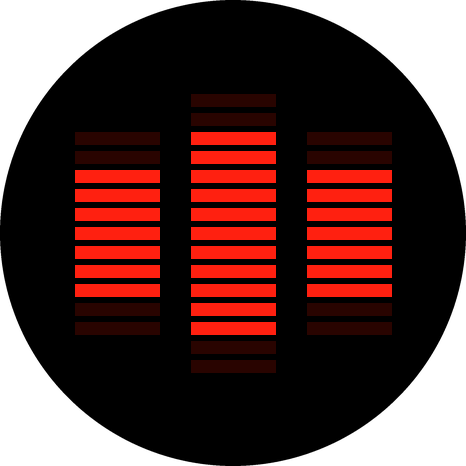
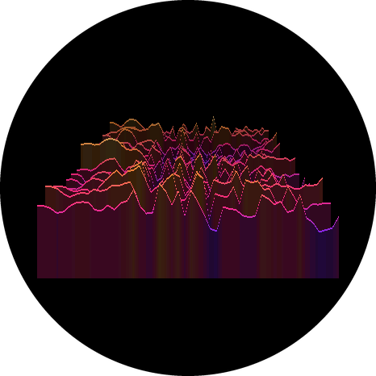
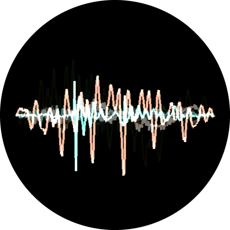
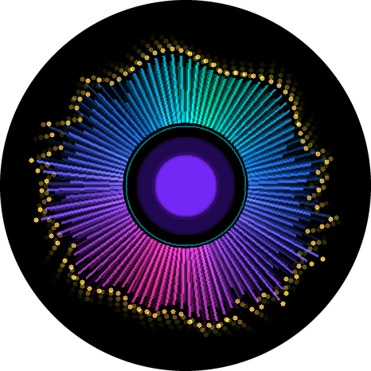
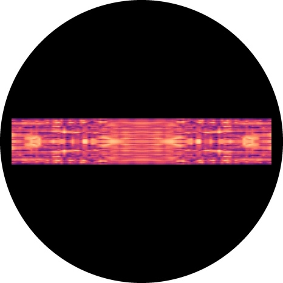
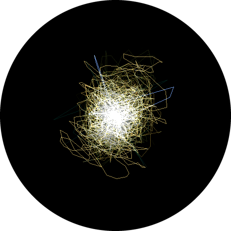
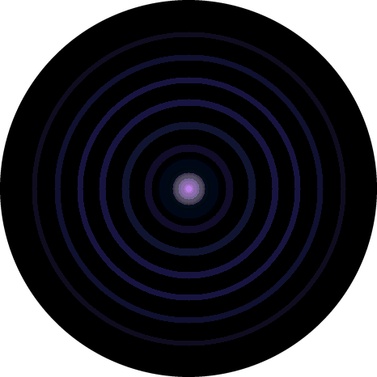

# Visualizer

*Boards with a microphone: the ESP32-S3 boards*

The Visualizer fills the screen with a moving picture of your voice, and of whatever the speaker is playing while it's on: the [voice effect](voice-effects.md) or a [sound](sound.md) file.  Its pages, left to right, are the visualizer itself, a page to choose which one, and the [Voice Ring](voice-ring.md)'s settings, as the ring is a picture of your voice too.  Tapping the visualizer also moves on to the next one.  The choice is saved, and the visualizer can be picked to show when the display turns on, in [Settings](settings.md#startup).  The [WiFi Hotspot Remote](phone-remote.md) lists them on its Screen tab, and shows the one you tap.

|  |  |  |  |
|:-:|:-:|:-:|:-:|
| KITT | Terrain | Scope | Halo |

|  |  |  |
|:-:|:-:|:-:|
| Aurora | Orbit | Ripples |

*Playing Mr. Roboto on the speaker.*

| Visualizer | What it shows |
|---|---|
| **KITT** | Three columns of red bars that light up from the middle, like KITT's voice box in Knight Rider |
| **Terrain** | A 3D spectrum: frequency from left (low) to right (high), loudness as height, and the last second receding into the distance.  The valleys are indigo and the peaks go through pink and orange to gold.  When it's quiet the flat rows make a perspective grid |
| **Scope** | The waveform, like an oscilloscope with a glowing trace.  Your voice is aqua and the speaker coral, both whiter as they get louder.  Each trace starts at the same point in the wave, so a held note stands still |
| **Halo** | The spectrum bent into a slowly turning ring of spokes, lows at the top and highs at the bottom, mirrored left and right.  Teal through blue and violet to magenta, with gold peak markers that fall back slowly |
| **Aurora** | A spectrogram folded into a mirror image: each moment is a line across the middle, low frequencies in the center, and the history flows up and down away from it.  Speech leaves symmetric, feathery patterns in deep purple, magenta and orange |
| **Orbit** | Each moment of the sound plotted against the one just before it.  A steady tone draws an ellipse, and a voice draws looping knots that change with every vowel.  Violet into ice blue for your voice, amber into gold for the speaker |
| **Ripples** | Each syllable sends a ring out from the middle, like a drop in still water.  Louder ones are wider, brighter and faster, and the color is the pitch: teal for a low voice through to gold for hiss |

## How they follow the sound

Like the [Voice Ring](voice-ring.md), the visualizers adjust to the surroundings on their own: a quiet room stays dark, and they scale back for loud talking or a noisy room within a few seconds.  The spectrum ones track the background in each frequency band separately, so a steady hum doesn't light its band for long.  The speaker's sound is clean, so it's shown on a fixed scale that only moves for loud passages.  The speaker runs a little ahead of what you hear, by up to a tenth of a second, as the board buffers its sound.

## Adding one

Each visualizer is a file, `core/ui/vis_<name>.c`, that draws a frame at a time into the screen's pixels.  [`core/ui/visualizer.h`](../../core/ui/visualizer.h) describes the sound analysis they're given (the level, 48 spectrum bands and the waveform of each source) and the drawing helpers.  Add it to the list in [`core/ui/feature_visualizer.c`](../../core/ui/feature_visualizer.c), at the end so the saved choices still mean the same ones.
