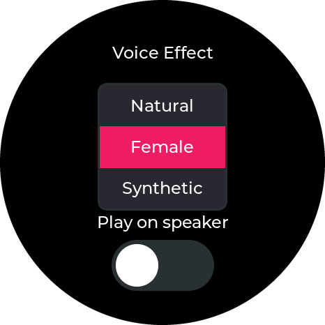
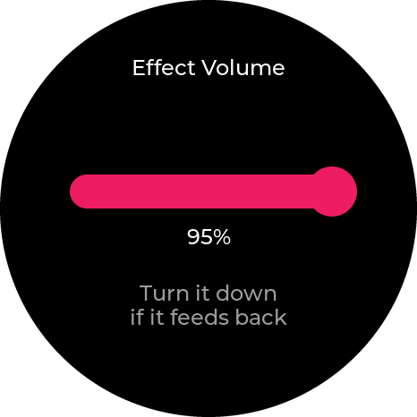

# Voice Effects

*The ESP32-S3-Touch-AMOLED-1.75*

|  |  |
|:-:|:-:|
| Voice Effect | Effect Volume |

The *Voice Effect* page, in the Voice feature, runs your voice through an effect on the board itself:

| Preset | Sound |
|---|---|
| Natural | Your own voice, like a mask's voice amplifier, with just the boom below it and the hiss above it taken out |
| Female | Your own voice, raised in pitch to around 180 Hz, with the vowels raised less, kept to the middle of the voice's range |
| Synthetic | Snapped pitch, a faint metallic ring and slight digital grit |
| Android | A monotone female robot |
| AI | Thinner, higher and snapped, with a quick shimmer |
| Robot | A monotone robot at a low pitch |
| Deep | Your voice, lower |
| Dalek | Higher, thinner and harsh, ring modulated at 30 Hz like the Daleks in Doctor Who |
| Drone | Lower, ring modulated and slightly crushed |
| Borg | Your voice as a crowd speaking in unison, one a little higher and two lower, with a hollow, metallic sheen, like the Borg collective in Star Trek: The Next Generation |

The effect goes to the [Voice Lab](voice-lab.md) stream (`voice_monitor.py --listen effect` plays it) and, with *Play on speaker* switched on, to the board's speaker.  While it's on the speaker, the [sound player](sound.md) waits.

The *Effect Volume* page, next to it, sets how loud the effect is on the speaker, separately from the sound player's volume.  50% is about 10 dB louder than the microphone picks it up, and 100% about 35 dB, with a limiter that rounds off the peaks.  Each preset is set a little louder or quieter on the speaker than that, so that they'd all start to feed back at about the same setting.  On the ESP32-S3-Touch-AMOLED-1.75 in its housing, every preset holds at 100% with room to spare (the [Seal Test](../build/seal-test.md) says how much), even with a mirror held in front of the mask.  Somewhere that reflects more of the sound back, like a corner, brings it down.  If it feeds back, turn it down.

*Loud room*, on the same page, is for loud places: *Off*, or *1* to *Max*, for how strongly it keeps the room out.  Every preset has a gate that keeps the speaker quiet between words, which normally opens at anything above the microphones' own hiss, so in a loud room the room's noise holds it open and comes through.  With *Loud room* on, the gate only opens for something much louder: your voice, which is far louder in the microphones from inside the mask than the room is through it.  It opens at a fixed level, which each step raises by 4 dB, or 12 dB above the room's steady noise if that's higher (the quietest moments in the last 3 seconds, as speech always pauses in that time).  So the room doesn't come through between words, on the speaker or to HiveMind.  Start at *2*, and go up a step if the room still comes through, or down one if your words get cut.

Measured worn, with music played loud nearby:

| Loud room | Music that got through | Your voice | Your quiet words |
|---|---|---|---|
| 1 | 7% | 100% | 97% |
| 2 | none | 99.5% | 94% |
| 3 | none | 98% | 83% |
| Max | none | 94% | 71% |

Louder music, or a quieter voice, moves those along a step.  It takes a few seconds to catch up when a steady noise changes, so leave it off where it's quiet.  It's saved, unlike *Play on speaker*.

The board's **BOOT** button switches *Play on speaker* off and on, to stop feedback quickly.  While a sound is playing once over the rest (a [sound someone sent](sound.md#sounds-from-others), or one the app plays for [something that happened](../app/voice.md#setup-sounds)), it stops that instead.  (BOOT only matters at startup: held while the board starts, it waits for new firmware over USB.)  The [WiFi Hotspot Remote](phone-remote.md) has all of these too, with the volume in exact steps.

*Play on speaker* is always off at startup, in case it feeds back.  The speaker in the board's housing faces away from the mask, but some of it still reaches the microphones.  The board cancels most of that, because its audio chip hears what the speaker is playing (see its [board notes](../hardware/waveshare_esp32s3_touch_amoled_1_75.md#board-notes)), so every preset holds at 100% in a finished housing.  If it feeds back at low volume, run the [Seal Test](../build/seal-test.md), which says what to check.

## Seal Test

The *Seal Test* page, the last in the Voice feature, checks how far over full volume the voice effects can go before they feed back.  It listens to the room, plays a hiss through the speaker and measures how much of it the microphones hear (the leak) and how much is left after echo cancelling, then beeps and listens to you say "aaah" to check the two microphones hear you equally.  A full test does the same one band of pitches at a time, and a feedback check turns *Natural* up until it feeds back.  See [The Seal Test](../build/seal-test.md) for what each result means and what to check.

The remote's API can start it too, with `POST /api/seal?start=1` (`2` the full test, `3` the feedback check, `0` stops it), and `/api/state` has its progress and result under `seal`.  The board's serial log prints each result in full.

Playing the effect out loud needs the [speaker model](../build/speaker-housing.md).  On the low-profile model, which has no speaker (see [Model](settings.md#model)), only the *Voice Effect* page is there, titled *HiveMind Voice Effect*: it's the effect [HiveMind](comms.md) sends your voice through, the same setting as *HiveMind voice* in the app, and HiveMind's own *HiveMind Voice* page isn't there.  On the speaker model the page is titled *Speaker Voice Effect*, as HiveMind has its own.  The [other boards](../other-boards.md) the firmware runs on don't have them.

The presets are the same as the effects in `tools/voice_monitor.py`, so they can be tried and tuned on a computer first.  The pitch-following presets add about 15-20 ms of delay, the others less.

## Feedback, or the processor running behind

Two different things can spoil an effect, and they sound different:

- **Feedback** gets worse the louder the speaker is, and stops when *Play on speaker* is off or the volume's turned down.  It's a howl or a ringing, or on the ring modulated presets like Dalek, a hiss that carries on after you stop talking.  Turn it down, or see the [Seal Test](../build/seal-test.md).
- **The processor running behind** sounds garbled or noisy, even at a low volume, and it's in a recording of the effect too ([Record](../app/record.md) in the app).  The effects are very sensitive to how busy the processor is: the heavier ones, which shift your voice or rebuild it (Female, Synthetic, AI, Android, Robot, Borg), take a lot of it, and anything else the board does at the same time, like drawing the display, eats into what's left.  The firmware is built so that every preset keeps up with any display page, the [Voice Ring](voice-ring.md) and the [Sound Visualizer](visualizer.md) included, and with comms on.  If one doesn't, please report it, saying what was on the screen.

Lessons from tuning them on the board, for anyone changing them, are in [Voice effects and the processor](../development/voice-effects-cpu.md).

Expect Natural to feed back at a lower volume than the others: the effects that change the pitch or ring modulate move the sound off the frequencies that feed back, and Natural doesn't.
