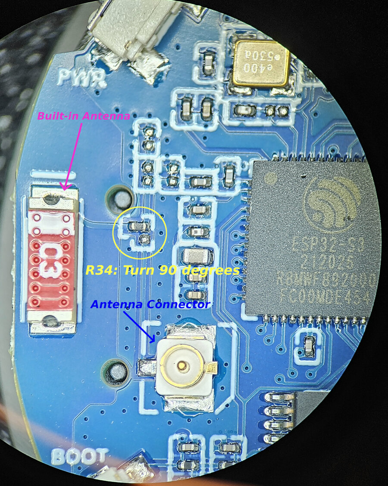

# Direct Mode Range

Why [direct mode](../features/comms.md#direct-mode) only reaches across a room, what was measured, and what could make it go further.

Back to [HiveMind (Comms)](../features/comms.md) or [the board](waveshare_esp32s3_touch_amoled_1_75.md).

## In short

**Direct mode is experimental.**  As built, it's best for demos, scenes and drones close together, across a room at most.  It needs no server and no internet, which makes it quick to show off.  For anything further, or through walls, use [cloud mode](../features/comms.md#cloud-mode).

**Why it doesn't reach further:** the unit's radio is fine, but its antenna is tiny, and it's squeezed in between the display and the battery.  Both are big pieces of metal as far as a radio is concerned, and they soak up most of what the antenna sends and hears.  Each unit ends up sending and hearing about a hundredth as well as a phone does.  Walls, furniture and people take what's left: the radio is on the same band as WiFi, which goes through bodies badly.

**What it isn't:**

- **Not your home WiFi getting in the way.**  It was tested with every 2.4 GHz WiFi access point in the house switched off, and it made no difference.
- **Not a setting.**  The radio already sends as loud as it's allowed to, in its most robust mode.
- **Not something a different housing fixes.**  The battery costs some of the signal wherever it goes in either housing, and most of the loss is in the board itself.

**Getting the most out of it today:**

- Keep the drones in the same room, with nothing much in between.
- A third unit in between [relays](../features/comms.md#relaying) what it hears, which helps texts reach a little further.
- Texts get through further than voice: each one is sent three times, so one copy usually makes it.  Voice is sent once, as it's spoken, so it breaks up first.

**What might come later**, if there's interest:

- **An external antenna**, as an advanced mod for people who can do very fine soldering.  It could make up most of what's lost.  See [An external antenna](#an-external-antenna).
- **A LoRa radio** paired with the phone, which would reach much further, through walls.  See [A LoRa radio](#a-lora-radio).

**Why not use the phones' radios instead?**  Phones have much better antennas than the unit, so phone to phone would reach a lot further.  But the ways phones can talk straight to each other, with no network in between, mostly work only between Android phones, and the rest come with catches on iPhones and computers.  DroneLab is meant to work on all of them, so for now it doesn't.  There's no iPhone app yet, but the app is deliberately built so one can follow, and direct mode shouldn't close that door.  See [Through the phones](#through-the-phones).

## The details

### What was tested

Three units in a basement, in their housings, none of them worn.  None of them were on a mask or a head, which would cost more again:

| Unit | Where |
|---|---|
| Speaker model, handheld, with the phone | Sending, on one side of a room |
| Speaker model, on a dresser | Relaying, across the room, about 25 ft (7.5 m) from the sender |
| Low-profile model, on a workbench | Answering with the [text and voice responders](../app/developer-options.md), in the next room, about 35 ft (10.5 m) from the sender and 10 ft (3 m) from the relay |

Direct mode was on frequency 11, with Long Range on (Espressif's slower 500 kb/s mode, which holds on a little better at the edge of range).  The texts' [Details](../app/text.md#message-details) and the app's developer options showed how strongly each unit heard the others:

- **Texts all arrived**, mostly with two or three of their three copies, many through the relay.  The sender was heard at -80 to -89 dBm, and the relay at about -70 dBm.
- **Voice wasn't usable** at that distance.  The radio stops hearing anything at about -95 to -100 dBm, so -85 leaves little margin, and voice has no second copy to fall back on.

In open air, a radio this strong should be heard at about -40 dBm at 35 ft, not -85.  The walls account for some of the 45 dB difference, but nowhere near all of it.

### Ruling out WiFi

The house's three WiFi access points used all three of the frequencies direct mode can use (1, 6 and 11), and one was 8 ft from the answering unit.  Switching off the 2.4 GHz radio on all three made no difference.

### Measuring the units themselves

Two units on a table, 1 m apart, heard each other at **-68 dBm**.  With decent antennas, 1 m apart should read about -20 to -25 dBm, so the two units together were losing about 45 dB.

To find which end loses it, one unit's [WiFi hotspot](../features/phone-remote.md) was switched on, and a phone 1 m away read how strongly it heard it, in a WiFi analyzer app (WiFiman).  The phone's antenna is a good one, so this measures the unit's own antenna:

| Unit 1 m from the phone | Signal |
|---|---|
| Speaker model, as built | -47 dBm |
| Speaker model, back cover and battery off | -38 to -41 dBm |
| Speaker model's board out of the housing, speaker unplugged | about the same as cover off |
| Low-profile model, as built | -47 dBm |
| Low-profile model, back cover and battery off | about -41 dBm |

So each unit loses about 20-25 dB:

- **About 6 dB is the battery.**  It's the same in both housings, although the speaker model's battery stands beside the antenna about 9 mm back, and the low-profile model's lies right over it about 6 mm back.  A battery that close upsets the whole board, not just the antenna's view, so moving it a few millimetres doesn't help.  Neither housing has room to move it much further.
- **About 15 dB is the board itself**: the antenna is tucked against the display's metal back and the board's ground.  No housing changes that.
- **Not the speaker or the housing's plastic**: the board out of its housing read the same as with only the back cover off.
- **Not the transmit power**: the firmware leaves it at the radio's full 20 dBm.

Every 6 dB lost roughly halves the range in open air, and two units each losing 20-25 dB lose most of it.

### Why texts get further than voice

A text is sent three times, a tenth of a second apart, so a single copy getting through is enough, and a unit in between that hears it weakly sends it on again.  Voice goes out as it's spoken, a packet every few tens of milliseconds, each carrying a copy of the two before it, so a lost packet or two is filled in.  More than that and it breaks up.  At the edge of range packets go missing in bursts, so voice gives out well before texts do.

### What software could still do

A few small changes could add a few dB between them, which helps at the edge of range but doesn't change the picture:

- Long Range at its slower 250 kb/s, instead of 500 kb/s: about 3 dB, but each packet takes twice as long on the air.
- More copies of earlier voice packets in each one, so longer gaps are filled in.
- Giving WiFi a bigger share of the radio, which it shares with Bluetooth to the phone.

### Where the antenna is

On the back of the board, along the edge between the `PWR` and `BOOT` buttons, opposite the USB-C port:

- **The built-in antenna** (J2 on the schematic) is the chip with the red label.
- **The antenna connector** (J4) is a U.FL socket (Waveshare calls it IPEX 1), just below it.
- **R34** picks between them.  It's a 0 Ω resistor with three pads: as it comes, it joins the radio to the built-in antenna.  **Turned 90 degrees**, it joins the radio to the connector instead.

The housings' layouts (`part="layout"` in each model) mark the antenna in black, from `antenna_box` in [`board.scad`](../../hardware/boards/waveshare_esp32s3_touch_amoled_1_75/board.scad).

### An external antenna

*Not tried yet.*  Moving R34 lets an antenna on a cable take over from the built-in one, so the antenna can sit away from the board, the battery and the wearer's head.  It could make up most of the 20-25 dB each unit loses.

**This is an advanced mod.**  R34 is an 0201 part: 0.6 x 0.3 mm, smaller than a grain of sand.  Turning it needs advanced soldering skills, a fine-tipped soldering station or hot air, fine tweezers, and a microscope.  It's easy to lose the part or lift a pad, and that puts the radio out of action until it's put right.  The U.FL connector is fragile too: it's rated for about 30 plug-ins, and the cable needs holding down inside the housing so a tug doesn't reach the board.  No firmware change is needed.

Two kinds of antenna are worth trying:

- **A flexible antenna inside the housing**, stuck to the inside wall furthest from the board and the battery: for example the Molex 146153-0100, a 35 x 9 mm strip with a 100 mm cable and a U.FL plug.  It's a balanced design, which doesn't depend on a ground plane under it.  Nothing shows outside, but it's still close to the wearer's face.
- **A stub antenna outside**, on a bulkhead connector through the housing's wall (about a 6.4 mm hole): for example an Adafruit 852 U.FL to RP-SMA cable with a Linx ANT-2.4-CW-RCT-RP half-wave antenna.  That antenna's 113 mm tall, so it's for finding out the best that's possible, not for wearing; most short stubby antennas need a ground plane under them and do worse.  WiFi antennas mostly use RP-SMA, which doesn't fit plain SMA, so match the cable and the antenna.

Either way, keep the antenna's gain to about 2-3 dBi.  Measure the same way as above: the unit's hotspot at 1 m from a phone, before and after, and then a walk with a unit on a mask.

### A LoRa radio

*Not started.*  LoRa radios work at 915 MHz in the US (868 MHz in Europe), well away from WiFi.  Signals at that frequency go through walls and bodies far better, and reach much further.  A ready-made LoRa board, such as the Heltec WiFi LoRa 32 V4, could pair with the phone over Bluetooth, with no soldering.  Texts would be easy, as they're small.  Voice would need LoRa's fastest settings or a plain FSK mode, and a low bitrate, and is the open question.  It'll be looked at if enough people want direct mode to reach further.

### Through the phones

*Considered, not pursued.*  The unit would stay linked to its own phone over Bluetooth, as now, and the phones would carry the voice and texts between each other.  A phone's antenna is far better than the unit's: 1 m from the unit, a phone heard it at -47 dBm, where another unit heard it at -68 dBm.  So phone to phone could do much better than unit to unit, even with the phones in pockets.  The catch is that DroneLab is deliberately built to work across platforms, and the ways phones talk directly to each other don't.  There's no iPhone app yet, but the app is written once, in Flutter, for Android, the Linux desktop and, in time, iPhone, and everything it does is chosen to keep that possible: the unit talks to it over plain Bluetooth LE, and the hive meets on a standard Mumble server.  A direct mode that only worked between Android phones would leave iPhone users out for good:

| Way | Android | iPhone | Computers |
|---|---|---|---|
| Google Nearby Connections | Yes | Only an experimental port | No |
| WiFi Direct | Yes | No | No |
| WiFi Aware | Some phones | iOS 26 on an iPhone 12 or later, but linking to Android phones is unreliable so far | No |
| Bluetooth LE, phone to phone | Yes | Yes, with limits | Mostly |

- **Bluetooth LE** is the only one on every platform, and it could carry voice.  But an iPhone in the background hides its Bluetooth from phones that aren't Apple's, so phones would have to find each other with the app open first.  Bluetooth's long-range mode isn't open to iPhone apps either.  Taking incoming links is limited on Windows.  And keeping a small mesh of phone-to-phone links going, with relaying, would be the biggest piece of work in the app so far.
- **WiFi Aware** is worth watching: Apple added it in iOS 26, and if linking iPhones and Android phones becomes reliable, it would carry voice easily.
- **A LoRa radio** sidesteps all of this: to a phone or computer, it's just another Bluetooth gadget, like the unit.

Meanwhile, for a hive with no internet, such as at an event or a scene, [cloud mode](../features/comms.md#cloud-mode) works without the internet too: a [Mumble server](../features/comms.md#setting-up-a-mumble-server) on a laptop or a Raspberry Pi, and a travel router that everyone's phone joins.  It works on every platform, including Mumble's own apps, as far as the router's WiFi reaches.  Someone has to bring the box, and the phones use mobile data for the internet meanwhile.  Android may say the network has no internet: tell it to stay connected.

### Measuring your own

- **How strongly units hear each other:** the app's [Details](../app/text.md#message-details) on a text received over direct mode, or the signal bars by each unit on the [Voice tab](../app/voice.md#whos-there).  The [developer options](../app/developer-options.md) answer `/nearby` with each unit's signal.
- **A unit's antenna on its own:** switch on the unit's [WiFi Hotspot Remote](../features/phone-remote.md), and read its signal 1 m away in a WiFi analyzer app on a phone.  Compare it with the -47 dBm above.
