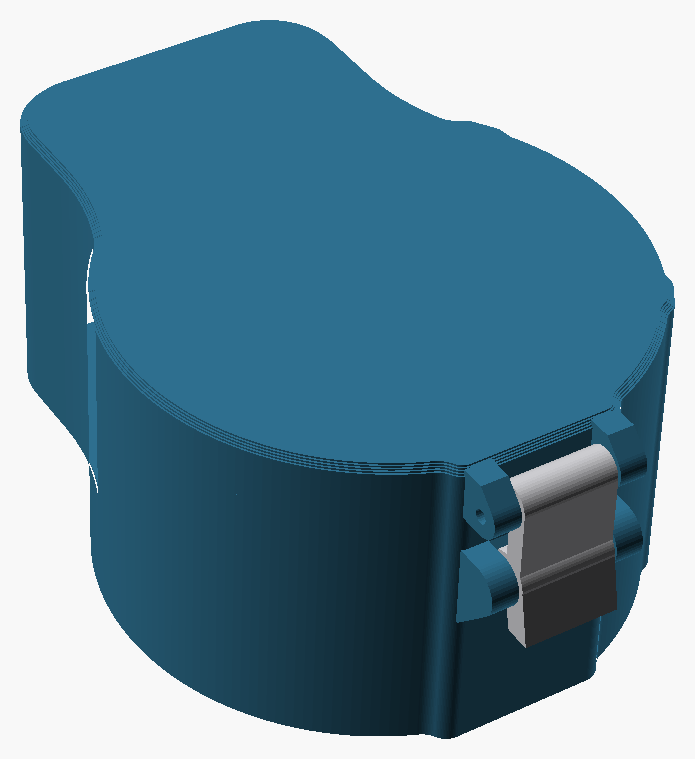
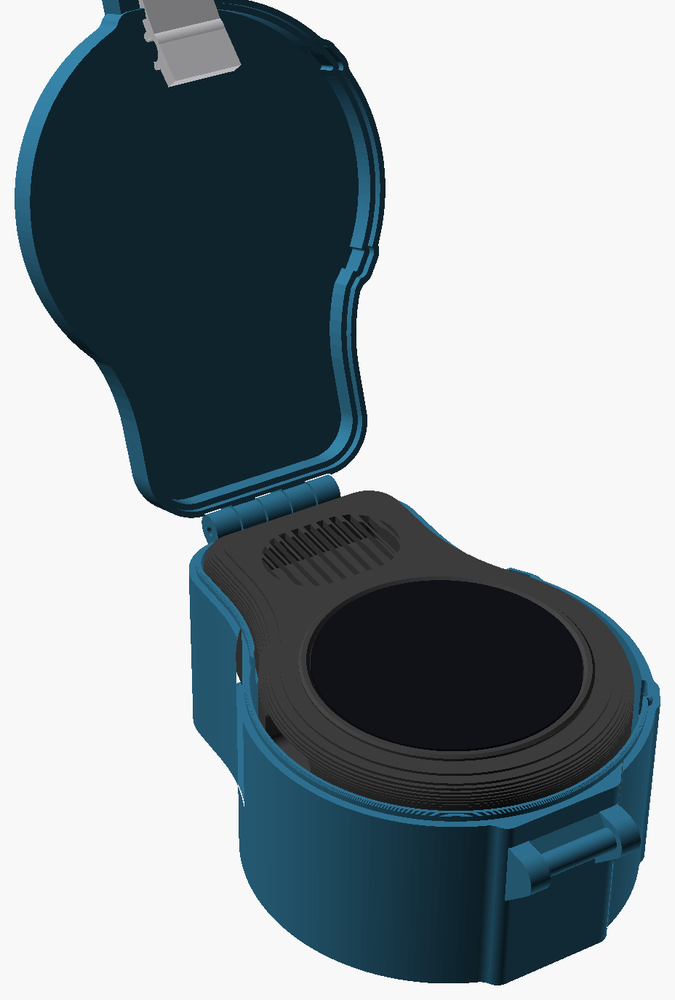
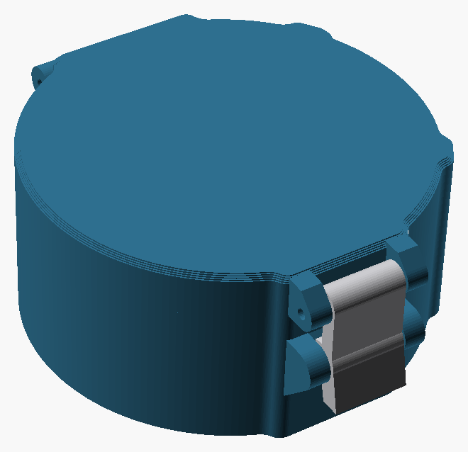
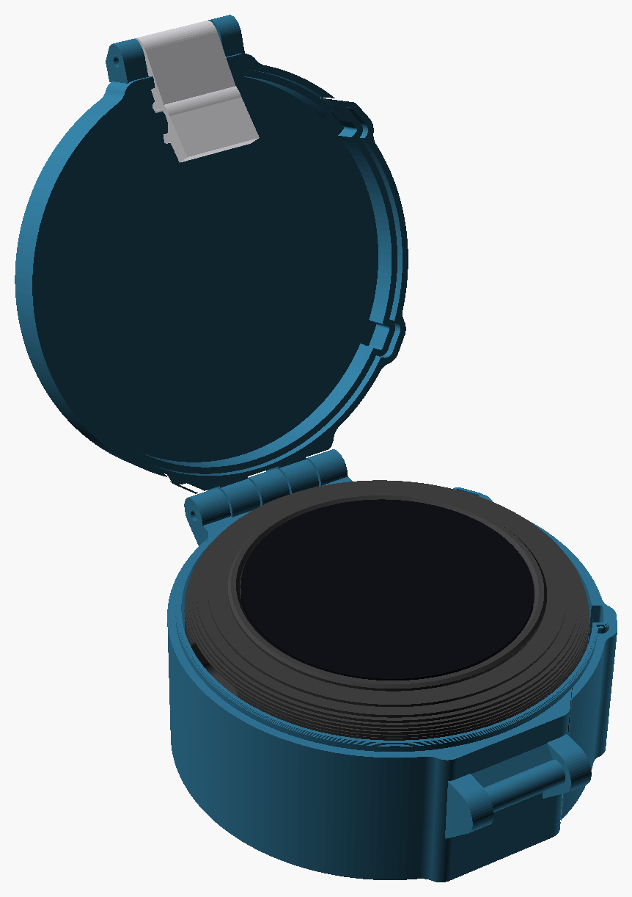

# Travel Cases for the 1.75" Housings

Hinged cases that carry either of the 1.75" housings with the board in it, so the display is protected in a bag:

- `low_profile_case.scad` - for the [low-profile housing](../#the-low-profile-housing): round, about 74 x 88 mm across, counting the hinge and clasp, and 36 mm tall.
- `speaker_case.scad` - for the [speaker housing](../#the-speaker-housing): shaped like it, with room for the pod below the display, about 76 x 112 mm across, counting the hinge and clasp, and 47 mm tall.

| | Closed | Open, with the housing in it |
|---|---|---|
| **Speaker housing's case** |  |  |
| **Low-profile housing's case** |  |  |

**Status:** the speaker housing's case is printed and works.  The low-profile housing's is designed, not printed yet.

## How they work

The housing lies in the case on its back, the display facing up.  Its thread drops into a round well in the floor, and the housing rests on the ledge around it, on its back (or, in the speaker housing, on the turning collar's grip), so nothing presses on the glass.  The pocket follows the housing's outline with 0.5 mm to spare all round (`case_clear`), including a notch for each plunger that stands out of its side, so the housing goes in one way round and can't turn or rattle.  The notches reach 1.5 mm past the plungers' ends (`plunger_room`), so with the case on its side, and the housing's weight on the plungers' side, the case can't press a button, even with the longest test plungers.

Each case is three printed parts: the bottom, which holds most of the housing, the lid, which covers its front 6 mm, and the clasp.  The bottom and lid are joined along one side by a hinge, whose pin is a length of 1.75 mm 3D printer filament.  On the other side, the clasp is a lever that turns on a second filament pin in two ears on the lid, and its lower end is a C that snaps round a 4.2 mm bar on the bottom, like the clasp on the older 1.28" and 1.46" cases.  To open it, pull the grip below the C outwards.  The C's upper jaw is a spring, separated from the lever by a slot, so it bends to let the bar through and snaps back round it.  The lower half of the C, which takes the pull when something pushes the lid open, is solid.

Where the bottom and lid meet, the inner part of the bottom's wall stands up 1.5 mm past the seam as a lip, 1 mm wide, and fits into a rebate in the lid's wall with 0.2 mm to spare, so the lid can't shift sideways and the seam is closed all round.  The lid's wall outside the lip comes down over it to the seam.  The walls are 2.4 mm thick, to leave room for both.  Nothing bends but the C's upper jaw, by about 0.45 mm, and the clasp prints on its side, so the C's layers run round it, its strongest way.  If it wears, it's a quick reprint.

The pocket is made from the housing's own design file (`../msa_low_profile_housing.scad` or `../msa_speaker_housing.scad`), so if a housing changes, render its case again and it fits.  The case itself, the walls, hinge and clasp, is in [`hardware/common/travel_case.scad`](../../../common/travel_case.scad), shared by both, and its settings are at the top of that file.  The lid has been checked to swing open past 130 degrees without touching the bottom.

## Printing

The cases' STL files come with each model's parts, in the `travel_case/` folder of the zip on the [latest release](https://github.com/rcat3/DroneLab/releases/latest) ([speaker](https://github.com/rcat3/DroneLab/releases/latest/download/DroneLab-speaker-model-stl.zip), [low-profile](https://github.com/rcat3/DroneLab/releases/latest/download/DroneLab-low-profile-model-stl.zip)).  Or run `./render.sh` in this folder to render both cases to the `stl/` folder (it needs [OpenSCAD](https://openscad.org/)), or `./render.sh low_profile` or `./render.sh speaker` for one.  The parts come out turned the right way up to print, with no supports:

- **`lp_case_bottom`** or **`speaker_case_bottom`** - Printed standing on its floor.
- **`lp_case_lid`** or **`speaker_case_lid`** - Printed on its top.
- **`lp_case_clasp`** or **`speaker_case_clasp`** - Printed on its side, 14 mm tall.  The two cases' clasps are the same.
- **`clasp_test`** - Optional: three clasps that snap on more or less firmly, with one, two and three notches in the grip (`clasp_test_snaps`: 0.35, 0.45 and 0.55 mm).  The middle one is the same as the plain clasp.  Try each on the case and keep the one that snaps on with a firm click and stays on when you shake the case.  Printed on their sides, like the clasp.  `./render.sh tests` renders it.

**Materials:** PLA, PLA+ or PETG.

## Putting it together

1. Line up the lid's knuckles between the bottom's.
2. Push a length of 1.75 mm filament through all five, and cut it off flush at both ends.  The holes are 2.1 mm, a snug fit.  Horizontal holes can print a little small, so if the filament won't go through, open them up with a 2 mm drill.  A touch of a soldering iron or a drop of glue on each end keeps the pin from working out.
3. Put the clasp between the lid's ears, the C at the bottom with its mouth towards the case, and push filament through the ears and the clasp the same way.  The ears' holes are 2.1 mm, and the clasp's 2.3 mm, so it turns freely.
4. Close the lid, swing the clasp in, and press the C onto the bar until it snaps on.  If it's too stiff, or it doesn't hold, try the `clasp_test`'s clasps, or set `snap` at the top of `hardware/common/travel_case.scad` and print a clasp.

### Cases printed before the springy clasp

The first speaker case's clasp had short, stiff jaws, so how firmly it held depended on a few tenths of a millimeter of the print, and it could come undone.  Its bar is the same, so just print the new clasp (or the `clasp_test`), push the old pin out, and fit it.  Its hole is 2.1 mm now, so it turns on the filament without rattling.

Its plunger notches stop just 0.5 mm past the 1.8 mm plungers' ends, so with the case on that side, the housing could rest on the plungers, and with longer plungers, press the power button and turn the board on.  If you'd rather not reprint the bottom, use the 1.8 mm plungers (`plunger_proud`, not the 2.3 mm test ones), and file or carve each notch's end about 1 mm deeper.  The notches are at the top of the bottom's wall, by the seam, so it's easy to get at.

## Credits and License

These cases are an original design.  Their clasp works the same way as the older 1.28" and 1.46" travel cases' clasp, a lever with a C that snaps round a bar, but it's drawn from scratch, not taken from those files.  Like the housings, they're by Rubber Cat, and licensed under the [Creative Commons Attribution-NonCommercial-ShareAlike 4.0 International License](https://creativecommons.org/licenses/by-nc-sa/4.0/).  This is separate from the license of the rest of the repository.
