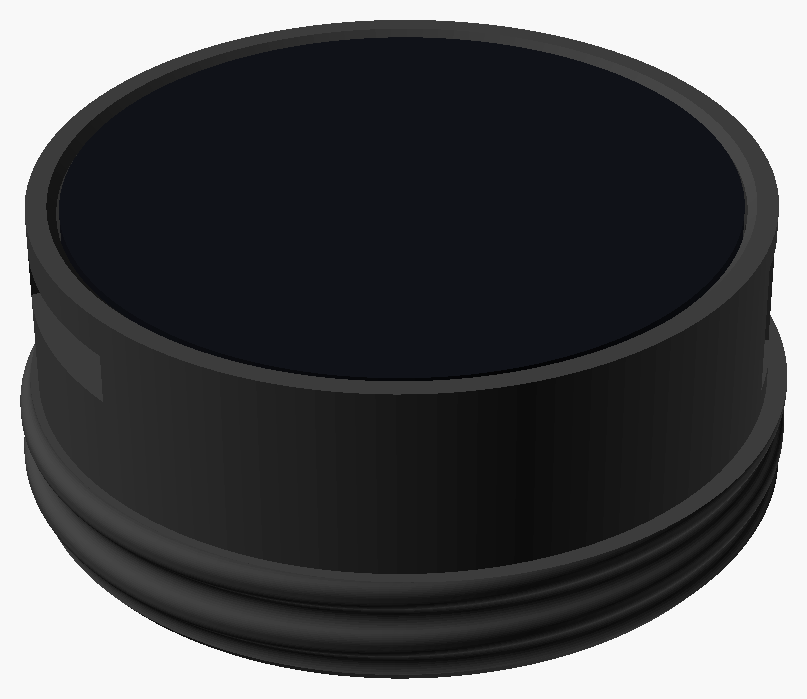

# Building with the ESP32-S3-Touch-LCD-1.46 (deprecated)

**This housing is no longer supported.**  Build the [ESP32-S3-Touch-AMOLED-1.75](../../../docs/hardware/waveshare_esp32s3_touch_amoled_1_75.md) instead.  This guide is kept for anyone who wants to build it anyway.  The firmware still supports this board: see [Other Boards](../../../docs/other-boards.md).

The [Waveshare ESP32-S3-Touch-LCD-1.46](https://docs.waveshare.com/ESP32-S3-Touch-LCD-1.46) is a 1.46" round touch screen (412x412) on an ESP32-S3 with 8 MB of PSRAM, a microphone, a built-in speaker, a micro SD card slot, WiFi, Bluetooth, an accelerometer and a battery charger.  Every [feature](../../../docs/features/README.md) but the voice effects runs on it.  Get the version **with the cover glass**: the housing is made for it.

The housing screws into the voice port of an MSA Millennium mask:



It's one printed part, with the board in front and a small battery inside the thread, and there's no soldering.  The board's built-in speaker faces into the mask, so it's best for images, the voice displays, Lovense control and the phone remote, rather than for sound.  It doesn't have [voice effects](../../../docs/features/voice-effects.md): the speaker would feed back long before an effect was loud enough to hear.  For voice effects, build the [ESP32-S3-Touch-AMOLED-1.75](../../../docs/hardware/waveshare_esp32s3_touch_amoled_1_75.md).

There was also a speaker housing for this board, with two speakers and their own amplifiers.  It's no longer supported, and the 1.75" board replaces it.  Its design is kept in [`hardware/deprecated`](../waveshare_esp32s3_touch_lcd_1_46_speaker_housing/).

## Board notes

- **Power:** the board runs from USB-C or from a 3.7 V LiPo battery on its 2-pin MX1.25 connector (check the polarity before plugging a battery in).  On battery, press the `PWR` button on the side to turn it on.  The firmware keeps the power switched on after you let go.  Hold `PWR` for 2 seconds to turn it off.
- **Charging:** the board charges its battery at up to 2 A, set by R8 (82k), which is far more than the housing's small battery should take.  The housing covers the USB-C port so it can't be plugged in by accident.  It's worth changing R8 to about 390k, which charges the 702030 battery at about 0.4 A.  The charge current is roughly 165 kΩ·A divided by R8.  **R8 is an 0201 surface mount part, 0.6 x 0.3 mm.**  Changing it isn't for the faint of heart: it takes a microscope, a capable soldering station with a fine tip (or hot air), and advanced soldering skills.  Measure the current with a USB meter afterwards.
- **Rotation:** the display controller can't rotate the picture by 90 degrees itself, so the ESP32 rotates it while drawing.  It's fast enough that you shouldn't notice.
- **Not used yet:** the clock chip.

## The housing

The board sits in a cup on the outside of the mask, with its glass flush with the front.  Its micro SD slot and side buttons stay reachable, and the buttons are pressed through flexible tabs in the wall.  The cup's back plate carries the voice port thread, and the space inside the thread holds the battery.

### Parts to buy

- A [Waveshare ESP32-S3-Touch-LCD-1.46](https://docs.waveshare.com/ESP32-S3-Touch-LCD-1.46), the version with the cover glass
- A 702030 LiPo battery (7 x 20 x 30 mm) with a JST 1.25 mm plug
- A short JST 1.25 mm 2-pin extension cable, for the battery
- Three M2 countersunk screws, about M2 x 5

### Printing

In [this folder](./), run `./render.sh` (it needs [OpenSCAD](https://openscad.org/)) and print `stl/housing.stl`, front down, in PLA or PLA+.  That folder's README has more about the design, and some optional test prints.

### Putting it together

1. Plug the extension cable into the board's battery socket.  It's between the board and the back plate, so it can't be reached once the board is in.
2. Fit the board into the cup from the front, with the extension's wires out through the opening in the back plate.
3. Screw the board to the back plate with the three M2 screws, from the back, through the inside of the thread, into the standoffs on the board.
4. Plug the battery into the extension and tuck it into the space inside the thread.

To use USB (to charge, or for the first flash with [updates over WiFi](../../../docs/building-firmware.md#updating-over-wifi), after which new firmware can go over WiFi), take the board out and unplug the battery first.  To print the housing with an opening for the port, set `usb_access = true` in the design.

## Travel case

There's a hinged case to carry the housing in, in [`travel_case`](travel_case/).  It prints in one go, all five parts laid out together.

## Building the firmware

Set up ESP-IDF as described in [Building the Firmware](../../../docs/building-firmware.md#esp32-s3-boards), then from the top of the repo:

```
idf.py -C platforms/esp-idf -B build-s3-146 -DBOARD=waveshare_esp32s3_touch_lcd_1_46 build
idf.py -C platforms/esp-idf -B build-s3-146 -p /dev/ttyACM0 flash monitor
```

The small round trimmer on the back of the board sets the speaker's volume, on top of the volume setting.

## After it's built

- Put images, sounds and Lovense patterns on a micro SD card (see [Images](../../../docs/features/images.md#images-on-the-sd-card), [Sound](../../../docs/features/sound.md#sounds-on-the-sd-card) and [Lovense](../../../docs/features/lovense.md#patterns-on-the-sd-card)).
- Use the [Level](../../../docs/features/level.md) to check the display sits straight.
