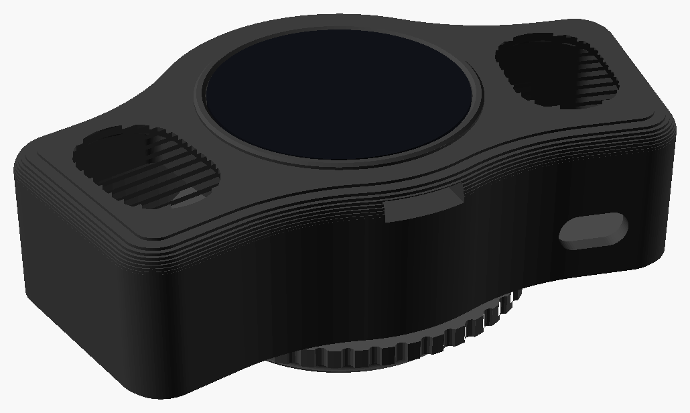
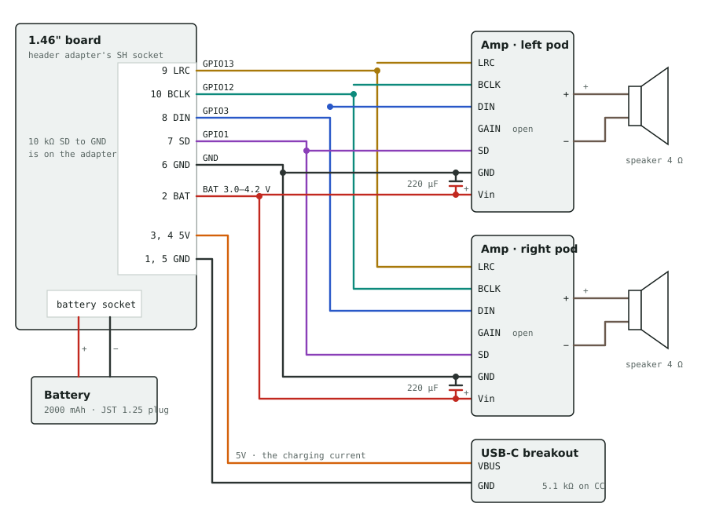

# Speaker Housing for the ESP32-S3-Touch-LCD-1.46 (deprecated)



**This housing is no longer supported.**  The [ESP32-S3-Touch-AMOLED-1.75](../../boards/waveshare_esp32s3_touch_amoled_1_75/) and its speaker housing replace it.  The design is kept here for anyone who wants to build it or bring it back, for example as a stereo player.  The board's [simple housing](../waveshare_esp32s3_touch_lcd_1_46/) is deprecated too, but the firmware still supports the board (see [Other Boards](../../../docs/other-boards.md)).

It's an all-in-one housing that screws into the voice port of an MSA Millennium mask: the display in the middle, a small speaker in a pod on each side, and a chamber behind for a 2000 mAh battery, two MAX98357A amplifier boards and a USB-C charging port, with a turning collar.  It was fully assembled and worn.

## Why it was dropped

- **It's a hard build.**  It needs a custom adapter PCB, parts from specialty electronics shops, and soldering, including a tiny 0201 resistor on the board.  The 1.75" board has its own amplifier and speaker socket, so its housing needs no soldering but the speaker's plug.
- **No USB.**  The board's USB-C port faces into a speaker pod, so it can't be reached: firmware updates have to go over WiFi, or the board has to come out.  The housing's own USB-C port only charges.
- **Voice effects.**  The 1.46" board has one microphone and can't hear what its amplifiers are playing.  The 1.75" board's audio chip hears its speaker, so it can cancel the speaker out of its two microphones, and averaging the two microphones turned out to help too.  Two speakers also give the sound more ways to get back to the microphone.
- **Upkeep.**  Voice effects are hard to tune, and keeping them working on two very different boards and housings means testing everything twice.  The housing would also have needed a lot of changes to catch up with the 1.75" housing.

## Firmware

The current firmware doesn't drive the amplifiers, and leaves voice effects out on the 1.46" board: it plays sound on the board's built-in speaker.

The last firmware that drives them is in the repository's history.  `git log --diff-filter=A --format=%h -- hardware/deprecated/waveshare_esp32s3_touch_lcd_1_46_speaker_housing/README.md` names the commit that moved this housing here.  Check out the commit before it, and build with `set(RCAT_SPEAKER EXTERNAL)` in `platforms/esp-idf/features.cmake`.  It switches the amplifiers on with SD only while sound is playing.  The amplifiers are on I2S port 0: BCLK on GPIO12, LRC on GPIO13, DIN on GPIO3 and SD on GPIO1.  That firmware mixes the sound down to one channel and plays it on both speakers.

## Making the STL files

Run `render.sh` in this folder.  It needs [OpenSCAD](https://openscad.org/).

```
./render.sh             # every part
./render.sh tests       # the test prints
./render.sh body back   # just these parts
```

The STL files go in the `stl/` folder, turned the right way up to print.  The parts render in parallel, and the body and collar take the longest, around a minute.

The housing uses the board's dimensions from [`../waveshare_esp32s3_touch_lcd_1_46/board.scad`](../waveshare_esp32s3_touch_lcd_1_46/board.scad), and the voice port thread and turning collar from [`../../masks/msa_millennium`](../../masks/msa_millennium/), which the 1.75" housing shares.

## How it goes together

The voice port thread is on a collar that turns freely on the back, so the housing can be held level while the collar is screwed into the mask.  The board is turned a quarter turn, with its buttons at the top, so set the display's [Rotation](../../../docs/features/settings.md#rotation) to match.

The wiring to the board goes through the [J9 header adapter](header_adapter/), a small PCB soldered onto the board's pin header, so the board can come out without cutting anything.  `header_adapter = true` (the default) shapes the back plate for it.

### Parts to buy

- A [Waveshare ESP32-S3-Touch-LCD-1.46](https://docs.waveshare.com/ESP32-S3-Touch-LCD-1.46), the version with the cover glass
- Two speaker modules, 35 x 25 x 6.5 mm sealed boxes with an oval cone on the front (DWEII 3525, 4 ohm 3 W)
- A LiPo battery up to 50.5 x 34 x 9.9 mm (a 103450, 2000 mAh), rated to charge at 1C, with a JST 1.25 mm plug
- Two MAX98357A amplifier boards
- A USB-C breakout with 5.1k resistors from CC1 and CC2 to GND
- The J9 header adapter PCB (see below), with its parts, and a 10-pin JST SH cable (A10SR10SR30K102A, 4") cut near one end
- Two 220 uF 10 V low-ESR electrolytic capacitors, 6.3 mm diameter
- M2 socket head screws: four M2 x 8 for the back, four M2 x 6 for the washer, and six M2 x 10 with nuts and washers for the boards
- Three M2 countersunk screws, about M2 x 5, for the board

### The header adapter PCB

A small PCB that solders onto the 2x10, 1.27 mm pin header (J9) on the back of the board.  All the wiring to the back of the housing plugs into one 10-pin JST SH socket on it, so the board can come out for a firmware update without cutting anything.

- **Gerbers:** [`header_adapter_gerbers.zip`](header_adapter/fab/header_adapter_gerbers.zip), ready to upload to a board house.  Order it 2 layers, 1.6 mm thick, 1 oz copper, in any finish and color.  It's about 11 x 16 mm.
- **Parts:** a JST SM10B-SRSS-TB socket, a 10k 0603 resistor, and a JST SHR-10V-S housing with SH crimp leads for the mating plug.
- **Fitting it:** see the [adapter's README](header_adapter/), which has the pinout, the orientation and the checks to do before powering it up.  It hasn't been fitted to a board yet.

### Parts to print

**Materials:** print the `gasket` in TPU (or cut it from rubber or foam).  Everything else is PLA or PLA+.

- **`body`** - The display cup and the speaker pods.  It prints well standing on one of its short sides with tree supports.  Printed on its back, the curved front edges show more layer lines.
- **`back`** - Closes the chamber, with the posts the collar turns on.  Use 4 or more walls so the posts are solid.
- **`collar`** - The voice port thread, with a knurled grip.
- **`washer`** - Holds the collar on.  It's in two halves so it fits in through the thread.
- **`gasket`** - A thin ring between the back and the collar, so the housing doesn't turn by itself.  Print it in TPU, or cut it from 1 mm rubber or craft foam.
- **`plungers`** - Two pins that press the board's side buttons through the top of the housing.
- **`spacers`** - Six short tubes the amplifier and charging port boards stand on.

### Screws

| Screws | How many | Where they go |
|---|---|---|
| M2 countersunk, about M2 x 5 | 3 | Through the display cup's back plate into the standoffs on the back of the board, from inside the chamber.  Their heads sit flush. |
| M2 x 10 socket head, with nuts and washers | 6 | Hold the two amplifiers and the USB-C breakout to the back: each goes through the back from outside, its head in a counterbore, then through a spacer and the board, with a nut on top. |
| M2 x 8 socket head | 4 | Hold the back onto the body.  They cut their own thread in the body. |
| M2 x 6 socket head | 4 | Hold the two halves of the washer to the ends of the collar's posts, inside the collar.  Stop when the collar turns firmly but smoothly. |

### Wiring

Everything but the battery connects through the socket on the header adapter.  The battery plugs into the board's own battery socket.



Dots are joints, and wires that cross without a dot don't touch.  The two amplifiers are wired in parallel: each signal from the socket goes to both.

| SH pin | Signal | Header pin | Goes to |
|---|---|---|---|
| 1 | GND | 3, 4, 12 | USB-C breakout GND |
| 2 | BAT | 2 | Vin on both amplifiers |
| 3, 4 | USB_5V | 1 | USB-C breakout VBUS |
| 5 | GND | 3, 4, 12 | USB-C breakout GND |
| 6 | GND | 3, 4, 12 | GND on both amplifiers |
| 7 | SD (GPIO1) | 11 | SD on both amplifiers.  The 10k resistor to GND is on the adapter. |
| 8 | DIN (GPIO3) | 13 | DIN on both amplifiers |
| 9 | LRC (GPIO13) | 20 | LRC on both amplifiers |
| 10 | BCLK (GPIO12) | 18 | BCLK on both amplifiers |

- Wire each amplifier signal to the first amplifier, then run a short wire from there to the same pad on the second one, so nothing needs splicing.
- Each speaker connects to its amplifier's + and - outputs, neither of which is ground.  Leave GAIN unconnected.
- BAT is connected straight to the battery, so the 10k resistor keeps the amplifiers switched off while the board is off.
- Put a 220 uF capacitor across Vin and GND at each amplifier, stripe to GND.  Lay it on its side, as standing up it nearly touches the back of the speaker.
- Don't plug into the board's own USB-C port and the housing's at the same time.
- Check that the USB-C breakout reads about 5.1k from CC1 to GND and from CC2 to GND, or chargers won't turn on.
- Keep the I2S wires (LRC, BCLK, DIN) short and run them beside a ground wire, away from the speaker leads.  If you hear crackling, add a 33-47 ohm resistor in series with BCLK.
- Cover every joint with heat shrink.  A short on BAT goes straight to the battery.

### Putting it together

1. Solder the header adapter onto the board's 2x10 header (see its README).  Push the plungers in from inside the display's pocket, then fit the board and screw it in with the three countersunk screws.
2. Stick each speaker into its pocket from the back.  The adhesive frame on its front holds it to the grille.
3. Screw the amplifiers and the USB-C breakout to the back: each M2 x 10 goes through the back from outside, then a spacer, the board and a nut.  Tape the battery to the back with its leads at the upper left, seen from the front (upper right from the back), next to the board's battery socket.
4. Wire it up, then screw the back on with the M2 x 8 screws.
5. Put the gasket over the posts, then the collar, grip first.
6. Drop each half of the washer in through the threaded end, line its holes up with two posts, and screw it down with the M2 x 6 screws.  Stop when the collar turns firmly but smoothly.

To take the board out, to charge it or flash it over USB, take the back off, unplug the SH cable and then the battery, then take out the board's three screws and push it out the front.  The adapter comes with it.

## Charge current

The board charges its battery at up to 2 A, set by R8 (82k) next to its charger chip.  That's more than the 2000 mAh battery should take, so change R8 to about 180k, which charges at about 0.9 A.  The charge current is roughly 165 kΩ·A divided by R8.

The charging current also goes through the header adapter's SH socket, which shares it over two pins each way, at about 1 A a pin.  At 2 A that's right at their rating, so 0.9 A leaves plenty of margin.

R8 is a tiny 0201 part, so changing it is fine soldering work.  Measure the charge current with a USB meter afterwards.

## Test prints

- **`pod_test`** - One of the pods on its own, to check the speaker's fit.
- **`plunger_test`** - The plungers in three lengths, two of each, standing 1.3, 1.8 and 2.3 mm out of the housing.  `plunger_proud` is set to the one that worked best.

The thread test rings are in the [1.46" simple housing's folder](../waveshare_esp32s3_touch_lcd_1_46/#test-prints).

## Files

- `msa_speaker_housing.scad` - The housing, in OpenSCAD.  All of the dimensions are named settings at the top.
- `render.sh` - Renders the parts to STL files.
- `header_adapter/` - The J9 header adapter PCB: its KiCad files, Gerbers and 3D model.
- `images/` - The picture above and the wiring diagram.  `images/render_view.scad` is the view the picture was rendered from.

## Credits and License

This design is based on [RP2040-LCD-1.28-MSA](https://www.printables.com/model/538771-rp2040-lcd-128-msa) by whyrlpool, whose voice port thread was in turn adapted from the [Gas Mask VPU Cover (MSA compatible)](https://cults3d.com/en/3d-model/various/gas-mask-vpu-cover-msa-compatible).

Like the design it's based on, everything in this folder is licensed under the [Creative Commons Attribution-NonCommercial-ShareAlike 4.0 International License](https://creativecommons.org/licenses/by-nc-sa/4.0/).  This is separate from the license of the rest of the repository.
